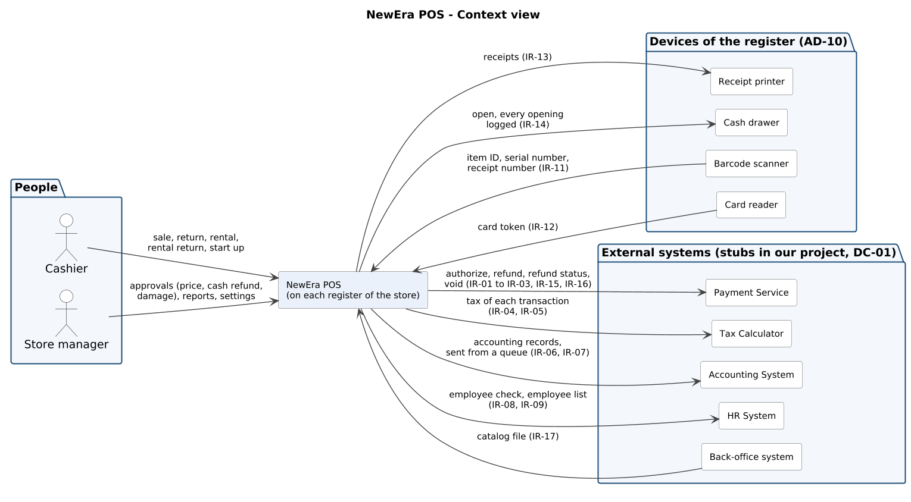
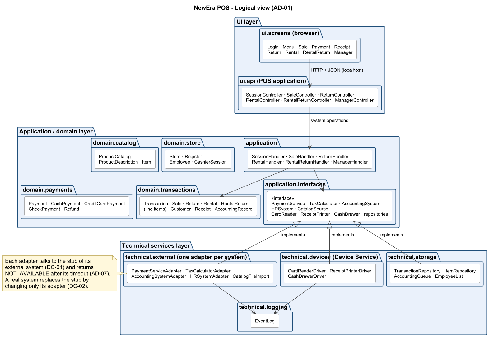
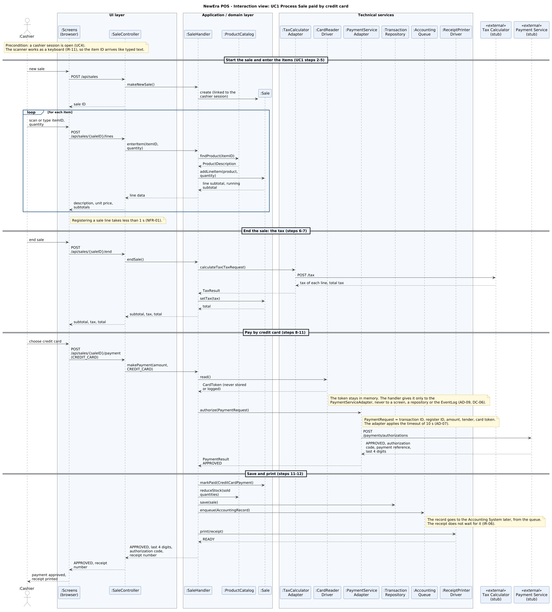
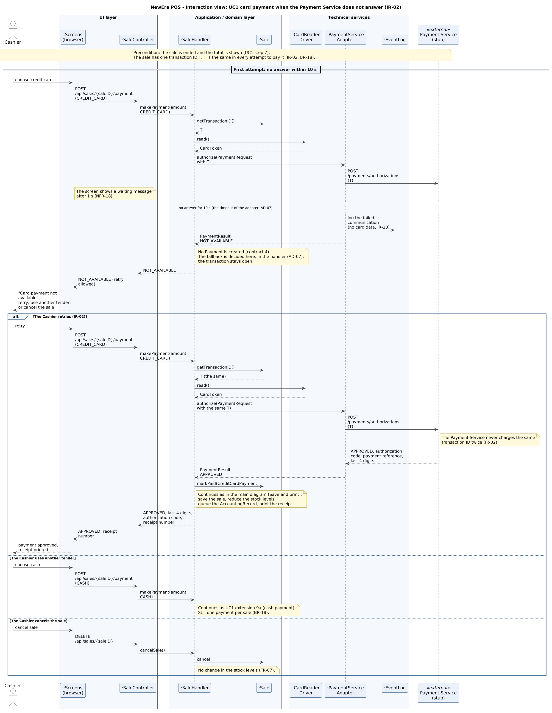
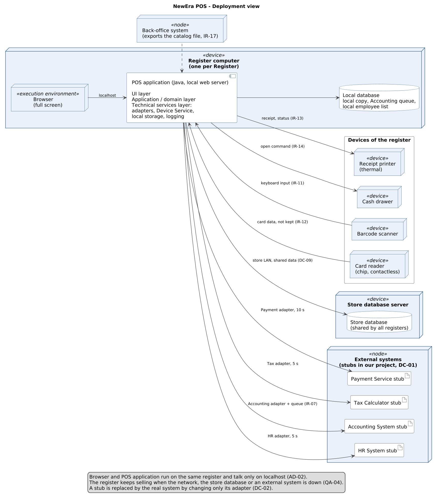
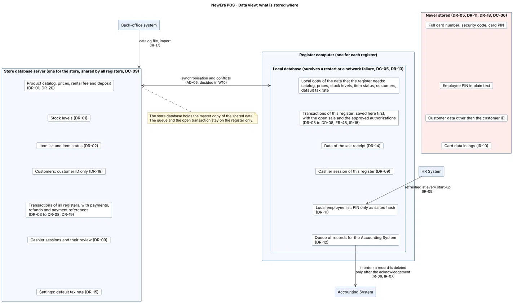

# Architecture Description – NewEra POS

|                  |                                                                                                     |
| ---------------- | --------------------------------------------------------------------------------------------------- |
| **Maintainer**   | Haifa Chkoundali                                                                                    |
| **Version**      | 0.4                                                                                                 |
| **Last updated** | W09 (reviews #51 to #56 integrated, consistency pass of the whole document)                         |
| **Part of**      | Increment 2 – Design (milestone W11)                                                                |
| **Structure**    | ISO/IEC/IEEE 42010:2022 – Architecture description                                                  |

> **Status: draft.** This document gives the views of the architecture description (§4), their correspondences (§5) and the decisions with their records (§6.1). All the views and the correspondences are written. AD-01 to AD-03 were accepted by the team in W09; AD-04, AD-07, AD-09 and AD-10 are proposals until the team confirms them, and AD-05, AD-06 and AD-08 are still open (AD-05 and AD-06 are decided in W10). The inputs are the architecture drivers ([architecture_drivers.md](architecture_drivers.md), Alfonso) and the domain model ([domain_model.md](domain_model.md), Borja).

## 1. Introduction

### 1.1 Purpose

This document describes the architecture of **NewEra POS**: the main parts of the system, how they work together, and why they were chosen. It is the link between the requirements ([SRS](../requirements/SRS.md)) and the detailed design (domain model, system sequence diagrams, operation contracts).

### 1.2 System of interest

NewEra POS is the application a cashier uses at a store register to process sales, returns, rentals and rental returns, and to start up the register (UC1–UC5). It runs on the registers of the store, uses four devices (barcode scanner, card reader, receipt printer, cash drawer – SRS §3.1.2) and four external systems (Payment Service, Tax Calculator, Accounting System, HR System – SRS §3.1.3).

### 1.3 Inputs

| Input                                  | Document                                                                                                                                         |
| -------------------------------------- | ------------------------------------------------------------------------------------------------------------------------------------------------ |
| Requirements (FR, NFR, IR, BR)         | [SRS.md](../requirements/SRS.md) v1.1                                                                                                            |
| External interfaces                    | [external_interfaces.md](../requirements/external_interfaces.md)                                                                                 |
| Design constraints                     | SRS §3.6 (DC-01 to DC-09)                                                                                                                        |
| Architecture drivers                   | [architecture_drivers.md](architecture_drivers.md) v0.2 (Alfonso)                                                                                |
| Domain model, SSD, operation contracts | [domain_model.md](domain_model.md), [system_sequence_diagrams.md](system_sequence_diagrams.md), [operation_contracts.md](operation_contracts.md) |
| UI prototype                           | [ui_prototype.md](ui_prototype.md)                                                                                                               |

## 2. Stakeholders and concerns

Stakeholders from [stakeholders.md](../requirements/stakeholders.md). A _concern_ is something a stakeholder cares about in the architecture.

| Stakeholder          | Concerns                                                                                                   | Related requirements                        |
| -------------------- | ---------------------------------------------------------------------------------------------------------- | ------------------------------------------- |
| Cashier              | Fast response at the till; the system keeps working when an external system is down; clear error messages  | NFR-01, NFR-05, NFR-06, IR-02, IR-05, IR-09 |
| Customer             | Secure card payment; correct total and receipt                                                             | NFR-08, NFR-11, BR-01, BR-05                |
| Store manager        | Control over prices, default tax rate and employees; correct stock levels                                  | NFR-07, BR-04, IR-05, IR-09, FR-14          |
| Owner                | Reasonable cost; reliable figures; system can grow (new payment methods)                                   | NFR-03, NFR-09                              |
| Accountant           | Every transaction reaches the Accounting System, in order and only once                                    | IR-06, IR-07, BR-14                         |
| HR                   | Each transaction linked to the right employee; local employee list kept up to date                         | IR-08, IR-09, BR-13                         |
| System administrator | Easy to install and configure; clear logs; devices and external systems easy to connect                    | NFR-10, IR-10, DC-02, DC-03                 |
| Development team     | Can build and test the system with stubs; can replace a stub by a real system later; uses known technology | DC-01, DC-02, DC-04, DC-07                  |

## 3. Viewpoints

A _viewpoint_ defines how a view is made: which concerns it answers and which model or notation it uses. Notation: UML (PlantUML), as in the rest of the project.

| Viewpoint            | Concerns answered                                                                                                            | Model / notation                      | Stakeholders                           |
| -------------------- | ---------------------------------------------------------------------------------------------------------------------------- | ------------------------------------- | -------------------------------------- |
| **Context**          | What is inside and outside the system; which external systems and devices it talks to                                        | Context diagram                       | All                                    |
| **Logical (layers)** | Main parts of the software and their responsibilities; how the domain is separated from the UI and from the external systems | UML package diagram (layers)          | Development team                       |
| **Interaction**      | How the parts work together for the main scenarios (UC1 sale, failure of an external system)                                 | UML sequence diagram                  | Development team                       |
| **Deployment**       | Where the software runs; register, local storage, network, external systems                                                  | UML deployment diagram                | System administrator, development team |
| **Data**             | Which data is stored locally and which is sent to external systems; what survives a restart                                  | Class diagram (from the domain model) | Accountant, development team           |

## 4. Views

### 4.1 Context view

The context view shows NewEra POS as one box, with the people, the devices and the external systems around it. It fixes the boundary of the system: what the POS exchanges with its surroundings and through which interface requirement. It answers the concerns of the cashier, the store manager, the system administrator and the development team (§2).



_Editable source: [`assets/architecture_context.puml`](../../assets/architecture_context.puml) (PlantUML)._

| Element                | Type            | What is exchanged                                                                                                                                        | Requirements                                      |
| ---------------------- | --------------- | -------------------------------------------------------------------------------------------------------------------------------------------------------- | ------------------------------------------------- |
| **Cashier**            | Person          | Operates the register in every use case (UC1–UC5): sale, return, rental, rental return and start up.                                                     | SRS §3.1.1                                        |
| **Store manager**      | Person          | Approves what a cashier may not do alone (price change, cash refund, damage), reads the lists and the sessions to review, and changes settings.          | FR-06, FR-25, FR-52, FR-68 to FR-70, FR-74, FR-75 |
| **Barcode scanner**    | Device          | Item ID, serial number or receipt number, typed like keyboard input.                                                                                     | IR-11                                             |
| **Card reader**        | Device          | Chip and contactless card data, as a token that is not kept after the Payment Service answers.                                                           | IR-12                                             |
| **Receipt printer**    | Device          | Receipts. The printer reports ready, no paper or error.                                                                                                  | IR-13                                             |
| **Cash drawer**        | Device          | Opens for a cash payment, a cash refund, the opening count and the closing count. Every opening is logged.                                               | IR-14                                             |
| **Payment Service**    | External system | Authorization of a card or check payment, card refund, status of a refund, void of an authorization. Timeout 10 s; a retry uses the same transaction ID. | IR-01 to IR-03, IR-15, IR-16                      |
| **Tax Calculator**     | External system | The tax of every sale, return, rental and rental return. Timeout 5 s; when it does not answer, the default tax rate is used.                             | IR-04, IR-05                                      |
| **Accounting System**  | External system | Accounting records of the completed transactions, sent from a local queue; the POS never waits for it.                                                   | IR-06, IR-07                                      |
| **HR System**          | External system | Check of the employee ID and PIN; list of employees for the local copy. Timeout 5 s; when it does not answer, the local list is used.                    | IR-08, IR-09                                      |
| **Back-office system** | External system | The product catalog, as a file that the POS imports at start-up or when a store manager asks for it.                                                     | IR-17                                             |

In our project the external systems are replaced by stubs (DC-01). A stub and the real system are two implementations of the same interface, so only the adapter of a system changes when the real one replaces the stub (DC-02, AD-04). Each system has its own timeout and fallback (SRS §3.1.3, AD-07).

The store database server (DC-09) is part of NewEra POS and is shown in the deployment view (§4.4).

### 4.2 Logical view (layers)

The logical view shows the main parts of the POS application and what each one is responsible for. It answers the concerns of the development team (§2): the business rules are kept apart from the screens and from the external systems, a stub can be replaced by the real system, and the work can be split between people. The style is the layered architecture of AD-01, inside the local web application of AD-02, in Java (AD-03). The names are those of the domain model, the SSDs and the system interfaces ([system_interfaces.md](system_interfaces.md)).



_Editable source: [`assets/architecture_logical.puml`](../../assets/architecture_logical.puml) (PlantUML)._

| Layer                    | Package                                                                               | Main classes                                                                                                                                                                                                                       | Responsibility                                                                                                                                                                                                                                                                                                                                                                                                                                                                                                                                                    | Source                                                   |
| ------------------------ | ------------------------------------------------------------------------------------- | ---------------------------------------------------------------------------------------------------------------------------------------------------------------------------------------------------------------------------------- | ----------------------------------------------------------------------------------------------------------------------------------------------------------------------------------------------------------------------------------------------------------------------------------------------------------------------------------------------------------------------------------------------------------------------------------------------------------------------------------------------------------------------------------------------------------------- | -------------------------------------------------------- |
| **UI**                   | `ui.screens`                                                                          | Login, Menu, Sale, Payment, Receipt, Return, Rental, RentalReturn and Manager screens                                                                                                                                              | Web pages shown in the browser of the register. They show data and send the cashier's actions; they contain no business rule. Based on the UI prototype.                                                                                                                                                                                                                                                                                                                                                                                                          | AD-02, NFR-05, NFR-06, NFR-13 to NFR-18                  |
|                          | `ui.api`                                                                              | `SessionController`, `SaleController`, `ReturnController`, `RentalController`, `RentalReturnController`, `ManagerController`                                                                                                       | Receive the requests of the system API (one per system operation, system_interfaces.md §3), check the format and call the application layer. Together with the screens they form the MVC of the UI layer (AD-01).                                                                                                                                                                                                                                                                                                                                                 | AD-01, AD-02                                             |
| **Application / domain** | `application`                                                                         | `SessionHandler`, `SaleHandler`, `ReturnHandler`, `RentalHandler`, `RentalReturnHandler`, `ManagerHandler`                                                                                                                         | One handler per use case (UC4, UC1, UC2, UC3, UC5) and one for the store manager functions. A handler runs the system operations of its SSD (`makeNewSale`, `enterItem`, `endSale`, `makePayment`…) as described in the operation contracts, and decides the fallback when an external system is not available (AD-07). `ManagerHandler` has the store manager functions: reorder list (FR-68), default tax rate (FR-69), disable an employee in the local list (FR-70), list and review of the sessions to review (FR-74, FR-75) and the catalog import (IR-17). | SSDs, contracts, AD-07                                   |
|                          |                                                                                       | `ManagerApproval`                                                                                                                                                                                                                  | Checks the employee ID and PIN of a store manager for an approval inside a use case (price override, `approveCashRefund`, `confirmDamage`) and for the functions of `ManagerHandler`. It asks the `HRSystem`, or the local employee list when the HR System is not available, and drops the PIN after the check. Used by `SaleHandler`, `ReturnHandler`, `RentalReturnHandler` and `ManagerHandler`, so the check is written once.                                                                                                                                | AD-09, NFR-07, NFR-08, FR-06, FR-25, FR-52, IR-08, IR-09 |
|                          |                                                                                       | `AccountingSender`                                                                                                                                                                                                                 | Background job started by `SessionHandler` at start-up. It takes the records from `AccountingQueue` in order, sends them through `AccountingSystemAdapter`, removes a record only after its acknowledgement and tries again later when the Accounting System doesn't answer. The start-up and the receipt never wait for it. Details (how often it tries again) in AD-06.                                                                                                                                                                                         | IR-06, IR-07, FR-42, AD-06                               |
|                          | `application.interfaces`                                                              | `PaymentService`, `TaxCalculator`, `AccountingSystem`, `HRSystem`, `CatalogSource`, `CardReader`, `ReceiptPrinter`, `CashDrawer`, repositories; result classes (`PaymentResult`, `TaxResult`, `Acknowledgement`, `EmployeeCheck`…) | The Java interfaces of system_interfaces.md §4 and the classes they return. The application layer only knows these interfaces, never their implementation.                                                                                                                                                                                                                                                                                                                                                                                                        | DC-02, AD-04, AD-10                                      |
|                          | `domain` (`domain.store`, `domain.catalog`, `domain.transactions`, `domain.payments`) | see the next four rows                                                                                                                                                                                                             | The classes of the domain model, in four packages. The packages use each other as in the domain model (a sale has payments and line items of products, and belongs to a cashier session).                                                                                                                                                                                                                                                                                                                                                                         | Domain model                                             |
|                          | `domain.store`                                                                        | `Store`, `Register`, `Employee`, `CashierSession`                                                                                                                                                                                  | The register, the employees and the cashier session with its opening and closing cash.                                                                                                                                                                                                                                                                                                                                                                                                                                                                            | Domain model, BR-13, BR-17                               |
|                          | `domain.catalog`                                                                      | `ProductCatalog`, `ProductDescription`, `Item`                                                                                                                                                                                     | Products, prices, stock levels and the rentable items with their status.                                                                                                                                                                                                                                                                                                                                                                                                                                                                                          | Domain model, BR-09, BR-11, DR-02                        |
|                          | `domain.transactions`                                                                 | `Transaction`, `Sale`, `Return`, `Rental`, `RentalReturn`, their line items, `Customer`, `Receipt`, `AccountingRecord`                                                                                                             | The transactions and their business rules: totals, tax, refund amount, rental fee, deposit and late fee.                                                                                                                                                                                                                                                                                                                                                                                                                                                          | Domain model, BR-01 to BR-18                             |
|                          | `domain.payments`                                                                     | `Payment`, `CashPayment`, `CreditCardPayment`, `CheckPayment`, `Refund`                                                                                                                                                            | One class per tender behind the abstract `Payment`, as in the domain model, so that a new payment method is a new class. This structure stays provisional until AD-08 is decided.                                                                                                                                                                                                                                                                                                                                                                                 | NFR-09, BR-05, BR-06, BR-08                              |
| **Technical services**   | `technical.external`                                                                  | `PaymentServiceAdapter`, `TaxCalculatorAdapter`, `AccountingSystemAdapter`, `HRSystemAdapter`, `CatalogSourceAdapter`                                                                                                              | One adapter per external system and one for the catalog file. Each adapter implements its interface, talks to the stub of its system (DC-01), applies the timeout and returns `NOT_AVAILABLE` when there is no answer (AD-04, AD-07).                                                                                                                                                                                                                                                                                                                             | DC-01, DC-02, IR-01 to IR-10, IR-15 to IR-17             |
|                          | `technical.devices`                                                                   | `CardReaderDriver`, `ReceiptPrinterDriver`, `CashDrawerDriver`                                                                                                                                                                     | The Device Service of AD-10. The scanner works as a keyboard and needs no class.                                                                                                                                                                                                                                                                                                                                                                                                                                                                                  | AD-10, IR-11 to IR-14                                    |
|                          | `technical.storage`                                                                   | `TransactionRepository`, `ItemRepository`, `AccountingQueue`, `EmployeeList`, `StoreDatabaseSync`                                                                                                                                  | Read and write the local database of the register and the queue of records for the Accounting System. The repositories hide whether the data comes from the local copy or from the store database. `StoreDatabaseSync` is a placeholder for the link with the store database (stock levels, item status, unique receipt numbers, BR-11), decided in AD-05 and AD-06 (W10).                                                                                                                                                                                        | DC-05, DC-09, IR-07, IR-09, BR-11                        |
|                          | `technical.logging`                                                                   | `EventLog`                                                                                                                                                                                                                         | Failed communications with external systems and every opening of the cash drawer, without card data or personal data.                                                                                                                                                                                                                                                                                                                                                                                                                                             | IR-10, IR-14, NFR-11                                     |

**Rules between the layers**

- Calls go down: the UI calls the application layer, and the application layer calls the domain and the interfaces of `application.interfaces`. The UI never calls the domain or a technical service directly.
- The one dependency that goes up is on purpose: the technical services implement the interfaces of `application.interfaces` and return its result classes (dependency inversion). So the stub and the real system are two implementations of the same interface, and only the adapter changes when the real system comes (DC-02, QA-14).
- The domain packages don't depend on the application layer, the UI or the technical services; they may depend on each other as in the domain model. So they can be tested without a database, a device or an external system.
- Card data goes from `CardReaderDriver` to `PaymentServiceAdapter` only. It is never stored, logged or sent to the screens (DC-06, NFR-11).

**Correspondence with the other views (§5).** All the packages run inside the POS application on the register computer of the deployment view (§4.4), except `ui.screens`, which runs in the browser of the same register. The interaction view (§4.3) shows UC1 through these layers.

### 4.3 Interaction view

The interaction view shows how a use case runs through the layers of the logical view (§4.2): which class receives each request, which class does the work and which technical service talks to the outside. The messages are the system operations of [system_interfaces.md](system_interfaces.md) §3, and the participants are the classes of §4.2, so the views use the same names as the domain model, the SSDs and the contracts. Two scenarios of UC1 Process Sale are shown: the normal payment by credit card, and the payment when the Payment Service does not answer.

#### 4.3.1 UC1 Process Sale paid by credit card



_Editable source: [`assets/architecture_uc1.puml`](../../assets/architecture_uc1.puml) (PlantUML)._

What the diagram shows:

- **UI layer.** The screens send one request for each system operation to `SaleController`, which only calls the application layer. The controller and the screens contain no business rule (AD-01). A scanned item ID arrives like typed text (IR-11, AD-10).
- **Application / domain layer.** `SaleHandler` runs the operations of the SSD of UC1 (`makeNewSale`, `enterItem`, `endSale`, `makePayment`) as the operation contracts describe them. It works with the domain classes (`ProductCatalog`, `Sale`) and with the external systems and the devices only through the interfaces of `application.interfaces`.
- **Technical services.** The adapters and drivers implement those interfaces: `TaxCalculatorAdapter` and `PaymentServiceAdapter` talk to the stubs (DC-01) and apply the timeouts (AD-04, AD-07); `CardReaderDriver` and `ReceiptPrinterDriver` are the Device Service (AD-10); `TransactionRepository` and `AccountingQueue` keep the sale and the accounting record.
- **Card data.** The card token is read once, stays in memory and is given only to `PaymentServiceAdapter`. It is never stored, logged or sent to a screen (IR-12, AD-09, DC-06).
- **After the approval.** The sale is saved, the stock levels are reduced, the accounting record is queued and the receipt is printed. The receipt does not wait for the Accounting System (IR-06).

#### 4.3.2 UC1 card payment when the Payment Service does not answer



_Editable source: [`assets/architecture_uc1_payment_unavailable.puml`](../../assets/architecture_uc1_payment_unavailable.puml) (PlantUML)._

What the diagram shows:

- **Timeout in the adapter.** `PaymentServiceAdapter` waits at most 10 s, logs the failed communication in the `EventLog` without card data (IR-10) and returns `NOT_AVAILABLE` instead of an error (AD-07). The screen shows a waiting message after 1 s (NFR-18).
- **Fallback in the handler.** `SaleHandler` decides what happens next, because it depends on the use case: no payment is created, the sale stays open (BR-18) and the cashier chooses to retry, to use another tender or to cancel the sale (UC1 extension 9b2b).
- **Retry with the same transaction ID.** The sale keeps one transaction ID. A retry sends the same ID to the Payment Service, which never charges the same transaction twice (IR-02). The card is read again, because the card data was discarded (AD-09).
- **Void when the cashier gives up.** When the cashier uses another tender or cancels the sale after `NOT_AVAILABLE`, the handler sends a void with the same transaction ID through `PaymentServiceAdapter` (`voidAuthorization`), so that a late approval of the first request can't charge the customer (IR-15, AD-07).

**Correspondence with the other views (§5).** The screens run in the browser and every other participant runs in the POS application on the register computer (§4.4). The participants are the classes of §4.2; the messages are the system operations of [system_interfaces.md](system_interfaces.md) §3 and the operation contracts.

### 4.4 Deployment view

The deployment view shows where the software runs, which devices and systems it is connected to, and what is replaced by a stub in our project. It answers the concerns of the system administrator and of the development team (§2): easy to install and configure, devices and external systems easy to connect, and a stub that can be replaced by the real system (NFR-10, DC-02, DC-03). The names are those of the logical view (AD-01), the domain model (`Register`) and the SRS.



_Editable source: [`assets/architecture_deployment.puml`](../../assets/architecture_deployment.puml) (PlantUML)._

| Node                                            | What runs or is stored there                                                                                                                                                                                                                                                                                                                                 | Source                                    |
| ----------------------------------------------- | ------------------------------------------------------------------------------------------------------------------------------------------------------------------------------------------------------------------------------------------------------------------------------------------------------------------------------------------------------------ | ----------------------------------------- |
| **Register computer** (one for each `Register`) | A standard computer. It runs the browser, the POS application and the local database, and the devices are connected to it.                                                                                                                                                                                                                                   | DC-03, AD-01, AD-02                       |
| Browser                                         | Shows the cashier screens (`ui.screens` of the logical view) in full-screen mode. It also receives the codes of the barcode scanner, which works as a keyboard. It talks to the POS application only on `localhost`.                                                                                                                                         | AD-02                                     |
| POS application                                 | The Java program that runs as a small local web server. It contains the three layers of AD-01 (UI, application / domain, technical services); its UI layer is the system API (`ui.api`), and the screens run in the browser. The technical services layer holds one adapter for each external system, the Device Service, the local storage and the logging. | AD-01 to AD-03, DC-02                     |
| Local database                                  | The local copy of the data that the register needs (transactions, product catalog, local employee list) and the queue of records for the Accounting System. It survives a restart and a network failure.                                                                                                                                                     | DC-05, DC-09, NFR-04, IR-07, IR-09, FR-48 |
| **Store database server**                       | The one store database shared by all registers: product catalog, prices, stock levels, item status, customers and transactions. The registers are its clients.                                                                                                                                                                                               | DC-09, QA-16, BR-11                       |
| **Devices**                                     | Barcode scanner (works as a keyboard: its code is typed into the browser), card reader (chip and contactless), thermal receipt printer and cash drawer. They are standard devices connected to the register computer; the models are not fixed.                                                                                                              | IR-11 to IR-14, NFR-10, AD-10             |
| **External systems**                            | In our project the Payment Service, Tax Calculator, Accounting System and HR System are **stubs** that follow the interfaces of SRS §3.1.3 and can simulate _approved_, _declined_, _timeout_ and _not available_. The POS reaches each one through its own adapter, so the real system replaces the stub without a change in the rest of the POS.           | DC-01, DC-02, IR-01 to IR-10              |
| Back-office system                              | Exports the product catalog as a file. The POS imports it at start-up or when a store manager starts an import.                                                                                                                                                                                                                                              | IR-17                                     |

**Network links** (the numbers are the numbers on the links of the diagram)

| No. | Link                                    | Medium                                                          | Notes                                                                                                                                                                   |
| --- | --------------------------------------- | --------------------------------------------------------------- | ----------------------------------------------------------------------------------------------------------------------------------------------------------------------- |
| 1   | Barcode scanner → browser               | Cable to the register computer; the scanner works as a keyboard | The code is typed into the window that has the focus, the browser. The screen sends it to the POS application through the system API, like a typed code (IR-11, AD-10). |
| 2   | Browser – POS application               | `localhost`                                                     | The local server only accepts connections from the register itself (AD-02).                                                                                             |
| 3   | Card reader → POS application           | Cable to the register computer, standard driver                 | Through the Device Service. Card data goes only to the Payment adapter and is not kept (IR-12, AD-10).                                                                  |
| 4   | POS application → receipt printer       | Cable to the register computer, standard driver                 | Through the Device Service: receipt and status (IR-13, AD-10).                                                                                                          |
| 5   | POS application → cash drawer           | Cable to the register computer, standard driver                 | Through the Device Service. Every opening is logged with its reason (IR-14, AD-10).                                                                                     |
| 6   | POS application – local database        | On the register computer                                        | Local copy, Accounting queue and local employee list (DC-05).                                                                                                           |
| 7   | POS application – store database server | Store network                                                   | If the connection is lost, the register keeps selling with its local copy and its queue (DC-09).                                                                        |
| 8   | POS application – Payment Service       | Network                                                         | Timeout 10 s. The cashier can retry with the same transaction ID (IR-02).                                                                                               |
| 9   | POS application – Tax Calculator        | Network                                                         | Timeout 5 s (IR-05).                                                                                                                                                    |
| 10  | POS application – Accounting System     | Network                                                         | The records are sent in the background from the local queue (IR-06, IR-07); the timeout is in the configuration (AD-07).                                               |
| 11  | POS application – HR System             | Network                                                         | Timeout 5 s (IR-09).                                                                                                                                                    |
| 12  | Back-office system → POS application    | Not fixed yet (see the open points)                             | The catalog file (IR-17).                                                                                                                                               |

**What the register does when something is not available**

| What is not available            | What the register does                                                                                                                                   | Source               |
| -------------------------------- | -------------------------------------------------------------------------------------------------------------------------------------------------------- | -------------------- |
| Network or store database server | Sells, returns and rents with the local copy; the records wait in the local queue and are sent later, in order.                                          | DC-09, QA-04, IR-07  |
| The Payment Service              | The cashier is told, the transaction stays open, and the cashier retries with the same transaction ID or cancels and uses another tender.                | IR-02                |
| The Tax Calculator               | The default tax rate is applied and the transaction is marked for correction.                                                                            | IR-05                |
| The Accounting System            | The records wait in the local queue and are sent in the background, in order. The receipt is printed without waiting.                                    | IR-06, IR-07         |
| The HR System                    | The register checks the employee ID and the PIN against the local employee list.                                                                         | IR-09                |
| A device                         | The cashier sees a message and uses the fallback of SRS §3.1.2: types the identifier, uses another tender, reprints, or opens the drawer with the key.   | IR-11 to IR-14       |
| The register computer (restart)  | It is ready in less than 30 seconds. The queue is kept, and every approved authorization without a completed transaction is voided at the next start-up. | NFR-02, FR-48, IR-15 |

**Correspondence with the logical view (§5).** The UI layer is served by the POS application and shown in the browser; the application / domain layer and the technical services layer run inside the POS application on the register computer.

**Open points of this view**

- The number of registers in a store is not fixed (architecture drivers, open question 3); the diagram shows one register, and the store database server serves all of them.
- In our project the stubs run on a separate test computer, or on the register computer during development. The protocol and the data format between the POS and the external systems are fixed in the system interfaces (`system_interfaces.md`).
- The local database product and the synchronisation with the store database are decided in AD-05 and AD-06 (W10).
- The medium of the catalog file of the back-office system (store network, shared folder or removable drive) is not fixed in IR-17. It is decided with the `CatalogSource` interface in the system interfaces.

### 4.5 Data view

The data view shows **where each kind of data is stored**: in the store database that all registers share, in the local database of one register, or nowhere. It answers the concerns of the accountant (every transaction reaches the Accounting System once and in order) and of the development team (what survives a restart or a network failure, what is never stored) in §2. It is drawn from the logical database requirements of the SRS (§3.5, DR-01 to DR-20), the design constraints DC-05, DC-06 and DC-09 and the [domain model](domain_model.md), and it uses the same names. The choice of the database product and the table design belong to AD-05 and AD-06 (W10), so this view says _what_ is stored where and not _how_.



_Editable source: [`assets/architecture_data.puml`](../../assets/architecture_data.puml) (PlantUML)._

**Where the data is stored**

The **master copy** of a data item is the place where its value is decided; the other place keeps a copy.

| Data (SRS §3.5)                                                                                                   | Store database server (shared by all registers)                                     | Local database of each register                                                                            | Source                                            |
| ----------------------------------------------------------------------------------------------------------------- | ----------------------------------------------------------------------------------- | ---------------------------------------------------------------------------------------------------------- | ------------------------------------------------- |
| Product catalog, prices, rental fee and deposit                                                                   | Master copy. The catalog comes from the back-office file (IR-17)                    | Copy of what the register needs, to sell without the network                                               | DR-01, DR-20, DC-09, IR-17                        |
| Stock levels                                                                                                      | Master copy, changed by the quantity of each sale and return (see below)            | Estimate; a sale reduces the local value at once (see below)                                               | DR-01, BR-09, DC-09                               |
| Item list and item status                                                                                         | Master copy: an item must not be rented at two registers at the same time           | Copy of the last known status                                                                              | DR-02, BR-11, DC-09                               |
| Customers (customer ID only)                                                                                      | Master copy: customer IDs are unique in the whole store                             | Copy of the customers the register needs, for the overdue check                                            | DR-18, BR-12, DC-09                               |
| Transactions (sales, returns, rentals, rental returns) with their lines, payments, refunds and payment references | All transactions of all registers, so that a return can be made at another register | The transactions of this register, **saved here first**; the open sale and the approved authorizations too | DR-03 to DR-08, DR-13, DR-19, FR-48, IR-15, DC-05 |
| Transactions waiting for the store database                                                                       | – (it only receives them and ignores a transaction ID that it already has)          | **Only here**, in the order made, each with its transaction ID; marked as sent after the acknowledgement   | DR-03, DR-13, DC-09                               |
| Data of the last receipt                                                                                          | –                                                                                   | Yes, to print it again                                                                                     | DR-14, FR-17                                      |
| Cashier sessions                                                                                                  | A copy, so that a store manager can review a session (FR-74, FR-75)                 | The session of this register (at most one open)                                                            | DR-09                                             |
| Employee list                                                                                                     | – (the HR System is the master)                                                     | Copy of the HR System, refreshed at every start-up; the PIN only as a salted hash                          | DR-11, IR-09                                      |
| Settings (default tax rate, reorder threshold)                                                                    | Master copy; only a store manager changes it                                        | Copy                                                                                                       | DR-15, BR-02, BR-04                               |
| Queue of records for the Accounting System                                                                        | – (it never goes to the store database)                                             | **Only here**, in the order of the transactions; a record is deleted after the acknowledgement             | DR-12, IR-06, IR-07, DC-05                        |
| Log of failed communications                                                                                      | –                                                                                   | Yes, without card data or other personal data                                                              | IR-10                                             |

**Stock levels and transactions for the store database** (review #52, Josué)

- The master stock level is changed by the **quantity** of each sale and return that a register sends, not by the stock value of the register. Two registers that sell the same product between two synchronisations therefore do not overwrite each other's sales.
- The local stock level is an **estimate**. It decides the reorder flag (FR-14) and the stock set to zero with the missing quantity recorded (FR-19) at the register, and it is refreshed at start-up and when the connection is back. A difference found at the synchronisation is recorded for the store manager.
- The **list of transactions waiting for the store database** is not the queue for the Accounting System: that queue never goes to the store database and its records are deleted after the acknowledgement (DR-12). A transaction stays in the list until the store database has acknowledged it. The store database ignores a transaction ID that it already has, so a transaction sent twice after a lost acknowledgement is stored once.

**What is never stored** (DR-05, DR-11, DR-18, DC-06, NFR-08, NFR-11)

| Data                                                   | What the POS does instead                                                                                                                                                               |
| ------------------------------------------------------ | --------------------------------------------------------------------------------------------------------------------------------------------------------------------------------------- |
| Full card number, security code, PIN of a card         | Only the last 4 digits, the authorization code and the payment reference of the Payment Service are kept (DR-05, DR-19). Card data is passed only to the Payment adapter (AD-10, AD-09) |
| PIN of an employee in plain text                       | The HR System checks the PIN; the local employee list keeps only a salted hash (DR-11)                                                                                                  |
| Personal data of a customer other than the customer ID | Only the data needed to find open and overdue rentals (DR-18)                                                                                                                           |
| Card data or personal data in the logs                 | The log of IR-10 has the system, the time and the error only                                                                                                                            |

**What survives a restart or a network failure**

| Event                                   | Result                                                                                                                                                                                                                   |
| --------------------------------------- | ------------------------------------------------------------------------------------------------------------------------------------------------------------------------------------------------------------------------ |
| Restart or crash of the register        | The local database keeps the transactions, the open sale, the approved authorizations and the queue (DR-13, FR-48). The cashier logs in again, and every authorization without a completed transaction is voided (IR-15) |
| Network or store database not available | The register works with its local copy and its queue (DC-09). The transactions wait in the list for the store database and are sent in order when the connection is back                                                                                |
| An external system not available        | The adapter applies the fallback of SRS §3.1.3; the records for the Accounting System wait in the queue (IR-07)                                                                                                          |

**Open points of this view**

1. **How the copies are kept up to date and how conflicts are solved** (an item rented at two registers while both are offline, customers registered twice, how a difference of stock levels is recorded) is decided in **AD-05** (W10, Borja), together with SRS open questions 6 and 8. The rule that the stock level is changed by quantities and not by values is already fixed in this view.
2. **Receipt numbers, transaction IDs and customer IDs** must be unique in the whole store (DC-09), also when a register is offline. A proposal for AD-05 is that each register builds the number from its register ID and its own counter.
3. **Retention.** How long the transactions and the accounting records are kept after they have been sent is open (SRS §3.5, open question 8, Borja, W10); it decides the size of the local database.
4. **Where the catalog import is stored** (IR-17): the import file is read at start-up or by a store manager; whether the register or the store database server imports it is decided in AD-05.
5. **Return offline of a sale that another register has not sent yet.** The register finds the original sale only in its local database or in the store database. Proposal for AD-05: while the store database is not available and the sale is not in the local database, the register gives the message of UC2 for an unknown receipt number (FR-21) and the cashier tries again when the connection is back. Whether a store manager may approve such a return is a question for the SRS (Alfonso).

## 5. Correspondences

How the views and the other documents are linked (ISO/IEC/IEEE 42010 _correspondences_). §5.1 links the views with each other. §5.2 links the interface requirements, the design constraints and the non-functional requirements with the components of the logical view (§4.2). The functional requirements are traced in the traceability matrix ([requirements_conventions.md](../requirements/requirements_conventions.md), section 4).

### 5.1 View to view

| From                                                                                        | To                                                                      | Correspondence                                                                                                                                                                                                                                                                                                                                                    |
| ------------------------------------------------------------------------------------------- | ----------------------------------------------------------------------- | ----------------------------------------------------------------------------------------------------------------------------------------------------------------------------------------------------------------------------------------------------------------------------------------------------------------------------------------------------------------- |
| Context view (§4.1) – Payment Service, Tax Calculator, Accounting System, HR System         | Logical view (§4.2) – `application.interfaces` and `technical.external` | One external system, one interface and one adapter: `PaymentService` / `PaymentServiceAdapter`, `TaxCalculator` / `TaxCalculatorAdapter`, `AccountingSystem` / `AccountingSystemAdapter`, `HRSystem` / `HRSystemAdapter` (DC-02, AD-04)                                                                                                                           |
| Context view – back-office system (catalog file)                                            | Logical view – `CatalogSource` and `CatalogSourceAdapter`               | The catalog import of IR-17                                                                                                                                                                                                                                                                                                                                       |
| Context view – barcode scanner, card reader, receipt printer, cash drawer                   | Logical view – `technical.devices`                                      | `CardReaderDriver`, `ReceiptPrinterDriver` and `CashDrawerDriver`. The scanner works as a keyboard and has no class (AD-10)                                                                                                                                                                                                                                       |
| Context view – Cashier, Store manager                                                       | Logical view – `ui.screens`, `ui.api`                                   | The screens of the cashier and the Manager screens; one controller for each use case and `ManagerController` for the store manager functions                                                                                                                                                                                                                      |
| Context view – external systems                                                             | Deployment view (§4.4) – External systems, Back-office system           | The same four systems (stubs in our project, DC-01) and the back-office file                                                                                                                                                                                                                                                                                      |
| Logical view – `ui.screens`                                                                 | Deployment view – Browser                                               | The screens are web pages shown in the browser of the register                                                                                                                                                                                                                                                                                                    |
| Logical view – `ui.api`, `application`, `application.interfaces`, `domain.*`, `technical.*` | Deployment view – POS application                                       | All these packages run in the POS application, on the register computer                                                                                                                                                                                                                                                                                           |
| Logical view – `technical.storage`                                                          | Deployment view – Local database, Store database server                 | The repositories read and write the local database. The register is a client of the store database server; how the two are synchronised is decided in AD-05 and AD-06                                                                                                                                                                                             |
| Logical view – `technical.devices`                                                          | Deployment view – Devices                                               | One driver for each device connected to the register computer                                                                                                                                                                                                                                                                                                     |
| Logical view – `technical.external`                                                         | Deployment view – External systems                                      | Each adapter talks to the stub (or the real system) of its external system, with its own timeout                                                                                                                                                                                                                                                                  |
| Logical view – `TransactionRepository`, `ItemRepository`, `AccountingQueue`, `EmployeeList` | Data view (§4.5)                                                        | Transactions, payments and payment references (saved first on the register); catalog, stock levels and item status (copy); queue of records for the Accounting System (only on the register); employee list (copy, PIN only as a salted hash)                                                                                                                     |
| Deployment view – Local database, Store database server                                     | Data view – the two columns of the table "Where the data is stored"     | The same two stores                                                                                                                                                                                                                                                                                                                                               |
| Logical view – `domain.*`                                                                   | Domain model and Data view                                              | The same names as the conceptual classes; the attributes that are stored are those of DR-01 to DR-20 (SRS §3.5)                                                                                                                                                                                                                                                   |
| Logical view – `ui.api`, `application`                                                      | SSDs and operation contracts                                            | One controller method for each system operation. One handler for each use case: `SessionHandler` (UC4), `SaleHandler` (UC1), `ReturnHandler` (UC2), `RentalHandler` (UC3), `RentalReturnHandler` (UC5) and `ManagerHandler` (store manager)                                                                                                                       |
| Logical view – `ui.api`                                                                     | System interfaces ([system_interfaces.md](system_interfaces.md)) §3     | The controllers receive the requests of the system API: each system operation of §3 is received by one method of the controller of its use case                                                                                                                                                                                                                   |
| Logical view – `application.interfaces`                                                     | System interfaces ([system_interfaces.md](system_interfaces.md)) §4     | The Java interfaces of the adapters and the devices (`PaymentService`, `TaxCalculator`, `AccountingSystem`, `HRSystem`, `CatalogSource`, `CardReader`, `ReceiptPrinter`, `CashDrawer`) are those of §4, with the same names                                                                                                                                       |
| Architecture decisions (§6)                                                                 | Views                                                                   | AD-01: layers of the logical view. AD-02: browser and local server of the deployment view. AD-03: all packages (Java). AD-04, AD-07: adapters and handlers. AD-05, AD-06: data view and `technical.storage` (open, W10). AD-09: `technical.devices`, `technical.external`, `technical.storage` and `application`. AD-10: `technical.devices` and the Devices node |

### 5.2 Requirement to component

| Requirement                      | What it asks                                                                      | Component in the logical view (§4.2)                                                                                                                                                                          | Decision     |
| -------------------------------- | --------------------------------------------------------------------------------- | ------------------------------------------------------------------------------------------------------------------------------------------------------------------------------------------------------------- | ------------ |
| IR-01, IR-16                     | Authorization of card and check payments; complete the payment only if approved   | `PaymentServiceAdapter`; `CreditCardPayment`, `CheckPayment`; the handlers complete the payment only after an approved answer                                                                                 | AD-04        |
| IR-02                            | Timeout of 10 s; retry with the same transaction ID                               | The adapter applies the timeout and returns `NOT_AVAILABLE`; the handlers of UC1, UC3 and UC5 offer the retry or another tender                                                                               | AD-07        |
| IR-03                            | Card refund with the payment reference, without the card number                   | `PaymentServiceAdapter`; `Refund`; the reference is stored by `TransactionRepository`                                                                                                                         | AD-09        |
| IR-15                            | Store every approved authorization; void it after a crash                         | `TransactionRepository` stores it with the open transaction; `SessionHandler` sends the void at start-up, and `SaleHandler` when the cashier gives up a card payment after `NOT_AVAILABLE` (§4.3.2), through `PaymentServiceAdapter`; `EventLog` logs it | AD-07        |
| IR-04, IR-05                     | Tax from the Tax Calculator; default tax rate after 5 s                           | `TaxCalculatorAdapter` (timeout); the handlers apply the default tax rate and the mark _tax to be corrected_; `ManagerHandler` changes the default rate (store manager only)                                  | AD-07        |
| IR-06, IR-07                     | Queue for the Accounting System, in order and without loss                        | `AccountingQueue`; `AccountingSender` (background job); `AccountingSystemAdapter` (called only by `AccountingSender`); `AccountingRecord`                                                                     | AD-04, AD-06 |
| IR-08, IR-09                     | PIN checked by the HR System; local employee list as fallback                     | `HRSystemAdapter`; `EmployeeList`; `SessionHandler` (login); `ManagerApproval` (manager approvals)                                                                                                             | AD-09        |
| IR-10                            | Log of failed communications, without card data                                   | `EventLog`, called by every adapter                                                                                                                                                                           | AD-04        |
| IR-11                            | Item identifier, serial number or receipt number from scanner or keyboard         | `ui.screens` (the scanner works as a keyboard, no class)                                                                                                                                                      | AD-10        |
| IR-12                            | Chip and contactless card reader; card data not kept                              | `CardReaderDriver`, which passes the card data to `PaymentServiceAdapter` only                                                                                                                                | AD-09, AD-10 |
| IR-13                            | Thermal receipt printer; message when there is no paper                           | `ReceiptPrinterDriver`; `Receipt`; the handler shows the message                                                                                                                                              | AD-10        |
| IR-14                            | Cash drawer only for the four allowed reasons; every opening logged               | `CashDrawerDriver` checks the reason; `EventLog` logs time, cashier and reason                                                                                                                                | AD-10        |
| IR-17                            | Import of the product catalog                                                     | `CatalogSourceAdapter`; `ProductCatalog`; started by `SessionHandler` at start-up or by `ManagerHandler`                                                                                                      | AD-04        |
| DC-01                            | Stubs for the four external systems                                               | The adapters of `technical.external`; the configuration chooses the stub or the real system                                                                                                                   | AD-04        |
| DC-02                            | Each external system behind its own interface                                     | `application.interfaces` and `technical.external`                                                                                                                                                             | AD-01, AD-04 |
| DC-03                            | Standard register computer                                                        | The POS application and the browser on the register computer (§4.4)                                                                                                                                           | AD-02        |
| DC-04                            | Tools the team already knows                                                      | All packages (Java; HTML, CSS and JavaScript for the screens)                                                                                                                                                 | AD-03        |
| DC-05                            | Transactions and queue stored locally                                             | `technical.storage`: `TransactionRepository`, `AccountingQueue`                                                                                                                                               | AD-05        |
| DC-06                            | Card data not stored                                                              | `CardReaderDriver`, `PaymentServiceAdapter`; `TransactionRepository` keeps only the last 4 digits, the authorization code and the payment reference                                                           | AD-09        |
| DC-07, DC-08                     | Team and schedule; documents and UI in English                                    | No component. The packages let the team split the work by layer (AD-01); the texts of `ui.screens` are in English                                                                                             | AD-01        |
| DC-09                            | One store database shared by all registers; local copy and queue on each register | `technical.storage` (`TransactionRepository`, `ItemRepository`, `EmployeeList`, `AccountingQueue`); Store database server node                                                                                | AD-05 (open) |
| NFR-01, NFR-02                   | Time to register a line; start-up time                                            | `ui.api`, `application`, and `ProductCatalog` / `ItemRepository` work on the local copy, so no external system is called for a line; the waiting records are sent in the background by `AccountingSender` | AD-01, AD-02 |
| NFR-03, NFR-04                   | Availability; completed sale saved locally                                        | The adapters hide the failures of the external systems; the handlers apply the fallbacks; `TransactionRepository` saves locally first                                                                         | AD-05, AD-07 |
| NFR-05, NFR-06, NFR-13 to NFR-18 | Usability                                                                         | `ui.screens` (NFR-15: availability indicator filled by `application`; NFR-18: waiting message while an adapter request is open)                                                                               | AD-02        |
| NFR-07                           | Role-based access control                                                         | `ManagerApproval` checks the role of the `Employee` (`domain.store`) and the manager PIN for every manager action                                                                                             | AD-09        |
| NFR-08                           | PINs only as a salted hash, never shown or logged                                 | `EmployeeList`; `HRSystemAdapter`; `EventLog` never receives a PIN                                                                                                                                            | AD-09        |
| NFR-09                           | New payment method in less than 3 working days                                    | `domain.payments` (one class for each tender); `PaymentServiceAdapter`                                                                                                                                        | AD-08        |
| NFR-10                           | Standard printers and scanners                                                    | The interfaces of `technical.devices`                                                                                                                                                                         | AD-10        |
| NFR-11                           | At most the last 4 digits of a card number                                        | `CreditCardPayment` keeps only these digits; `Receipt`, the screens, `EventLog` and `AccountingSystemAdapter` receive only these digits                                                                       | AD-09        |
| NFR-12                           | Only the personal data of DR-11 and DR-18                                         | `Customer` (customer ID only), `EmployeeList`, `Receipt` (no customer data)                                                                                                                                   | AD-09        |
| NFR-19                           | Timeouts of 10 s and 5 s                                                          | Each adapter; the values are in the configuration of the POS (also for the Accounting System and the catalog import, AD-07)                                                                                   | AD-07        |
| NFR-20                           | Payment data encrypted when stored or sent                                        | `TransactionRepository` (stored data), `PaymentServiceAdapter` (sent data)                                                                                                                                    | AD-09        |

## 6. Architecture decisions

The decisions of the architecture. Each one is recorded in §6.1 with: context, options, decision, rationale, consequences, related requirements. AD-05, AD-06 and AD-08 are still open.

| ID    | Decision to take                          | Options to compare                                                                                                       | Drivers                                      | Status          |
| ----- | ----------------------------------------- | ------------------------------------------------------------------------------------------------------------------------ | -------------------------------------------- | --------------- |
| AD-01 | Architectural style of the POS            | Layered (UI / domain / technical services); MVC; client–server                                                           | NFR-09, DC-02                                | Accepted (W09)  |
| AD-02 | Kind of application                       | Desktop application; web application in a browser on the register                                                        | DC-03, DC-04, NFR-02                         | Accepted (W09)  |
| AD-03 | Programming language and frameworks       | Tools the team already knows (Java, Python, JavaScript…)                                                                 | DC-04, team skills                           | Accepted (W09)  |
| AD-04 | How the POS talks to the external systems | One adapter per system behind an interface (stubs replaceable by real systems); direct calls                             | DC-01, DC-02, IR-01 to IR-10, IR-15 to IR-17 | Proposed (§6.1) |
| AD-05 | Local storage                             | Embedded database (e.g. SQLite); files                                                                                   | NFR-04, IR-07, FR-48, DC-05                  | Open            |
| AD-06 | Accounting System queue                   | Persistent local queue with acknowledgement and transaction ID (no duplicates)                                           | IR-07, FR-42, BR-14                          | Open            |
| AD-07 | Timeouts and fallbacks                    | Where timeouts (10 s / 5 s) and fallbacks are handled: in each adapter or in a common component                          | IR-02, IR-05, IR-09, NFR-19                  | Proposed (§6.1) |
| AD-08 | Payment methods                           | One class per tender behind a common interface, so a new method can be added easily                                      | NFR-09, FR-09 to FR-12                       | Open            |
| AD-09 | Security of card data and PINs            | Card data only in memory until the Payment Service answers; PINs stored as a salted hash; role check for manager actions | NFR-07, NFR-08, NFR-11, DC-06                | Proposed (§6.1) |
| AD-10 | Device access                             | Scanner as keyboard input; printer and drawer through a device service                                                   | NFR-10, IR-11 to IR-14                       | Proposed (§6.1) |

### 6.1 Decision records

One subsection per decision, with this template. AD-01 to AD-03 were proposed in W08 and accepted by the team in W09.

```
#### AD-xx – <title>
- Context:
- Options:
- Decision:
- Rationale:
- Consequences:
- Related requirements:
```

#### AD-01 – Architectural style of the POS

- Context: The register has to keep selling when the network, the store database or an external system is down (QA-03, QA-04, DC-05, DC-09). Line entry must not wait for any external system (QA-01). A stub must be replaceable by the real system, and a new payment method must take less than 3 days (DC-02, NFR-09, QA-13, QA-14). Six students build the system part-time, so the structure must be simple and let people work in parallel (C-04).
- Options:
  1. Layered architecture on each register: UI, application/domain and technical services. Each external system and each device is reached through its own adapter in the technical services layer.
  2. MVC as the main style: views, controllers and a model for each screen.
  3. Client–server: a central server holds the logic and the data, and the register is a thin client.
- Decision (accepted in W09): option 1. The screens inside the UI layer use MVC, so options 1 and 2 are combined. Client–server is only used for the store database of DC-09: the register is a client of it, but it keeps a local copy and its own queue, so it can work on its own.
- Rationale: The layers keep the business rules (BR-01 to BR-18) in the domain layer, apart from the screens and the external systems. The adapters answer DC-02 and QA-14 directly, because a stub and the real system implement the same interface. A thin client (option 3) stops working when the server or the network is down, which breaks QA-04 and NFR-02. MVC alone does not say where the adapters and the local storage go. Layers are also the style of the course and of our domain model, so everyone in the team knows it.
- Consequences: The domain layer calls only interfaces, never the UI or a concrete adapter. Each layer gets its own package, so the work can be split by layer and by use case. The synchronisation with the store database and the conflicts between offline registers stay in AD-05.
- Related requirements: DC-02, DC-05, DC-09, NFR-01 to NFR-04, NFR-09; QA-01, QA-03, QA-04, QA-13, QA-14.

#### AD-02 – Kind of application

- Context: DC-03 allows a desktop or a web application on a standard register computer. The POS must print on the thermal printer and open the cash drawer (IR-13, IR-14), and be ready in less than 30 s with all external systems down (NFR-02). The UI prototype is in HTML, CSS and JavaScript and its screens were checked with the team (ui_prototype.md). Its code is throw-away, but the screen design is kept.
- Options:
  1. Desktop application installed on each register (for example JavaFX or Qt).
  2. Central web application: a server in the store and a browser on each register.
  3. Local web application: the POS program runs on each register as a small local server, and the screens are web pages shown in a full-screen browser on the same register (localhost).
- Decision (accepted in W09): option 3.
- Rationale: Option 2 needs the network for every screen, so the register stops when the network is down (QA-04), and a browser cannot reach the cash drawer or the printer directly. Options 1 and 3 both run on the register, so they work offline and reach the devices through the local program. Option 3 lets us build the screens with the same web technology as the prototype, which Yasmine and I already used, and keeps the logic in the local program, where the devices and the local database are. Option 1 would mean learning a desktop UI toolkit that nobody in the team lists in the README.
- Consequences: The register needs a browser in full-screen (kiosk) mode that starts with the POS program. The local server only accepts connections from the register itself. The UI talks to the application layer through the system operations of the SSDs (makeNewSale, enterItem, endSale, makePayment…), which become the interface between the two.
- Related requirements: DC-03, DC-05, NFR-02, NFR-04, NFR-10, NFR-13, IR-11 to IR-14; QA-02, QA-04, QA-15.

#### AD-03 – Programming language and frameworks

- Context: DC-04 asks for tools the team already knows, and C-06 for free, open-source tools. Skills in the README: Java (Alfonso, Borja), Python (Alfonso, Avni), C/C++ (Alfonso, Avni), web and full-stack development (Yasmine, me). The design is object-oriented (domain model, operation contracts), and the code needs automated tests with stubs (DC-01).
- Options:
  1. Java for the local server with a small web framework (for example Spring Boot or Javalin), HTML, CSS and JavaScript for the screens, JUnit for the tests.
  2. Python for the local server (Flask or FastAPI), HTML, CSS and JavaScript for the screens, pytest for the tests.
  3. JavaScript or TypeScript for everything (Node.js server and web screens).
- Decision (accepted in W09): option 1. The web framework (Spring Boot or Javalin) and the build tool are fixed at the start of increment 3.
- Rationale: Two members know Java, and it fits the class design we already have: the conceptual classes, the adapter interfaces (DC-02) and one class per tender (AD-08) map directly to Java classes and interfaces. The type checks also help when six people work on the same code. Python is known by two members too and is faster to write, but there an adapter interface is only a convention. Option 3 is known by fewer members. In all three options the screens are HTML, CSS and JavaScript (AD-02).
- Consequences: The database chosen in AD-05 needs a Java driver (SQLite has one). Members who don't know Java yet need a short setup guide in the repository.
- Related requirements: DC-01, DC-02, DC-04, DC-07, NFR-09; C-04, C-06, C-08.

#### AD-04 – How the POS talks to the external systems

- Context: The POS uses four external systems (Payment Service, Tax Calculator, Accounting System, HR System) and imports the catalog from the back-office system (IR-01 to IR-10, IR-15 to IR-17; the devices of IR-11 to IR-14 are in AD-10). In our project they are stubs (DC-01), and a stub must be replaceable by the real system without changing the rest of the POS (DC-02, QA-14). Each system has its own data format, timeout and fallback (SRS §3.1.3).
- Options:
  1. One adapter per external system. Each adapter implements a Java interface of `application.interfaces` (system_interfaces.md §4) and lives in `technical.external`.
  2. Direct calls: each handler sends the HTTP requests of the stubs itself.
  3. One common gateway class for all the external systems.
- Decision (proposal): option 1.
- Rationale: With direct calls (option 2), the protocol of the stubs would be spread over every handler, so replacing a stub by the real system would change every use case. That breaks DC-02. A common gateway (option 3) is one class that knows four protocols: every change touches it, and the tests can't simulate one system alone. With option 1 the stub and the real system are two implementations of the same interface, and the handlers don't see the difference. The tests can also use a simple fake of each interface, without any network.
- Consequences: There are five adapters: `PaymentServiceAdapter`, `TaxCalculatorAdapter`, `AccountingSystemAdapter`, `HRSystemAdapter` and `CatalogSourceAdapter`. The POS chooses the stub or the real implementation in its configuration at start-up. Each adapter turns the answer of its system into the result classes of system_interfaces.md (`PaymentResult`, `TaxResult`…) and logs a failed communication in the `EventLog`, without card data (IR-10). The `AccountingSystemAdapter` is called only by the `AccountingSender`, which takes the records from the `AccountingQueue` in the background (IR-06, IR-07, AD-06). The card token goes from the card reader to the `PaymentServiceAdapter` only (DC-06).
- Related requirements: DC-01, DC-02, DC-06, IR-01 to IR-10, IR-15 to IR-17, NFR-09; QA-14; system_interfaces.md §4 and §5.

#### AD-07 – Timeouts and fallbacks

- Context: The POS waits at most 10 s for the Payment Service and 5 s for the Tax Calculator and the HR System (NFR-19). The start-up and the receipt never wait for the Accounting System, because records go through the local queue and the `AccountingSender` sends them in the background (IR-06, IR-07). NFR-19 gives no timeout for the Accounting System and the catalog import. When a system doesn't answer, SRS §3.1.3 gives the fallback: the cashier can retry a card payment with the same transaction ID or use another tender (IR-02), the default tax rate is applied and the transaction is marked _tax to be corrected_ (IR-05), and the login uses the local employee list (IR-09). The screen shows a waiting message after 1 s (NFR-18).
- Options:
  1. Timeout and fallback both in each adapter.
  2. Timeout in each adapter, fallback in the handler of the use case.
  3. One common component that handles the timeouts and the fallbacks of all the systems.
- Decision (proposal): option 2.
- Rationale: The timeout belongs to the call, so the adapter that makes the call applies it and returns `NOT_AVAILABLE` instead of an error (system_interfaces.md, business results). The fallback is a business decision: which tender the cashier may use, which transactions get the mark _tax to be corrected_, what the cashier sees. It depends on the use case and its SSD extension, so it belongs to the handler. With option 1 these business rules would sit in the technical layer, and the adapter of the real system would have to repeat them. Option 3 puts everything in one place, but that component would need to know the extensions of every use case.
- Consequences: Every method of the adapter interfaces returns a result that can be `NOT_AVAILABLE`, and each handler deals with it as its SSD extension says. The timeout values are in the configuration of the POS, with the values of NFR-19 as defaults. The Accounting System and the catalog import also get a timeout in the configuration (proposed: 10 s), so that one call that never answers can't block the `AccountingSender` or the import. NFR-19 asks for no value here, so this is a design choice and not a requirement. The adapter logs the failure (IR-10).
  - For a payment or a refund, `NOT_AVAILABLE` means _outcome unknown_, not _declined_: the Payment Service may have approved the request after the timeout. An answer that arrives after the timeout is logged and ignored.
  - When the cashier gives up a card payment after `NOT_AVAILABLE` (another tender or cancel, IR-02), the handler sends a void with the same transaction ID, as IR-15 does after a crash, so the customer can't be charged twice.
  - For a card refund, the handler asks for the status of the refund with the same transaction ID (`refundStatus`, UC2 and UC5 9b2b) and keeps the refund _pending_ while the status is unknown.

  For a retry, the handler sends the same transaction ID again (IR-02, IR-15). The screen shows the waiting message while the request is open (NFR-18). The stubs can simulate _timeout_ and _not available_ (DC-01), so each fallback is tested (NFR-19 verification). The tests also cover a late answer: the stub approves after the timeout, and the POS must void the payment or find the refund status, never charge or refund twice.
- Related requirements: NFR-18, NFR-19, IR-02, IR-05, IR-07, IR-09, IR-10, IR-15, DC-01; QA-05, QA-06, QA-07.

#### AD-09 – Security of card data and PINs

- Context: The POS handles card data (chip and contactless reader, IR-12), the PINs of employees (login and manager approvals, IR-08, IR-09) and functions that only a store manager may use (price override, default tax rate, disabling an employee, cash refund approval, damage confirmation, session review; BR-04). The SRS forbids keeping card data (DC-06, NFR-20), asks for PINs only as a salted hash and never in logs or on screen (NFR-08), for masked card numbers (NFR-11) and for role-based access control (NFR-07). The POS is a local web application (AD-02): the browser shows the screens and talks to the local server, so anything sent through the browser can end up in a URL, a log or the browser history. The register can be offline: the HR System may be down (UC4 6c), and a card payment that is retried needs the card to be read again, because the card data is discarded (UC1 9b2b).
- Options:
  1. Card data. (A) The card data stays in memory, from `CardReaderDriver` to `PaymentServiceAdapter` only, and is discarded when the Payment Service answers; a later refund uses the payment reference (DR-19). (B) The card data is stored encrypted in the local database, so that a retry or a refund needs no new card reading.
  2. PINs. (A) The HR System checks the PIN, and the local employee list keeps it only as a salted hash, for the login when the HR System is not available. (B) The local list keeps the PIN encrypted (reversible). (C) The POS keeps no PIN, so no login is possible without the HR System.
  3. Manager functions. (A) The UI hides the manager functions from cashiers. (B) Every manager function is checked in the handler on the server side: the role of the employee, and the employee ID and PIN of the store manager entered for that action.
- Decision (proposal): 1A, 2A and 3B, with these rules:
  - Card data lives only in memory, goes from `CardReaderDriver` to `PaymentServiceAdapter` and nowhere else (not to the screens, the repositories, the `EventLog` or the `AccountingSystemAdapter`). Only the last 4 digits, the authorization code and the payment reference are stored (DR-05, DR-19).
  - Payment data that is stored (NFR-20) is encrypted by `TransactionRepository` at field level, with the standard Java cryptography, so the rule does not depend on the database product of AD-05. The key is in the configuration of the register, not in the source code. `PaymentServiceAdapter` talks to the Payment Service through an encrypted connection (TLS) in the real system; the stub may use plain HTTP in our tests (DC-01).
  - A PIN is stored only as a salted hash (a slow function with a different salt for each employee). It is sent in the body of a request to `localhost`, never in a URL, and is not written to any log. The handler gives it to the `HRSystem` interface, or compares it with `EmployeeList` when the HR System is not available (IR-09), and drops it.
  - Every manager function is checked in the handler: the employee must be an active store manager, identified with employee ID and PIN for that action (UC2 9b2a, UC5 6a, FR-69, FR-70). The check uses the HR System, or the local list when it is not available (UC4 6c4). Hiding a button in the UI is only a help for the cashier.
  - `EventLog` only accepts the system, the time and the error (IR-10); no free text from a request is logged.
- Rationale: The card number is not needed after the authorization, and the payment reference is enough for a refund (IR-03). Option 1B would make the register hold card data, which breaks DC-06 and NFR-20; the price of 1A is that a failed payment needs a new card reading, which the SRS already accepts (UC1 9b2b). For the PIN, the HR System stays the only master (IR-08), and the salted hash is needed for the offline login (IR-09, UC4 6c). It cannot be turned back into the PIN, as an encrypted PIN (2B) could, and 2C would break IR-09. For the manager functions, hiding buttons (3A) protects nothing, because the local server accepts any request from the browser of the register, so the check has to be in the application layer. This is also where the business rules are, so a test with a fake `HRSystem` can check every rule without a browser.
- Consequences: No interface other than `CardReader` and `PaymentService` may have a parameter with card data. `TransactionRepository` needs an encryption step and a key, which the system administrator sets at installation. `EmployeeList` holds only the salt and the hash; at the first start-up without the HR System nobody can log in (UC4 6c2). The cashier needs the manager for every manager function, which means one more PIN entry. The verification is the compliance checklist of SRS §4 (no card number in the screens, the receipt, the log or the database schema) and a test for every manager function, once with a cashier (refused) and once with a store manager (accepted).
- Related requirements: NFR-07, NFR-08, NFR-11, NFR-12, NFR-20; DC-06; DR-05, DR-11, DR-19; IR-03, IR-08, IR-09, IR-10, IR-12; BR-04; FR-06, FR-44, FR-52, FR-69, FR-70, FR-75; AD-02, AD-04, AD-10.

#### AD-10 – Device access

- Context: Each register has a barcode scanner, a card reader, a thermal receipt printer and a cash drawer (SRS §3.1.2). The POS runs as a local web application (AD-02): the browser shows the screens but cannot reach the printer or the cash drawer, and the card data must not be kept (IR-12, DC-06). The device models are not fixed and must be standard devices (NFR-10, QA-15). The register must go on when a device fails (SRS §3.1.2).
- Options:
  1. Every device behind its own interface in a Device Service of the technical services layer, scanner included.
  2. The scanner as keyboard input; the card reader, the printer and the cash drawer behind interfaces in the Device Service.
  3. The browser talks to the devices directly, with browser interfaces for USB or serial devices.
- Decision (proposal): option 2.
- Rationale: A standard scanner works as a keyboard, so a scanned item identifier, serial number or receipt number is typed into the browser, which has the focus, and reaches the POS application in the same way as a typed code: the screen sends it through the system API (IR-11). It needs no driver, and the cashier can always type the code when the scanner fails. A web page cannot control the printer and the cash drawer in a reliable way (AD-02), and the cash drawer may only be opened for the reasons of IR-14, so the Device Service on the register does it, checks the reason and logs it. The interfaces (`ReceiptPrinter`, `CashDrawer`, `CardReader`) let the team test with simulated devices and change a device model without changing the rest of the POS (QA-15, NFR-10).
- Consequences: A scanned code reaches the POS through the screen and the system API (for example `enterItem`), the same way as a typed code; the POS application does not read the scanner. The technical services layer has a Device Service with three interfaces. The application layer gives a reason with every request to open the cash drawer, and the Device Service logs the time, the cashier and the reason (IR-14). The card reader passes the card data only to the Payment adapter, never to the local database or to the logs (IR-12, NFR-11). The Device Service reports the printer status (ready, no paper, error), and the application layer shows the message and the fallback of SRS §3.1.2 (IR-13). The tests use simulated devices. The cabling and the operating system drivers are part of the installation of each register (system administrator).
- Related requirements: NFR-10, NFR-11; IR-11 to IR-14; DC-03, DC-06; QA-15; AD-02.

## 7. Open issues

1. Closed in W09: the architecture drivers and the utility tree are done ([architecture_drivers.md](architecture_drivers.md) v0.2, Alfonso).
2. Closed in W09: the rental deposit by card is charged and refunded, not held (SRS §5.3, question 2). The `PaymentService` interface needs no hold or release operation.
3. Closed in W09: the team accepted AD-01 to AD-03. The web framework and the build tool of AD-03 are fixed at the start of increment 3.
