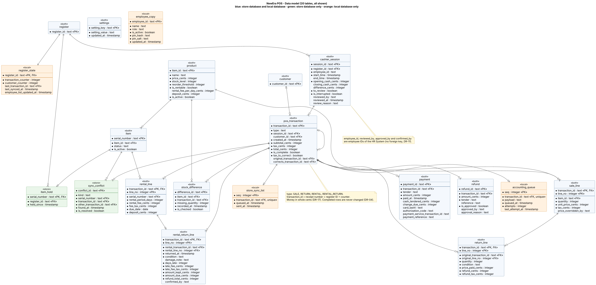

# Data Model – NewEra POS

| | |
| --- | --- |
| **Maintainer** | Borja Nicolás |
| **Version** | 0.1 (draft for review) |
| **Last updated** | W10 |
| **Part of** | Increment 2 (Design): data view ([architecture.md](architecture.md) §4.5), decision records AD-05 and AD-06 |

## 1. Purpose

This document gives the **tables of the store database and of the local database of each register**. It turns the logical database requirements of the SRS (§3.5, DR-01 to DR-20) and the [domain model](domain_model.md) into tables, columns, keys and relations. The [data view](architecture.md) says _where_ each kind of data is stored, AD-05 and AD-06 say _how_ the two databases are kept in step; this document says _what the tables are_. The names of the tables come from the names of the domain model (`ProductDescription` is the table `product`, `CashierSession` is `cashier_session`, and so on); a column has the name of the attribute, written with underscores.

## 2. Diagram

_20 of 20 tables shown. Editable source: [`assets/data_model.puml`](../../assets/data_model.puml) (PlantUML). Blue: table in the store database and in the local database. Green: store database only. Orange: local database only. `<<PK>>` primary key, `<<FK>>` foreign key; a column with a bullet is mandatory._

## 3. Rules for all tables

| Rule | What it means | Source |
| --- | --- | --- |
| Money in whole cents | Every amount is an integer number of cents (`price_cents`, `total_cents`…), so there are no rounding errors of floating-point numbers. The currency is one for the whole store (see §6). | DR-17 |
| Completed rows never change | A completed transaction, its lines, payments and refunds are inserted once and never updated or deleted. A correction (for example, the tax of a transaction marked `tax_to_correct`) is a new `pos_transaction` row whose `corrects_transaction_id` is the original. | DR-04 |
| No deletion of used rows | A product, item or customer that a transaction refers to is never deleted; a product or an item that is no longer used gets `is_active = false`. | DR-16 |
| Unique IDs without a central counter | `transaction_id` is the receipt number: register ID, a dash and the counter of the register (for example `R02-000153`). `customer_id` is built in the same way. The counters are in `register_state`. | DC-09, AD-05 |
| Employees are not a table of the store | The HR System is the master of the employees. `employee_id` columns (`cashier_session.employee_id`, `reviewed_by`, `approved_by`, `confirmed_by`, `price_overridden_by`) have no foreign key. | DR-11, IR-08 |
| One table for all four kinds of transaction | `pos_transaction.type` is `SALE`, `RETURN`, `RENTAL` or `RENTAL_RETURN`. The lines of each kind are in their own table. The amounts are always positive; the type gives the direction. | DR-03, DR-06 to DR-08 |
| Not stored at all | Full card number, security code, card PIN, PIN of an employee in plain text, any personal data of a customer other than the ID. | DR-05, DR-11, DR-18, DC-06 |

## 4. Tables

### 4.1 Catalog and stock

| Table | Meaning (domain model) | Main columns | Where | Requirements |
| --- | --- | --- | --- | --- |
| `product` | `ProductDescription` | `item_id` (PK), `name`, `price_cents`, `stock_level`, `reorder_threshold`, `is_rentable`, `rental_fee_per_day_cents`, `deposit_cents`, `is_active` | Both. Master: store database | DR-01, DR-20, DR-16 |
| `item` | `Item`: one rentable unit | `serial_number` (PK), `item_id` (FK), `status` (`AVAILABLE`, `RENTED`, `UNDER_MAINTENANCE`), `is_active` | Both. Master: store database | DR-02 |
| `item_hold` | A rental that is open at a register has a hold on the item (AD-05). `serial_number` is the primary key, so only one register can hold an item. | `serial_number` (PK, FK), `register_id` (FK), `held_since` | Store database only | BR-11, DC-09 |
| `stock_difference` | A sale that would make the stock level negative: the stock is set to zero and the missing quantity is recorded for a stock check by the store manager. | `difference_id` (PK), `item_id` (FK), `transaction_id` (FK), `missing_quantity`, `recorded_at`, `is_checked` | Both | FR-19 |
| `settings` | Default tax rate, reorder threshold, currency code, timeouts that a store manager may change. | `setting_key` (PK), `setting_value`, `updated_at` | Both. Master: store database | DR-15, BR-02, BR-04 |

### 4.2 Store, registers and sessions

| Table | Meaning | Main columns | Where | Requirements |
| --- | --- | --- | --- | --- |
| `register` | `Register` | `register_id` (PK) | Both | DC-09 |
| `customer` | `Customer`: the ID only | `customer_id` (PK) | Both | DR-18, BR-12 |
| `cashier_session` | `CashierSession` | `session_id` (PK), `register_id` (FK), `employee_id`, `start_time`, `end_time`, `opening_cash_cents`, `closing_cash_cents`, `difference_cents`, `to_review`, `is_interrupted`, `reviewed_by`, `reviewed_at`, `review_reason` | Both | DR-09, FR-74, FR-75 |

### 4.3 Transactions

| Table | Meaning | Main columns | Requirements |
| --- | --- | --- | --- |
| `pos_transaction` | `Transaction` (sale, return, rental, rental return) | `transaction_id` (PK, = receipt number), `type`, `session_id` (FK), `customer_id` (FK, rentals and rental returns), `created_at`, `subtotal_cents`, `tax_cents`, `total_cents`, `is_complete`, `tax_to_correct`, `original_transaction_id` (FK, returns), `corrects_transaction_id` (FK) | DR-03, DR-04, DR-06, DR-08 |
| `sale_line` | `SaleLineItem`: price at the moment of the sale | `transaction_id`, `line_no` (PK), `item_id` (FK), `quantity`, `unit_price_cents`, `tax_cents`, `price_overridden_by` | DR-03, DR-10 |
| `return_line` | `ReturnLineItem`: refers to one line of the original sale | `transaction_id`, `line_no` (PK), `original_transaction_id`, `original_line_no` (FK), `quantity`, `condition`, `price_paid_cents`, `refund_cents`, `refund_tax_cents` | DR-08 |
| `rental_line` | `RentalLineItem` | `transaction_id`, `line_no` (PK), `serial_number` (FK), `rental_period_days`, `rental_fee_cents`, `fee_tax_cents`, `due_date`, `deposit_cents` | DR-06, DR-20 |
| `rental_return_line` | `RentalReturn`: one row for each returned rental line | `transaction_id`, `line_no` (PK), `rental_transaction_id`, `rental_line_no` (FK), `returned_at`, `condition`, `damage_note`, `days_late`, `late_fee_cents`, `late_fee_tax_cents`, `amount_kept_cents`, `amount_due_cents`, `refund_total_cents`, `confirmed_by` | DR-07 |
| `payment` | `Payment`, `CashPayment`, `CreditCardPayment` in one table | `payment_id` (PK), `transaction_id` (FK), `tender`, `amount_cents`, `paid_at`, `cash_tendered_cents`, `change_due_cents`, `card_last4`, `authorization_code`, `payment_service_transaction_id`, `payment_reference` | DR-05, DR-19 |
| `refund` | `Refund` | `refund_id` (PK), `transaction_id` (FK), `amount_cents`, `tender`, `reference`, `is_approved`, `approved_by`, `approval_reason` | DR-08, FR-25 |

The overdue status of a rental is not stored: it is calculated from `due_date` and the current date (DR-06). A rental line is open as long as no `rental_return_line` refers to it. The payment fields that belong to the card payment (`authorization_code`, `payment_service_transaction_id`, `payment_reference`) are encrypted by `TransactionRepository` before they are written (AD-09, NFR-20).

### 4.4 Synchronisation, queue and local state

| Table | Meaning | Main columns | Where | Requirements |
| --- | --- | --- | --- | --- |
| `sync_conflict` | Two rentals of the same item that were found when an offline register sent its transactions (AD-05). For the store manager. | `conflict_id` (PK), `kind`, `serial_number` (FK), `transaction_id` (FK), `other_transaction_id` (FK), `found_at`, `is_resolved` | Store database only | DC-09, BR-11 |
| `accounting_queue` | The queue for the Accounting System (AD-06). A row is deleted after the acknowledgement. | `seq` (PK, the order), `transaction_id` (FK, unique), `payload`, `queued_at`, `attempts`, `last_attempt_at` | Local database only | DR-12, IR-06, IR-07 |
| `store_sync_list` | The transactions waiting for the store database (AD-05), in the order made. A row is marked as sent after the store database has committed the transaction. | `seq` (PK), `transaction_id` (FK, unique), `queued_at`, `sent_at` | Local database only | DC-09, DR-13 |
| `employee_copy` | Local copy of the employee list of the HR System | `employee_id` (PK), `name`, `role`, `is_active`, `pin_hash`, `pin_salt`, `updated_at` | Local database only | DR-11, IR-09 |
| `register_state` | The counters for the unique IDs, the last transaction (to print the receipt again) and the time of the last synchronisation | `register_id` (PK, FK), `transaction_counter`, `customer_counter`, `last_transaction_id`, `last_synced_at`, `employee_list_updated_at` | Local database only | DR-14, DC-09 |

The open sale, rental or return of a register is saved in `pos_transaction` with `is_complete = false`, in the local database only, so that it can be recovered after a crash (FR-48, IR-15). It is sent to the store database only when it is complete. The log of failed communications (IR-10) is a file of the register, not a table.

## 5. Traceability: DR to tables

| Requirement | Tables and columns |
| --- | --- |
| DR-01 | `product` |
| DR-02 | `item.status` and `item.item_id`; the change from _Under maintenance_ to _Available_ is a store manager action |
| DR-03 | `pos_transaction`, `sale_line` (`unit_price_cents` copied at the moment of the sale), `payment` |
| DR-04 | `pos_transaction.corrects_transaction_id`; the register database user has no `UPDATE` or `DELETE` on the transaction tables (AD-05) |
| DR-05 | `payment` (`cash_tendered_cents`, `change_due_cents`, `card_last4`, `authorization_code`); no column for the full card number |
| DR-06 | `pos_transaction` (type `RENTAL`), `rental_line`; overdue not stored |
| DR-07 | `rental_return_line`, `refund` |
| DR-08 | `pos_transaction.original_transaction_id`, `return_line`, `refund`; the quantity already returned of a sale line is the sum of `return_line.quantity` with this `original_transaction_id` and `original_line_no` |
| DR-09 | `cashier_session` |
| DR-10 | `sale_line.price_overridden_by` |
| DR-11 | `employee_copy` |
| DR-12 | `accounting_queue` |
| DR-13 | the local database (SQLite, one database transaction for each completed transaction, AD-05) |
| DR-14 | `register_state.last_transaction_id` |
| DR-15 | `settings` (default tax rate) |
| DR-16 | `is_active` of `product` and `item`; no deletion; `customer` rows are never deleted |
| DR-17 | all `*_cents` columns |
| DR-18 | `customer` has the ID only |
| DR-19 | `payment.payment_service_transaction_id`, `payment.payment_reference` |
| DR-20 | `product.rental_fee_per_day_cents`, `product.deposit_cents` |

## 6. Currency, tax rounding and retention (SRS question 8)

- **Currency.** One currency for the whole store, set in `settings` as a currency code when the register is installed. There is no conversion (DR-17). The amounts are cents of that currency.
- **Tax rounding.** The tax is calculated and stored **per line**: the Tax Calculator returns the tax of each line (system_interfaces.md §4.1), and the POS stores it in `sale_line.tax_cents` or `rental_line.fee_tax_cents`, rounded **half up** to whole cents if the answer has more decimals. The tax of the transaction is the **sum** of the taxes of its lines, so that the receipt adds up exactly. When the default tax rate is used (IR-05), the POS calculates the same way, line by line. The deposit has no tax (SRS question 1); the late fee has the tax of the rental fee, stored in `rental_return_line.late_fee_tax_cents`.
- **Tax of a return.** The refunded tax of a return line is the stored tax of the sale line for the returned quantity: tax of the line × quantity returned ÷ quantity sold, rounded half up. The last return of a line takes what is left of the tax, so that the refunded taxes of all returns of a line add up to the tax of the sale.
- **Retention.** The accounting record is deleted after the acknowledgement (DR-12). The register deletes from its local database the transactions that the store database has acknowledged, after **90 days**: the refund period is 30 days, a rental lasts 7 days at most, and a session is reviewed within days. Transactions that the store database has not acknowledged are never deleted. The store database keeps every transaction and the POS never deletes one. The legal retention period of the accounting data (for example 7 years in many countries) has to be confirmed with the owner of the store; it concerns the store database and its backup, not the registers.

## 7. Open points

1. The size of the local database with 90 days of transactions has not been measured; it is checked with the performance test of NFR-01 and NFR-02 (10,000 products).
2. The data model has no table for the pending refund of a card refund without answer (UC2 and UC5 9b2b) and no table for the repair of an item (DR-02): the SRS has no function for them yet (domain model §7.3, gaps 2 and 1: pending refund and repair).
3. The columns and the keys are the logical design. Indexes, the exact column types of PostgreSQL and SQLite and the schema script are written in the detailed design (W11).
