# Detailed Design – NewEra POS

| | |
| --- | --- |
| **Maintainer** | Alfonso Pinto |
| **Version** | 0.1 (draft for review) |
| **Last updated** | W11 |
| **Part of** | Increment 2 – Design (milestone W11) |
| **Inputs** | [Architecture](architecture.md) (logical view §4.2, AD-01 to AD-10), [system interfaces](system_interfaces.md), [operation contracts](operation_contracts.md), [system sequence diagrams](system_sequence_diagrams.md), [domain model](domain_model.md), [data model](data_model.md), [UI design](ui_design.md) |

> **Status: draft.** This document collects the detailed design of the five use cases: design sequence diagrams, design class diagram, activity diagrams and state diagrams. It is detailed enough to start coding in increment 3. Sections marked *To do* are filled in by their owners this week (task_plan_W11.md); everything is at v1.0 on Tue 24 Nov.

## 1. Purpose and how to read the diagrams

The architecture fixes the layers, the packages and the interfaces (AD-01, AD-04). This document shows how the objects of those layers work together to carry out each **system operation** of the SSDs, so that the result is exactly the postconditions of its **operation contract**.

Every design sequence diagram follows the same rules:
- It starts with the HTTP request of the system API (system_interfaces.md §3) that the controller of `ui.api` receives, and the controller only calls the handler of its use case (AD-01).
- The handler (`application`) runs the operation with the domain classes (`domain`) and reaches the outside only through the interfaces of `application.interfaces`: external systems, devices and repositories (DC-02, AD-04). The adapter applies the timeout; the handler decides the fallback (AD-07).
- The names of classes and methods are those of the logical view, the design class diagram (§3) and system_interfaces.md.
- Under each diagram, a note gives the **GRASP** patterns used: Controller, Creator, Information Expert, Low Coupling, High Cohesion, Polymorphism, Pure Fabrication, Indirection, Protected Variations.

Diagrams are in PlantUML in `assets/` (`.puml` + `.png`), named `dsd_uc<N>_<operation>`.

## 2. Design sequence diagrams

### 2.1 UC1 Process Sale (contracts 1–4) – Alfonso

| Diagram | Operations | Contract | Main design choices |
| --- | --- | --- | --- |
| [`dsd_uc1_makeNewSale_enterItem`](../../assets/dsd_uc1_makeNewSale_enterItem.puml) | `makeNewSale()`, `enterItem(itemID, quantity)` | 1, 2 | `TransactionRepository` gives the unique transaction ID (AD-05); `CashierSession` creates the `Sale`; the `Sale` creates its `SaleLineItem`s; the product is found in the local catalog, with no external call (NFR-01) |
| [`dsd_uc1_endSale`](../../assets/dsd_uc1_endSale.puml) | `endSale()` | 3 | Tax through the `TaxCalculator` interface; after the 5 s timeout the handler applies the default tax rate and the mark *tax to be corrected* (IR-05, AD-07) |
| [`dsd_uc1_makePayment`](../../assets/dsd_uc1_makePayment.puml) | `makePayment(amount, tenderType)` | 4 | `PaymentMethods` gives the `PaymentMethod` of the tender (AD-08); the card token goes only from `CardReader` to `PaymentService` (AD-09); approved: open authorization saved (IR-15), then one `saveCompleted` with stock, Accounting record and sync entry (AD-05, AD-06); declined or not available: no payment, retry with the same transaction ID, void when the cashier gives up (AD-07) |

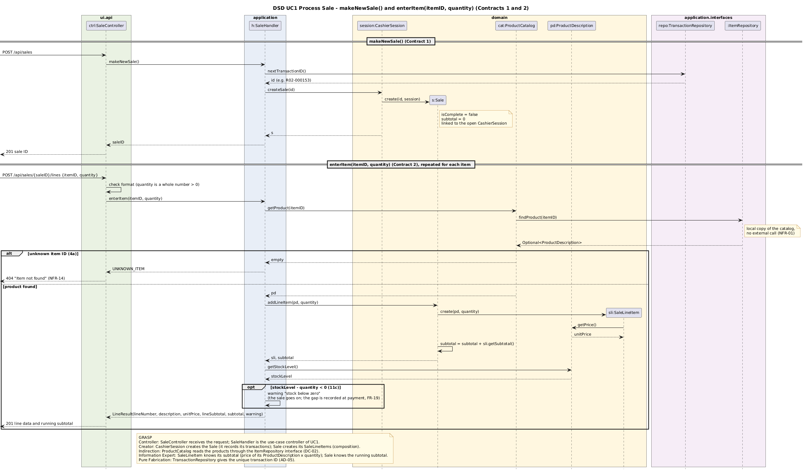

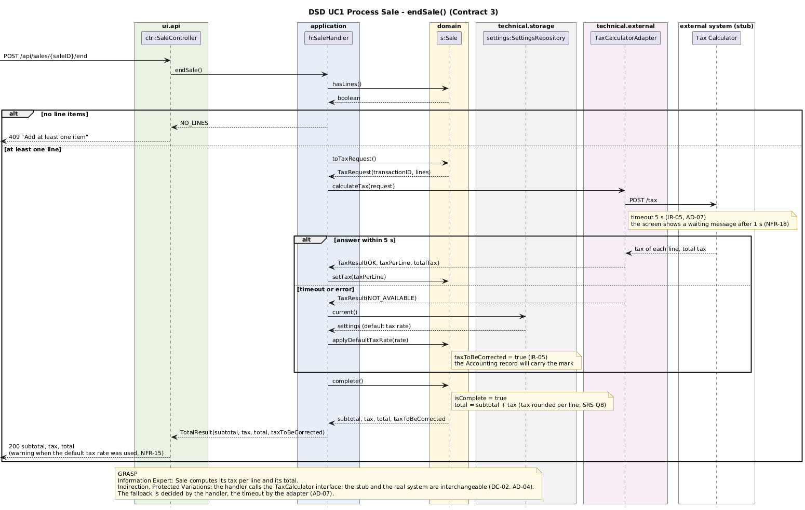

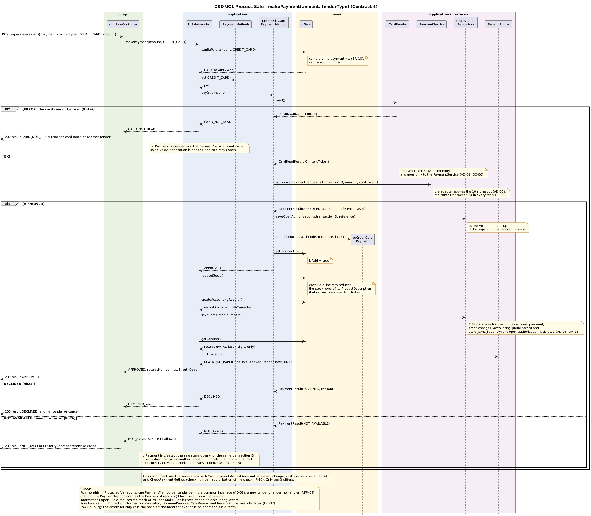

`makePayment` of UC1 is the reference for the payments of UC3 and UC5, which use the same `PaymentMethods`.

### 2.2 UC2 Handle Returns (contracts 5–9) – Yasmine

| Diagram | Operations | Contract | Main design choices |
| --- | --- | --- | --- |
| [`dsd_uc2_makeNewReturn_findSale`](../../assets/dsd_uc2_makeNewReturn_findSale.puml) | `makeNewReturn()`, `findSale(receiptNumber)` | 5, 6 | `CashierSession` creates the `Return`; the sale is searched in the local copy first and, only if it is not there, with `StoreDatabaseSync.findTransaction` (FR-21, AD-05); the `Sale` says whether it is within the refund period (BR-07); the quantity already returned of each line is read with the sale |
| [`dsd_uc2_enterReturnItem`](../../assets/dsd_uc2_enterReturnItem.puml) | `enterReturnItem(itemID, quantity, condition)` | 7 | `Return` creates its `ReturnLineItem` and checks what is left to return; the `SaleLineItem` gives the refund value (price and the tax charged in the sale, FR-27); `RESELLABLE` is the condition *Undamaged* of the domain model |
| [`dsd_uc2_confirmReturn`](../../assets/dsd_uc2_confirmReturn.puml) | `confirmReturn()` | 8 | `PaymentMethods` gives the `PaymentMethod` of the tender of the sale and `refund` does the rest (AD-08); card refund with the payment reference and the same transaction ID; `NOT_AVAILABLE` leads to `refundStatus` and then to *pending* (AD-07, §3.7 of system_interfaces.md); a declined refund or a check waits for the store manager; stock increases only for resellable items; one `saveCompleted` (AD-05, AD-06) |
| [`dsd_uc2_approveCashRefund`](../../assets/dsd_uc2_approveCashRefund.puml) | `approveCashRefund(managerID, pin, reason)` | 9 | `ManagerApproval` checks the store manager with the HR System, or with the local list when it does not answer (IR-08); `Refund.approve` records who approved and why; the cash `PaymentMethod` opens the drawer; the same steps serve UC5 (Contract 28) |
| [`dsd_uc2_checkRefundStatus`](../../assets/dsd_uc2_checkRefundStatus.puml) | `checkRefundStatus()` | – | A pending card refund is asked again with the same transaction ID; the new state is added to `refund_status` (insert only); the same steps serve UC5 |

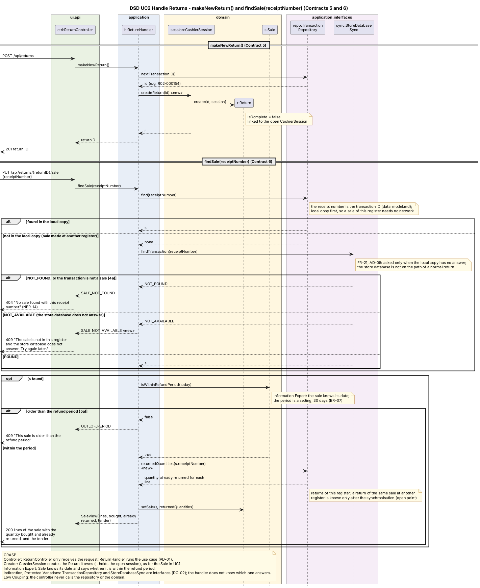

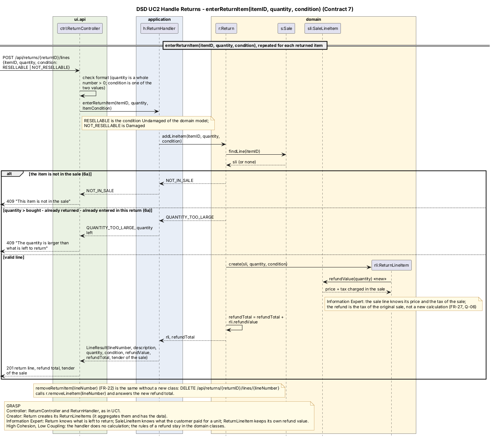

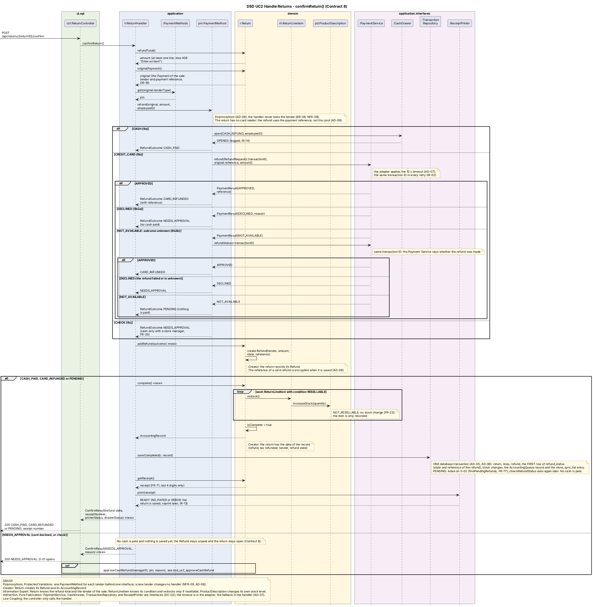

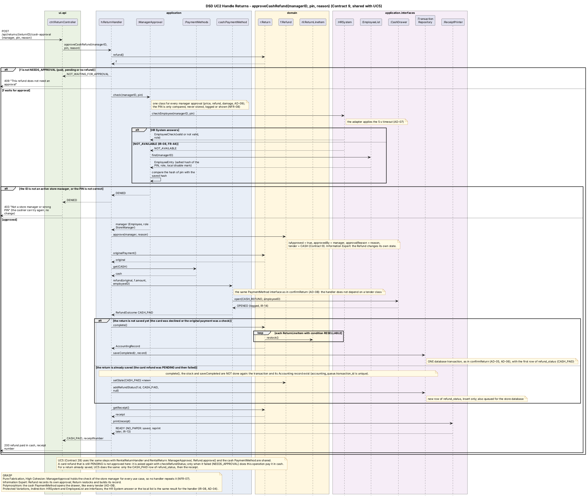

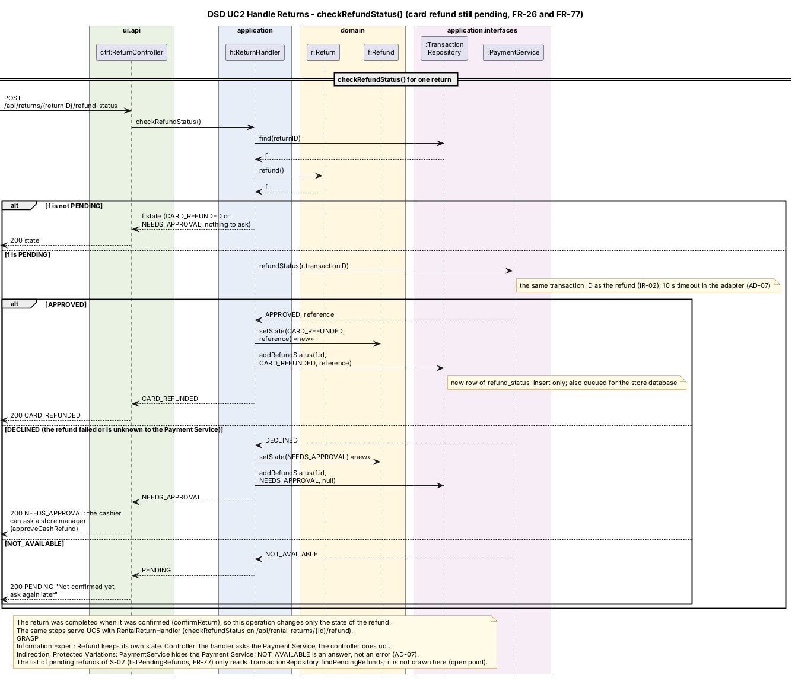

Each diagram has the GRASP patterns used in its own note. Messages marked `<<new>>` are not in the logical view or in `system_interfaces.md` yet: `CashierSession.createReturn(id)`, `TransactionRepository.returnedQuantities(receiptNumber)`, `SaleLineItem.refundValue(quantity)`, `Return.addRefund(outcome)`, `Return.complete()`, `Refund.setState(...)`, `CashPaymentMethod.payOut(amount, employeeID)` and the answer `SALE_NOT_AVAILABLE` of `findSale`. They are sent to Borja (design class diagram) and to Alfonso (`system_interfaces.md`).

### 2.3 UC3 Process Rental (contracts 10–15) – Avni

| Diagram | Operations | Contract | Main design choices |
| --- | --- | --- | --- |
| [`dsd_uc3_start_rental`](../../assets/dsd_uc3_start_rental.puml) | `makeNewRental()`, `enterCustomerID(customerID)`, `registerCustomer()` | 10, 11, 12 | `TransactionRepository` gives the rental ID and the customer ID (register ID + counter, SRS §5.3 Q5); `CashierSession` creates the `Rental`; each open `Rental` of the customer answers whether it has an overdue line (BR-12), on this register and, when reachable, at the other registers through `StoreDatabaseSync`; a new `Customer` is created by the `Rental` and saved with it, with no personal data (DR-18) |
| [`dsd_uc3_enter_item`](../../assets/dsd_uc3_enter_item.puml) | `enterRentalItem(serialNumber)`, `selectRentalPeriod(days)` | 13, 14 | `Item` knows its status (BR-11); a hold in the store database stops two registers renting the same item (`putHold`, AD-05, Q6), and without the store database the rental goes on from the local copy; `RentalLineItem` calculates its fee and due date for 1, 3 or 7 days (BR-15) |
| [`dsd_uc3_end_rental`](../../assets/dsd_uc3_end_rental.puml) | `endRental()`, `cancelRental()` | 15 | Tax only on the rental fee, not on the deposit (BR-10); after the 5 s timeout the handler applies the default tax rate and *tax to be corrected* (IR-05, AD-07), as in UC1; cancel removes the holds and saves nothing (FR-36) |
| [`dsd_uc3_pay_rental`](../../assets/dsd_uc3_pay_rental.puml) | `makePayment(amount, tenderType)` for a rental | 4 | The same `PaymentMethods` and steps as `dsd_uc1_makePayment` (AD-08); the total includes the deposit; approved: the items become *Rented*, one `saveCompleted` with the rental, the new customer, the Accounting record and the sync entry, which removes the hold in the store database (AD-05, AD-06); the rental receipt shows the customer ID as text and as a barcode (FR-39) |

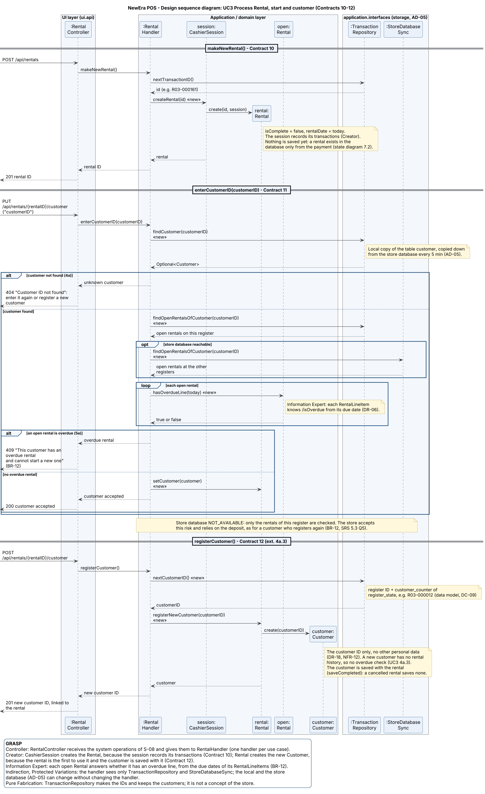

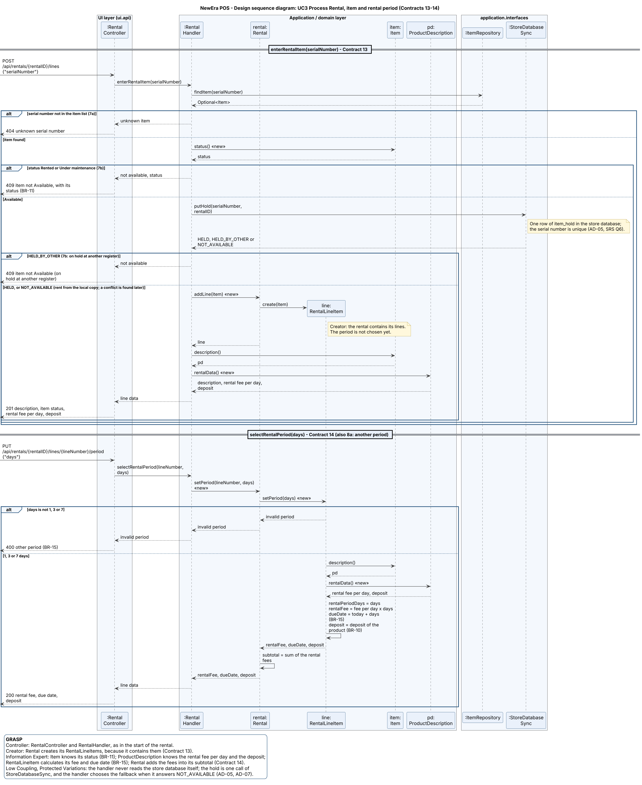

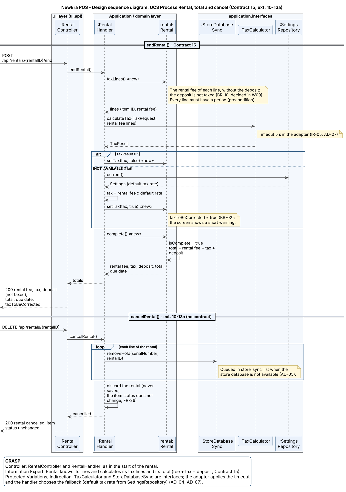

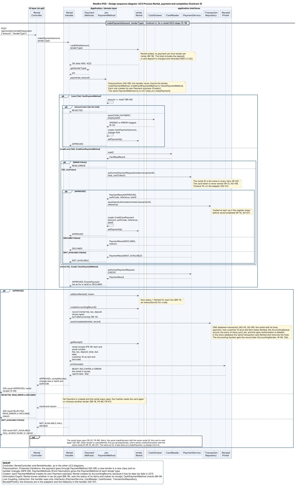

GRASP patterns: Controller (`RentalController`, `RentalHandler`), Creator (`CashierSession` creates the `Rental`; the `Rental` creates its `RentalLineItem`s, the new `Customer` and its `AccountingRecord`; each `PaymentMethod` creates its `Payment`), Information Expert (`Item` for its status, `ProductDescription` for the fee and the deposit, `RentalLineItem` for the fee, due date and overdue check, `Rental` for its total), Polymorphism (`PaymentMethod`), Pure Fabrication (`TransactionRepository`, `PaymentMethods`), Indirection, Low Coupling and Protected Variations (repositories, `StoreDatabaseSync`, `TaxCalculator`, devices). The justification is in the legend under each diagram.

Methods marked «new» in the diagrams are not yet in the logical view or system_interfaces.md (sent to Borja for the design class diagram, §3): `Rental.addLine`, `setPeriod`, `setCustomer`, `registerNewCustomer`, `hasOverdueLine`, `taxLines`, `setTax`, `complete`, `setItemsRented`; `CashierSession.createRental`; `RentalLineItem.setPeriod`; `Item.isAvailable`; `ProductDescription.rentalData`; `TransactionRepository.findCustomer`, `nextCustomerID` and `findOpenRentalsOfCustomer` (the last one also in UC5).

### 2.4 UC4 Start Up, close session and session review (contracts 16–21, 29) – Josué

The design sequence diagrams of UC4 start at the controller of `ui.api` and end at the adapters and the repositories. Each one gives the postconditions of its contract (16 to 21 and 29). The names are those of the logical view, the domain model and system_interfaces.md §3 and §4.

| Diagram | Operations | Contracts |
| --- | --- | --- |
| 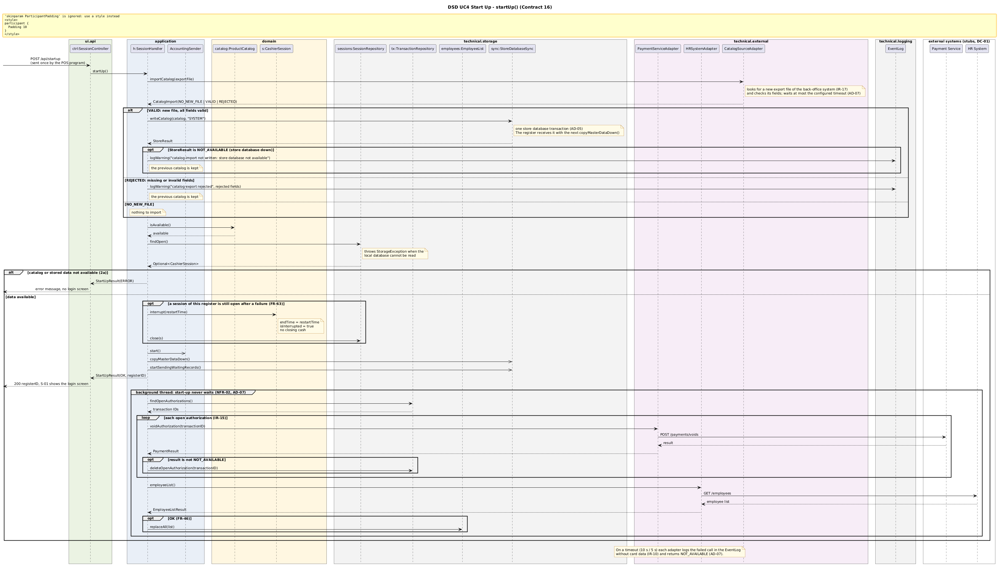 `dsd_uc4_startUp` | `startUp()` | 16 |
|  `dsd_uc4_logIn` | `logIn(employeeID, pin)` | 17 |
|  `dsd_uc4_enterOpeningCash` | `enterOpeningCash(amount)` | 18 |
| 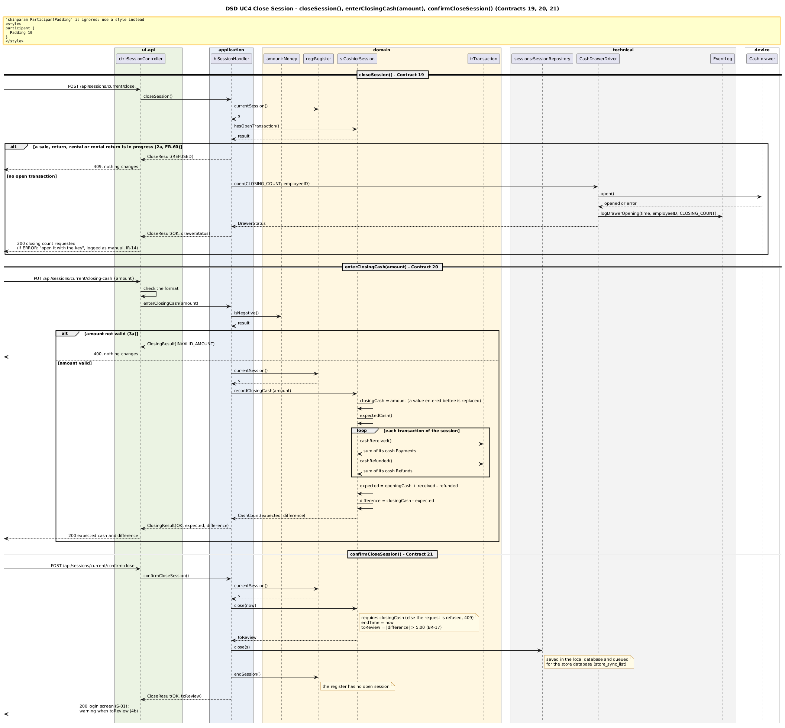 `dsd_uc4_closeSession` | `closeSession()`, `enterClosingCash(amount)`, `confirmCloseSession()` | 19, 20, 21 |
|  `dsd_uc4_confirmSessionReview` | `confirmSessionReview(sessionID, managerID, pin, reason)` | 29 |

GRASP patterns: Controller (`SessionHandler`, `ManagerHandler`), Creator (`Register` creates `CashierSession`), Information Expert (`CashierSession`, `EmployeeEntry`, `Transaction`), Low Coupling and Indirection (repositories, adapters, `StoreDatabaseSync`), Polymorphism (cash of each tender), Protected Variations (`NOT_AVAILABLE` in the interfaces) and Pure Fabrication (`ManagerApproval`, `AccountingSender`). The justification is under each diagram.

### 2.5 UC5 Return Rental (contracts 22–28) – Haifa

| Diagram | Operations | Contract | Main design choices |
| --- | --- | --- | --- |
| [`dsd_uc5_find_rental`](../../assets/dsd_uc5_find_rental.puml) | `makeNewRentalReturn()`, `findRental(code)`, `findRentalsOfCustomer(customerID)`, `selectRental(rentalID)` | 22–25 | `TransactionRepository` gives the transaction ID (AD-05); `CashierSession` creates the `RentalReturn`; the code is a rental receipt number or a serial number; a rental of another register is found through `StoreDatabaseSync` (AD-05); the `Rental` gives its open line (one line item per rental return); with the customer ID (ext. 5b) the open rentals of this register and, when reachable, of the other registers are listed, as in UC3 |
| [`dsd_uc5_record_condition`](../../assets/dsd_uc5_record_condition.puml) | `recordCondition(condition, damageNote)`, `confirmDamage(managerID, pin)` | 26, 27 | `RentalReturn` calculates the days late, the late fee (BR-16), the refund and the amount still due (BR-10, ext. 7b); tax on the late fee through `TaxCalculator`, after the 5 s timeout the default tax rate and *tax to be corrected* (IR-05, AD-07), as in UC1; a damaged item needs a store manager: `ManagerApproval.check` as in UC4, with the local employee list when the HR System is not available (IR-09); the deposit is kept and the refund is 0 (FR-52) |
| [`dsd_uc5_confirm_rental_return`](../../assets/dsd_uc5_confirm_rental_return.puml) | `confirmRentalReturn()`, `approveCashRefund(managerID, pin, reason)` | 28, 9 | The refund goes through the `PaymentMethod` of the tender of the rental (BR-08, AD-08), as the payment in UC1 and UC3; cash opens the drawer (IR-14); a card refund that gets no answer asks the refund status with the same transaction ID and stays PENDING, with no cash paid (AD-07, FR-77); declined card or check: NEEDS_APPROVAL and `approveCashRefund` of UC2 (Contract 9); one `saveCompleted` with the rental return, the refund, the item status, the Accounting record and the sync entry (AD-05, AD-06); with PENDING the rental is *Closed, refund pending* (state diagram 7.2) |

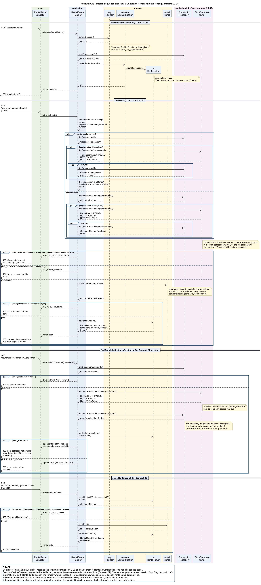

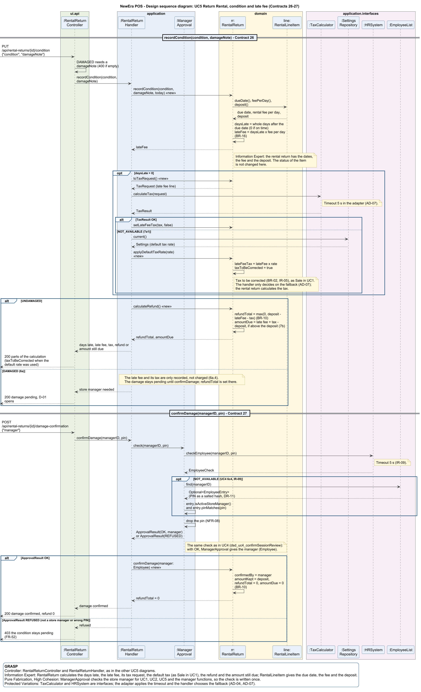

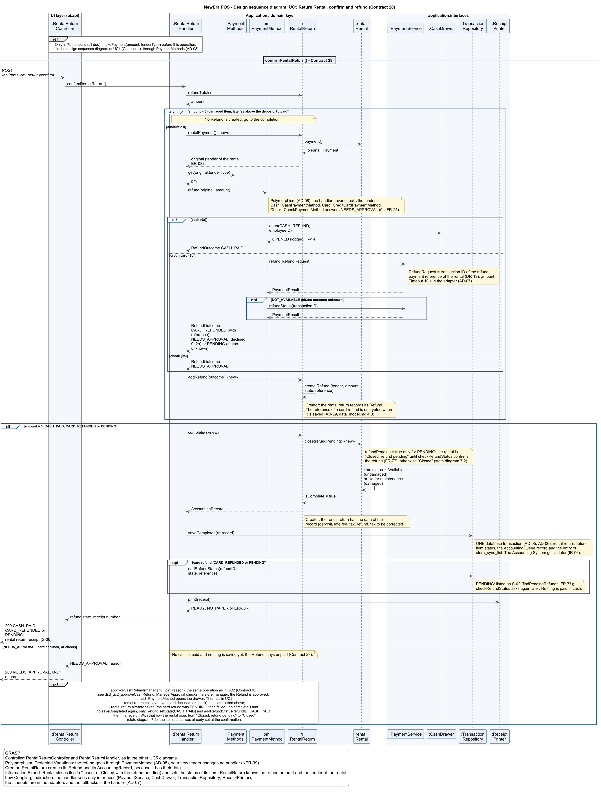

GRASP patterns: Controller (`RentalReturnController`, `RentalReturnHandler`), Creator (`CashierSession` creates the `RentalReturn`; the `RentalReturn` creates its `Refund` and its `AccountingRecord`), Information Expert (`Rental` for its open line and for closing itself and setting the item status, `RentalLineItem` for the due date, the fee and the deposit, `RentalReturn` for the late fee, the refund and the tender of the rental), Polymorphism (`PaymentMethod`), Pure Fabrication and High Cohesion (`ManagerApproval`, `PaymentMethods`, `TransactionRepository`), Indirection, Low Coupling and Protected Variations (repositories, `StoreDatabaseSync`, `TaxCalculator`, `HRSystem`, `PaymentService`, devices). The justification is in the legend under each diagram.

Methods marked «new» in the diagrams are not yet in the logical view or system_interfaces.md (sent to Borja for the design class diagram, §3): `CashierSession.createRentalReturn`; `RentalReturn.openRentalOfCustomer`, `recordCondition`, `setLateFeeTax`, `calculateRefund`, `confirmDamage`, `rentalPayment`, `addRefund`, `complete`; `Rental.close(refundPending)`; `TransactionRepository.findOpenRentalOfItem` and `StoreDatabaseSync.findOpenRentalOfItem`; `findOpenRentalsOfCustomer` as in UC3.

## 3. Design class diagram – Borja

One diagram per layer, with attributes, methods, visibility and navigability. The skeletons (names only) are in `assets/`; the methods come from the design sequence diagrams of §2.

| Layer | Diagram |
| --- | --- |
| Controllers and application | [`design_classes_application`](../../assets/design_classes_application.puml) |
| Domain | [`design_classes_domain`](../../assets/design_classes_domain.puml) |
| Interfaces and technical services: external systems, devices and log | [`design_classes_technical`](../../assets/design_classes_technical.puml) |
| Interfaces and technical services: repositories, accounting queue and store database | [`design_classes_storage`](../../assets/design_classes_storage.puml) |
| UI screens | [`ui_classes`](../../assets/ui_classes.puml) (ui_design.md §4) |

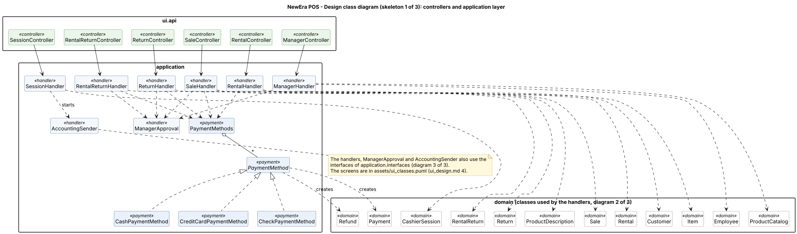

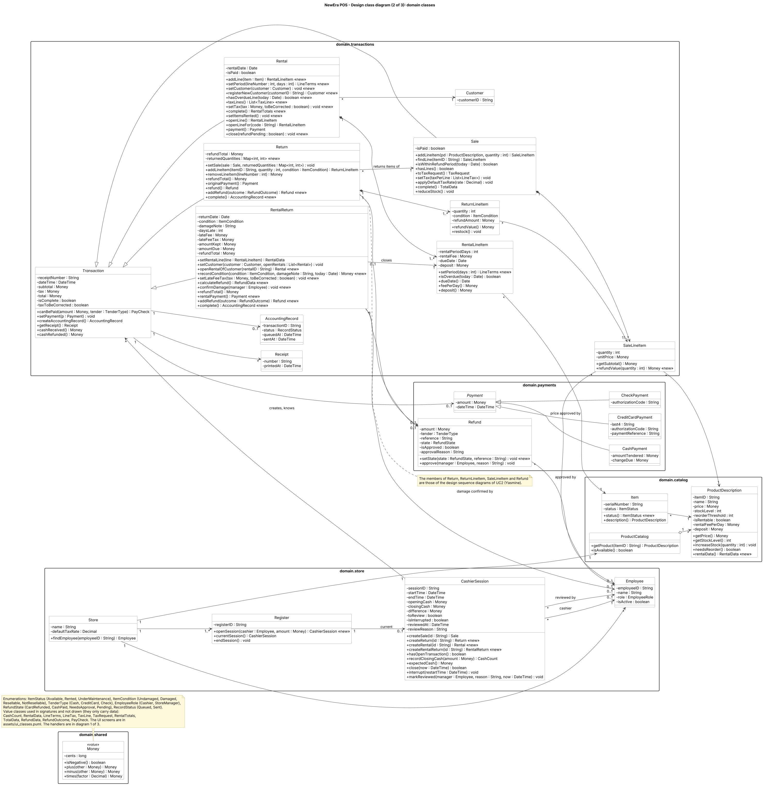

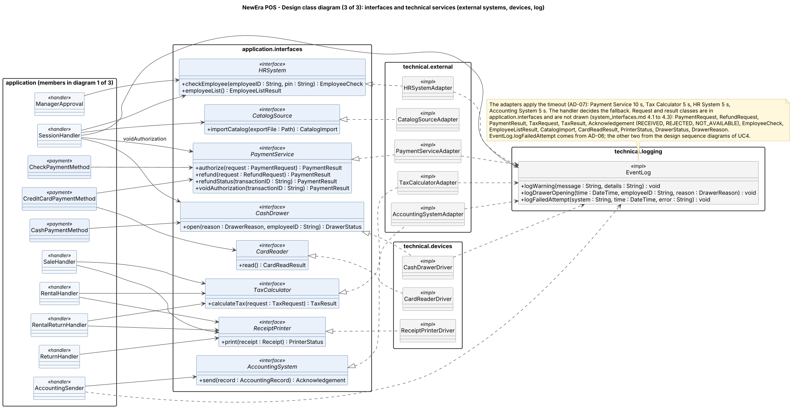

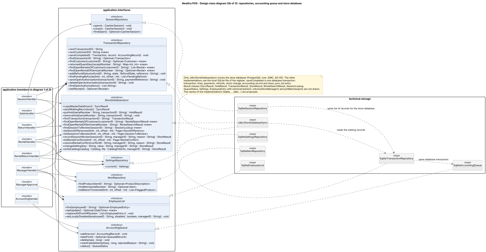

The attributes are those of the [domain model](domain_model.md) v0.8 and the methods come from the design sequence diagrams of §2 (UC1, UC3, UC4 and UC5). The methods of `Return`, `ReturnLineItem` and `ReturnHandler` come from the operation contracts 5 to 9 and are confirmed when the design sequence diagrams of UC2 are pushed. Visibility: `-` private, `+` public; getters and setters are not drawn. Methods marked «new» are used by a design sequence diagram and were not in the logical view or in system_interfaces.md v0.5. Every «new» method of the messages of Avni (UC3) and Josué (UC4) is in the diagrams, as is `Register.openSession` and `SessionHandler.pendingCashier`. A new class is `Money` (package `domain.shared`), which carries the amount in cents (data model §6).

**Points that the owners of the diagrams confirm** (the diagrams use the first name):

| Point | Where | Proposal |
| --- | --- | --- |
| `Item.isAvailable()` returns the status, not a boolean | UC3 (Avni) | Keep the name and return `ItemStatus`, or call it `status()`; the diagram has the first |
| `selectRentalPeriod(lineNumber, days)` has the line number | UC3 (Avni), system_interfaces.md §3.4 has only `days` | The line number is in the URL of the request; Alfonso adds it to §3.4 |
| `SessionRepository.open(s)` and `close(s)` take the session, because `Register` creates it | UC4 (Josué), system_interfaces.md §4.2 has the other parameters | The diagram follows the DSD; Alfonso updates §4.2 |
| `StoreDatabaseSync.startSendingWaitingRecords()` | UC4 `startUp` (Josué) | The job is `sendWaitingRecordsUp()` started by `SessionHandler`; the DSD uses the interface name |
| `SessionRepository` calls `StoreDatabaseSync.addToStoreSyncList(s)` | UC4 `enterOpeningCash` (Josué) | `store_sync_list` is a local table written by the repository (AD-05); `StoreDatabaseSync` only reads it, so there is no such method |
| `getSystemStatus()` and `listPendingRefunds()` are in `SessionHandler` | S-02 menu (ui_design.md) | Confirm, or move them to another handler |
| `ProductCatalog.getProduct` (UC1) and `ItemRepository.findProduct` | UC1 (Alfonso) | `ProductCatalog` reads the products through `ItemRepository`; not drawn |

*Open: the design sequence diagrams of UC2 (Yasmine).*

## 4. Activity diagrams – Yasmine

*To do (W11):* card refund of UC2 and UC5 (system_interfaces.md §3.7), and the background jobs (`AccountingSender`, synchronisation with the store database).

## 5. State diagrams – Borja

The state diagrams are in the [domain model](domain_model.md) §7:

| Object | Diagram |
| --- | --- |
| Item status | [`state_item_status`](../../assets/state_item_status.puml) (§7.1) |
| Rental | [`state_rental`](../../assets/state_rental.puml) (§7.2) |
| Cashier session | [`state_cashier_session`](../../assets/state_cashier_session.puml) (§7.3) |
| Card refund | [`state_card_refund`](../../assets/state_card_refund.puml) (§7.4) |

## 6. Traceability

| Use case | Contracts | Design sequence diagrams | Main classes |
| --- | --- | --- | --- |
| UC1 Process Sale | 1–4 | §2.1 | `SaleController`, `SaleHandler`, `Sale`, `SaleLineItem`, `ProductCatalog`, `PaymentMethods` |
| UC2 Handle Returns | 5–9 | §2.2 | `ReturnController`, `ReturnHandler`, `Return`, `ReturnLineItem`, `Refund` |
| UC3 Process Rental | 10–15 | §2.3 | `RentalController`, `RentalHandler`, `Rental`, `RentalLineItem`, `Item`, `Customer` |
| UC4 Start Up | 16–21, 29 | §2.4 | `SessionController`, `SessionHandler`, `CashierSession`, `Register`, `Employee` |
| UC5 Return Rental | 22–28 | §2.5 | `RentalReturnController`, `RentalReturnHandler`, `RentalReturn`, `Refund` |

## 7. Open points

None at the moment.
