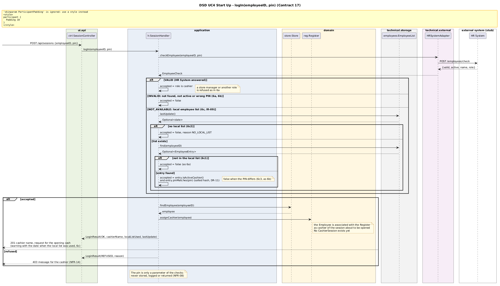
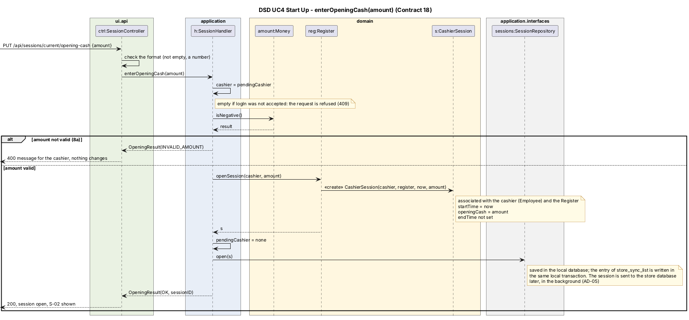
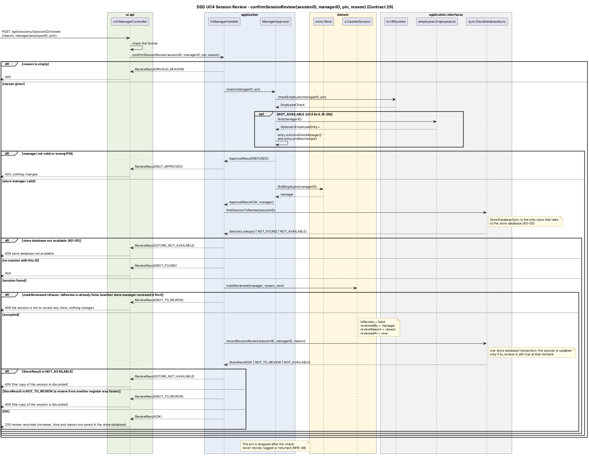

## 6. UC4 Start Up, close session and session review (Josué, A4)

The design sequence diagrams of UC4 start at the controller of `ui.api` and end at the adapters and the repositories. Each one gives the postconditions of its contract (16 to 21 and 29). The names are those of the logical view, the domain model and system_interfaces.md §3 and §4.

| Diagram | Operations | Contracts |
| --- | --- | --- |
|  `dsd_uc4_startUp` | `startUp()` | 16 |
|  `dsd_uc4_logIn` | `logIn(employeeID, pin)` | 17 |
|  `dsd_uc4_enterOpeningCash` | `enterOpeningCash(amount)` | 18 |
|  `dsd_uc4_closeSession` | `closeSession()`, `enterClosingCash(amount)`, `confirmCloseSession()` | 19, 20, 21 |
|  `dsd_uc4_confirmSessionReview` | `confirmSessionReview(sessionID, managerID, pin, reason)` | 29 |

GRASP patterns: Controller (`SessionHandler`, `ManagerHandler`), Creator (`Register` creates `CashierSession`), Information Expert (`CashierSession`, `EmployeeEntry`, `Transaction`), Low Coupling and Indirection (repositories, adapters, `StoreDatabaseSync`), Polymorphism (cash of each tender), Protected Variations (`NOT_AVAILABLE` in the interfaces) and Pure Fabrication (`ManagerApproval`, `AccountingSender`). The justification is under each diagram.