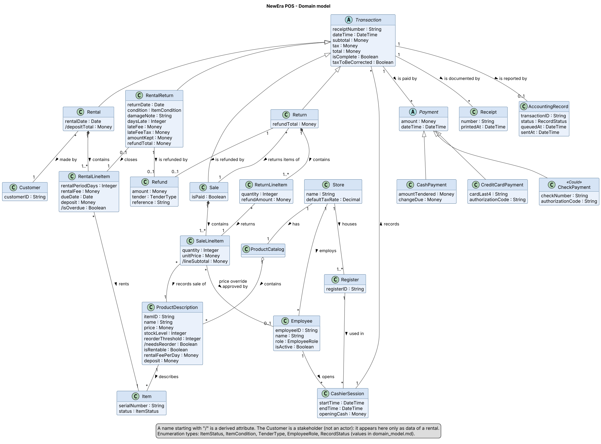

# Domain Model – NewEra POS

| | |
| --- | --- |
| **Maintainer** | Borja Nicolás |
| **Version** | 0.1 (draft for review) |
| **Last updated** | W07 |
| **Part of** | Increment 2 (Design), input to the SRS section 3.5, the [system sequence diagram](system_sequence_diagrams.md) and the [operation contracts](operation_contracts.md) |

## 1. Purpose

The domain model shows the **concepts of the store's world** that NewEra POS must know about, their attributes and how they are related. It is a conceptual model: it describes things of the domain (a sale, a product description, a rental), not software classes, and it has no operations. It is drawn from the [fully dressed use cases](../requirements/SRS.md) UC1–UC5, the [glossary](../requirements/glossary.md) and the business rules BR-01 to BR-14, and it will be the starting point of the design class diagram in W11.

Names follow the glossary. The names used in the [operation contracts](operation_contracts.md) of UC1 (Sale, SaleLineItem, ProductDescription, CashierSession, Payment, AccountingRecord and their attributes) are kept exactly, so that the contracts do not need to change.

## 2. Diagram

*Editable source: [`assets/domain_model.puml`](../../assets/domain_model.puml) (PlantUML). A name starting with `/` is a derived attribute.*

## 3. Concepts

| Concept | Meaning | Main attributes | Source |
| --- | --- | --- | --- |
| **Store** | The store that owns the registers, the catalog and the employees. | `name`, `defaultTaxRate` | BR-02 |
| **Register** | A physical POS terminal. | `registerID` | UC4 |
| **Employee** | A person of the HR System. The role decides what he or she may do. A cashier and a store manager are employees with a different `role`. | `employeeID`, `name`, `role`, `isActive` | UC4, BR-04, BR-13 |
| **CashierSession** | Period in which one employee works at one register; every transaction belongs to a session. | `startTime`, `endTime`, `openingCash` | UC4, BR-13 |
| **ProductCatalog** | All product descriptions of the store. | – | glossary |
| **ProductDescription** | A product type: what the scanned item identifier refers to. It holds the stock level; a rentable product also has its fee per day and deposit. | `itemID`, `name`, `price`, `stockLevel`, `reorderThreshold`, `/needsReorder`, `isRentable`, `rentalFeePerDay`, `deposit` | UC1, BR-03, BR-09, UC3 |
| **Item** | One physical unit of a rentable product, identified by its serial number. Items that are only sold are not modelled one by one: they are counted by `stockLevel`. | `serialNumber`, `status` | UC3, BR-11 |
| **Customer** | Person who rents (stakeholder, not an actor). Only the data needed to find open and overdue rentals is kept. | `customerID` | UC3, UC5, BR-12 |
| **Transaction** (abstract) | General term for a sale, return, rental or rental return. | `receiptNumber`, `dateTime`, `subtotal`, `tax`, `total`, `isComplete`, `taxToBeCorrected` | glossary, BR-01, BR-02 |
| **Sale** | The customer buys items (UC1). | `isPaid` | UC1 |
| **SaleLineItem** | One line of a sale. The price is copied from the product description when the item is entered, so a later price change does not change a completed sale. | `quantity`, `unitPrice`, `/lineSubtotal` | BR-03, BR-04 |
| **Return** | The customer brings back items of an earlier sale (UC2). | `refundTotal` | UC2, BR-07, BR-08 |
| **ReturnLineItem** | One returned line of the original sale. | `quantity`, `refundAmount` | UC2 |
| **Rental** | The customer takes one or more items for a period (UC3). | `rentalDate`, `/depositTotal` | UC3, BR-10 |
| **RentalLineItem** | One rented item with its period, fee, due date and deposit. | `rentalPeriodDays`, `rentalFee`, `dueDate`, `deposit`, `/isOverdue` | UC3, BR-12 |
| **RentalReturn** | The item of one rental line comes back (UC5), with its condition, the late fee and the amount kept from the deposit. | `returnDate`, `condition`, `damageNote`, `daysLate`, `lateFee`, `lateFeeTax`, `amountKept`, `refundTotal` | UC5, BR-10, BR-11 |
| **Payment** (abstract) | Money received in one tender: **CashPayment** (`amountTendered`, `changeDue`, BR-06), **CreditCardPayment** (last 4 digits and authorization code, BR-05) and **CheckPayment** (*Could*, authorized by the Payment Service). | `amount`, `dateTime` | UC1, UC3, BR-05, BR-06 |
| **Refund** | Money paid back for a return or a rental return, in the tender of the original payment. | `amount`, `tender`, `reference` | BR-08, UC5 |
| **Receipt** | Printed record of a transaction; it can be printed again. | `number`, `printedAt` | FR-16, FR-17 |
| **AccountingRecord** | The record of a completed transaction sent, or queued to be sent, to the Accounting System. The transaction ID lets the Accounting System ignore a record that arrives twice. | `transactionID`, `status`, `queuedAt`, `sentAt` | BR-14, IR-06, IR-07 |

**Enumeration types** (not drawn): `ItemStatus` = Available, Rented, UnderMaintenance, Reserved; `ItemCondition` = Undamaged, Damaged; `TenderType` = Cash, CreditCard, Check; `EmployeeRole` = Cashier, StoreManager; `RecordStatus` = Queued, Sent.

The four external systems (Payment Service, Tax Calculator, Accounting System, HR System) are actors and are **not** part of the domain model. Their data appears here only as attributes (`authorizationCode`, `tax`, `AccountingRecord`, `Employee`).

## 4. Associations and multiplicities

| Association | Multiplicity | Why |
| --- | --- | --- |
| Store – Register | 1 – 1..* | A store has one or more registers. |
| Store – ProductCatalog, Store – Employee | 1 – 1, 1 – * | One catalog; the store employs many people. |
| Register – CashierSession | 1 – * | A register has many sessions, one after the other (UC4 precondition: only one open at a time). |
| Employee – CashierSession | 1 – * | A session belongs to exactly one cashier (BR-13). |
| CashierSession – Transaction | 1 – * | Every transaction is made inside one session (FR-01, FR-30, FR-50). |
| ProductCatalog – ProductDescription | 1 – * | The catalog contains the descriptions. |
| ProductDescription – Item | 1 – * | Many units (serial numbers) share one description. |
| Sale – SaleLineItem | 1 – 1..* | A sale has at least one line (contract of endSale). |
| SaleLineItem – ProductDescription | * – 1 | Each line records the sale of one product. |
| SaleLineItem – Employee | * – 0..1 | The store manager who approved a price override (BR-04, FR-06). |
| Return – Sale | * – 1 | A return refers to the original sale (BR-07). |
| Return – ReturnLineItem – SaleLineItem | 1 – 1..*, * – 1 | Each returned line refers to a line of the original sale. |
| Rental – Customer | * – 1 | Needed to find overdue rentals (BR-12). |
| Rental – RentalLineItem | 1 – 1..* | See open question 3. |
| RentalLineItem – Item | * – 1 | An item can be rented many times, one after the other (BR-11). |
| RentalReturn – RentalLineItem | 0..1 – 1 | A rented line is closed by at most one return. |
| Transaction – Payment | 1 – * | Normally one payment; more than one if split tenders are allowed (SRS, UC1 open issue). A return has none. |
| Return / RentalReturn – Refund | 1 – 0..1 | Not every rental return has a refund (damaged item). |
| Transaction – Receipt | 1 – * | One receipt, reprints possible (FR-17). |
| Transaction – AccountingRecord | 1 – 0..1 | Created when the transaction is completed (BR-14). |

## 5. Alignment with the operation contracts and the SRS

- **Contracts of UC1** (Josué): every class and attribute they use exists with the same name: `Sale.isComplete`, `subtotal`, `tax`, `total` (inherited from `Transaction`), `Sale.isPaid`, `SaleLineItem.quantity`, `Payment.amount`, `ProductDescription.stockLevel`. `makePayment(amount, tenderType)` creates a `CashPayment`, `CreditCardPayment` or `CheckPayment` according to the tender type; I propose the contract uses `TenderType` instead of `String`.
- **SRS**: the glossary terms *customer ID*, *item list*, *rental receipt* and *item condition* are missing (see review of the SRS); here they are `Customer.customerID`, the set of `Item`, `Receipt` of a rental and `RentalReturn.condition`. The SRS section 3.5 is derived from this model.

## 6. Decisions and open questions

1. **Transaction as a generalization.** Sale, Return, Rental and RentalReturn share the same attributes (date, totals, session, payments, receipt, accounting record), so they are subclasses of the abstract `Transaction`, the term the glossary already uses.
2. **Items are modelled only when they are rented.** A sold product is only a stock level; a rentable unit needs an identity because it has a status (BR-11). Whether rented items count in the stock level for BR-09 is still open (glossary, open question 5).
3. **Several items per rental?** I use 1..* rental line items (as the NextGen case does). The SRS lists it as open; if the answer is "one item", the multiplicity changes to 1.
4. **Customer data.** Only `customerID` is shown. How customers are registered and which personal data is stored (NFR-12, data protection) is open (UC3 open issue).
5. **Late fee and deposit.** The attributes `lateFee`, `lateFeeTax` and `amountKept` of `RentalReturn` follow the working assumptions of UC5 (late fee taxed, deposit not taxed); they change if the team decides otherwise.
6. **Split tenders.** If a sale cannot be paid with more than one tender, the multiplicity Sale–Payment becomes 1 – 1.
7. **Opening cash and logout.** `endTime` of the session is filled only if the team adds a way to end the session (see the review of the SRS: no function ends a cashier session).
