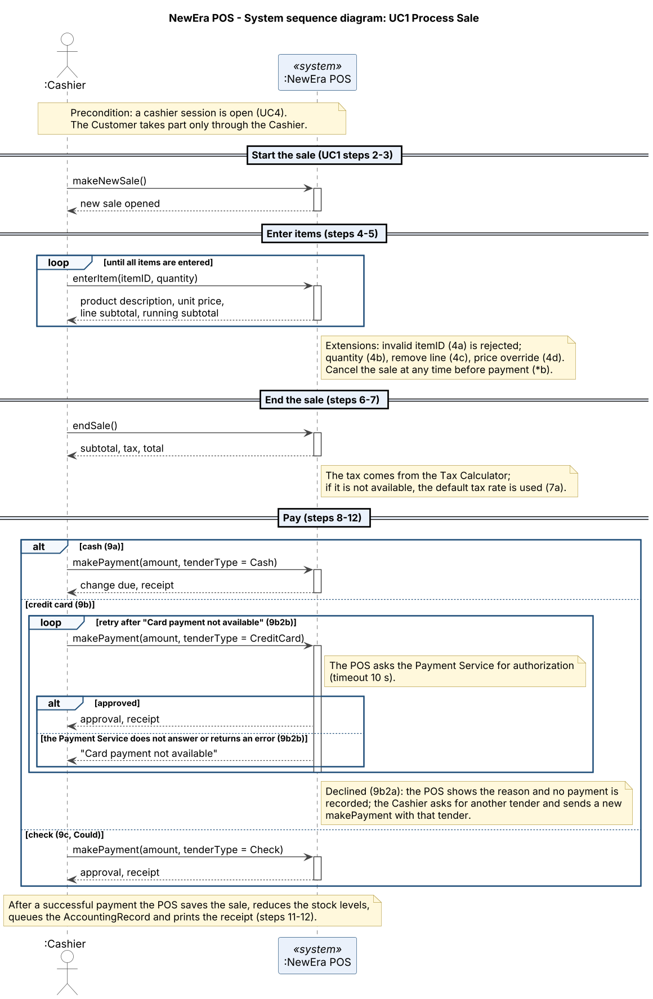
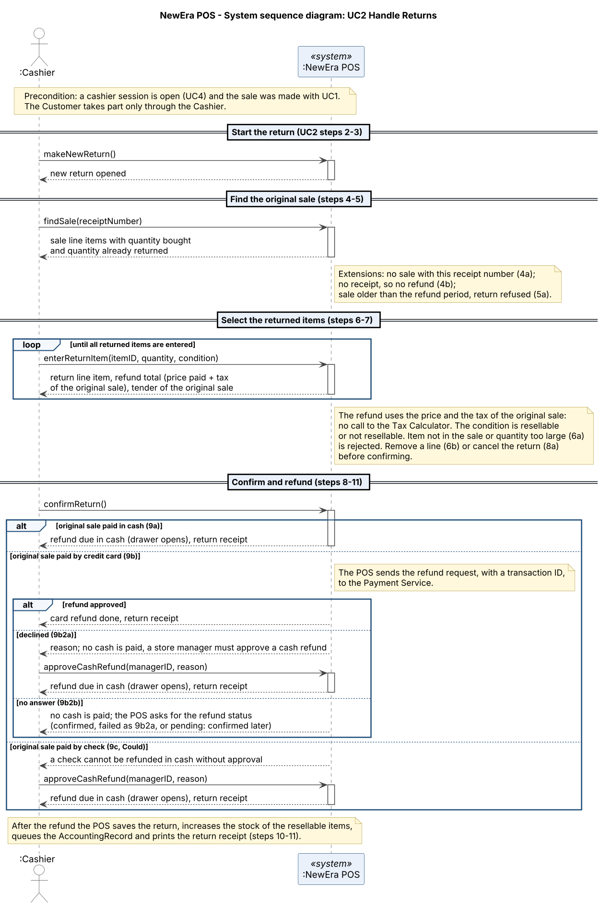
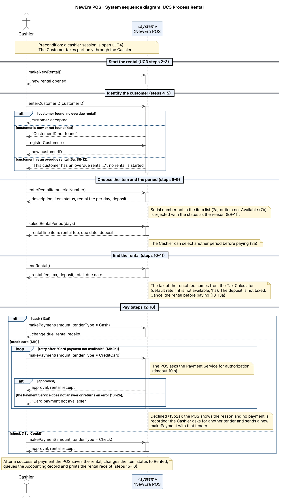
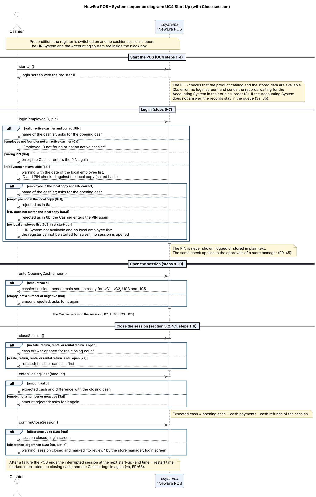
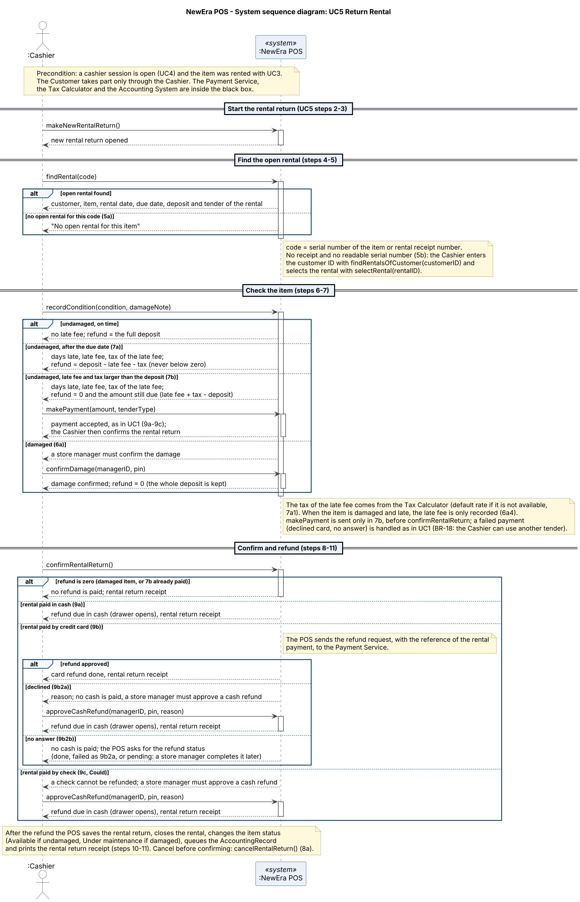

# System Sequence Diagrams – NewEra POS

| | |
| --- | --- |
| **Maintainer** | Borja Nicolás |
| **Version** | 0.8 (draft for review; review #54: outcomes of 6c, 3a, 7b and rental return in `closeSession`) |
| **Last updated** | W09 |
| **Part of** | Increment 2 (Design); input to the [operation contracts](operation_contracts.md) |

## 1. Purpose

A system sequence diagram (SSD) shows, for one use case scenario, the events that the actor sends to the system and the answers of the system, with the system treated as a **black box**. Each event is a **system operation**; the [operation contracts](operation_contracts.md) then describe what each operation changes in the [domain model](domain_model.md). The SSDs are drawn from the fully dressed use cases of the [SRS](../requirements/SRS.md). This version contains the SSDs of all five use cases: UC1 (W07), UC2 and UC3 (W08), and UC4 and UC5 (W09). The state diagrams of the item and of the rental, which explain the status changes shown here, are in the [domain model](domain_model.md), section 7.

## 2. UC1 Process Sale

*Editable source: [`assets/ssd_uc1.puml`](../../assets/ssd_uc1.puml) (PlantUML).*

The diagram shows the **main success scenario** (UC1 steps 1–13), the three payment variants of step 9 and the retry of the card payment when the Payment Service does not answer (extension 9b2b). The only actor is the Cashier: the Customer is a stakeholder who acts through the Cashier (SRS, section 1.3.1). The external systems (Payment Service, Tax Calculator, Accounting System) are not drawn, because they are inside the black box from the point of view of the Cashier; a note shows where they are used.

### 2.1 System operations

| Operation | UC1 steps | Returns to the Cashier | Contract |
| --- | --- | --- | --- |
| `makeNewSale()` | 2–3 | Confirmation that a new sale is open | Contract 1 |
| `enterItem(itemID, quantity)` | 4–5 (repeated) | Product description, unit price, line subtotal and running subtotal | Contract 2 |
| `endSale()` | 6–7 | Subtotal, tax and total | Contract 3 |
| `makePayment(amount, tenderType)` | 9–12 | Cash: change due. Credit card or check: approval. In all cases the receipt | Contract 4 |

The names and parameters are those of the contracts. The only difference is the type of `tenderType`: the diagram uses the values `Cash`, `CreditCard` and `Check` (the `TenderType` of the domain model) instead of a free `String`.

### 2.2 What is not in the diagram

The extensions of UC1 that are not part of the main scenario are mentioned in the notes of the diagram but have no system operation of their own yet and no contract. They are candidates for the next iteration:

| Extension | Possible operation |
| --- | --- |
| 4c Remove a line item | `removeItem(lineNumber)` |
| 6a Complete a sale with no line items | none (the System refuses `endSale()`; see the precondition of Contract 3) |
| 4d Price override by the store manager | `overridePrice(lineNumber, newPrice, managerID)` |
| \*b Cancel the sale at any time before payment | `cancelSale()` |
| 12a Reprint the receipt (FR-17) | `reprintReceipt()` |

### 2.3 Open points

1. **Payment declined (9b2a).** The Cashier asks for another tender and sends a new `makePayment` with it (note in the diagram). The retry of the same card payment after "Card payment not available" (9b2b) is the loop in the card variant.
2. **One tender per sale (decided in W09).** BR-18: a sale or a rental is paid with one tender, so `makePayment` is called once per successful payment. A customer who cannot pay the whole total with one tender uses another one (for example after a declined card, 9b2a), and the diagram needs no loop around the payment section.
3. **Tax Calculator failure (7a).** The contract of `endSale()` assumes the tax is the value returned by the Tax Calculator; the default tax rate and the flag *tax to be corrected* are not in the contract.

## 3. UC2 Handle Returns

*Editable source: [`assets/ssd_uc2.puml`](../../assets/ssd_uc2.puml) (PlantUML).*

The diagram shows the **main success scenario** (UC2 steps 1–12) and the refund variants of step 9, which depend on the tender of the original sale (BR-08). As in UC1, the Cashier is the only actor and the external systems are inside the black box. Version 0.4 follows the UC2 of the SRS after the review changes: the refund is the price paid plus the tax charged in the original sale, so the **Tax Calculator is not used** (#37); the Cashier records the **condition** of each returned item (#28); and a cash refund that replaces a declined card refund or a check refund needs the approval of a **store manager** (#50).

### 3.1 System operations

| Operation | UC2 steps | Returns to the Cashier | Contract |
| --- | --- | --- | --- |
| `makeNewReturn()` | 2–3 | Confirmation that a new return is open | Contract 5 |
| `findSale(receiptNumber)` | 4–5 | The sale line items with the quantity bought and the quantity already returned; refused if the sale is outside the refund period (BR-07) | Contract 6 |
| `enterReturnItem(itemID, quantity, condition)` | 6–7 (repeated) | The return line item, the refund total (price paid plus tax charged in the original sale) and the tender of the original sale | Contract 7 |
| `confirmReturn()` | 8–11 | Cash: refund due and receipt. Credit card: card refund through the Payment Service; if it is declined (9b2a) no cash is paid until a store manager approves it; if there is no answer (9b2b) no cash is paid and the POS asks for the refund status. Check (*Could*): cash only with manager approval. In all cases the return receipt | Contract 8 |
| `approveCashRefund(managerID, pin, reason)` | 9b2a, 9c | The refund due in cash and the return receipt. The approval, the manager and the reason are recorded | Contract 9 |

The tender is not a parameter of `confirmReturn()`: the System takes it from the original sale (BR-08). The store manager identifies himself or herself at the cashier's register, so `approveCashRefund` is sent by the Cashier with the manager's ID and PIN, which the System checks (FR-25, AD-09). The PIN is never shown, logged or stored in plain text (NFR-08).

### 3.2 What is not in the diagram

| Extension | Possible operation |
| --- | --- |
| 6b Remove a returned line item before confirming | `removeReturnItem(lineNumber)` |
| 8a Cancel the return before confirming | `cancelReturn()` |
| 9b2b Ask for the status of a card refund that did not answer | `checkRefundStatus()` (shown as a message of the System in the diagram) |

### 3.3 Open points

1. **`enterReturnItem` and the tax.** The tax is no longer calculated in the return, so no separate `endReturn()` operation is needed.
2. **No receipt (4b).** The SRS has no operation for a return without receipt; if the store manager may approve exceptions (UC2 open issue), a new operation or a parameter is needed.
3. **Card refund when the card is not present** (UC2 open issue) uses the payment reference stored with the sale (DR-19); the card variant of `confirmReturn()` does not change.

## 4. UC3 Process Rental

*Editable source: [`assets/ssd_uc3.puml`](../../assets/ssd_uc3.puml) (PlantUML).*

The diagram shows the **main success scenario** (UC3 steps 1–17), the identification of the customer (steps 4–5 with extensions 4a and 5a) and the three payment variants of step 13, with the retry of the card payment (13b2b).

### 4.1 System operations

| Operation | UC3 steps | Returns to the Cashier | Contract |
| --- | --- | --- | --- |
| `makeNewRental()` | 2–3 | Confirmation that a new rental is open | Contract 10 |
| `enterCustomerID(customerID)` | 4–5 | Customer accepted; or "Customer ID not found" (4a); or the overdue message and no rental (5a, BR-12) | Contract 11 |
| `registerCustomer()` | 4a | A new customer ID (stored with no other personal data, DR-18) | Contract 12 |
| `enterRentalItem(serialNumber)` | 6–7 | Description, item status, rental fee per day and deposit; rejected if the serial number is unknown (7a) or the item is not *Available* (7b, BR-11) | Contract 13 |
| `selectRentalPeriod(days)` | 8–9 | The rental line item: rental fee, due date and deposit (can be repeated, 8a) | Contract 14 |
| `endRental()` | 10–11 | Rental fee, tax of the rental fee, deposit, total and due date | Contract 15 |
| `makePayment(amount, tenderType)` | 13–16 | Cash: change due. Credit card or check: approval. In all cases the rental receipt | Contract 4 (shared with UC1) |

`makePayment` is the **same operation as in UC1**. It applies to the transaction that is open (a sale or a rental): Contract 4 (W08) already says that the `Payment` is associated with the current `Sale` or `Rental` and that after a rental the item status becomes *Rented*.

### 4.2 What is not in the diagram

| Extension | Possible operation |
| --- | --- |
| 10–13a Cancel the rental before paying | `cancelRental()` |

### 4.3 Open points

1. **Several items per rental** (UC3 open issue). The diagram shows one item: if a rental can have several, `enterRentalItem` and `selectRentalPeriod` go in a loop, as `enterItem` in UC1, and the domain model already allows 1..\* rental line items.
2. **Who may register a customer** (UC3 open issue): `registerCustomer()` is a system operation of the Cashier for now.
3. **Card payment of the deposit** (UC3 open issue): if the deposit is only held, the card variant of `makePayment` changes.

## 5. UC4 Start Up (with Close session)

*Editable source: [`assets/ssd_uc4.puml`](../../assets/ssd_uc4.puml) (PlantUML).*

The diagram shows the **main success scenario** of the start-up (UC4 steps 1–10), the results of the login (valid cashier, 6a, 6b and the four outcomes of 6c, when the HR System is not available) and the **close session** function (SRS section 3.2.4.1, FR-60 to FR-63), which is a part of UC4 and not a new use case. The HR System and the Accounting System are inside the black box. Between the opening and the closing of the session the Cashier works with UC1, UC2, UC3 and UC5.

### 5.1 System operations

| Operation | UC4 steps | Returns to the Cashier | Contract |
| --- | --- | --- | --- |
| `startUp()` | 1–4 | The login screen with the register ID; or an error and no login screen if the catalog or the stored data are not available (2a). The waiting records are sent to the Accounting System, or stay in the queue (3a, 3b) | Contract 16 |
| `logIn(employeeID, pin)` | 5–7 | The name of the cashier and the request for the opening cash; or "Employee ID not found or not an active cashier" (6a); or a wrong PIN (6b); or, when the HR System is not available (6c), a warning that the local employee list was used and then one of four results: the login continues as for a valid cashier, the employee is not in the local copy (6c1, as 6a), the PIN does not match the local copy (6c3, as 6b), or there is no local list and the register is not started for sales (6c2) | Contract 17 |
| `enterOpeningCash(amount)` | 8–10 | The cashier session is open and the main screen is shown; or the amount is rejected (8a) | Contract 18 |
| `closeSession()` | close session 1–2 | The cash drawer opens for the closing count; or a refusal because a sale, return, rental or rental return is still open (2a, FR-60) | Contract 19 |
| `enterClosingCash(amount)` | close session 3–4 | The expected cash and the difference with the closing cash; or the amount is rejected (3a, FR-61, FR-62) | Contract 20 |
| `confirmCloseSession()` | close session 5–6 | The session is closed and the login screen is shown; if the difference is larger than 5.00, a warning and the mark "to review" (4b, BR-17, FR-74) | Contract 21 |

`startUp()` is the first event of the whole system: it is sent when the POS program is started, and before it there is no cashier session. The PIN is a parameter of `logIn` only; it is never shown, logged or stored in plain text (NFR-08).

### 5.2 What is not in the diagram

| Item | Possible operation |
| --- | --- |
| Failure of the register (\*a) | none: at the next `startUp()` the System ends the interrupted session (end time = restart time, marked interrupted) and the Cashier logs in again (FR-63) |
| Review of a session by the store manager (FR-75) | `listSessionsToReview()` and `confirmSessionReview(sessionID, managerID, pin, reason)`, sent by the store manager (FR-75 records who reviewed the session and when). They are a later step of ext. 4b (step 2, FR-74, FR-75), after the session is closed, and have no contract yet, like the other candidates in this table |
| Disabling an employee or changing the default tax rate while the HR System is not available (6c4) | functions of the store manager; no system operation yet |

### 5.3 Open points

1. **Login attempts and the role.** The SRS does not say if the login is blocked after several wrong PINs or if a store manager may open a session (UC4 open issues). If it does, `logIn` returns one more result.
2. **Opening cash.** The System only records the amount; whether it is compared with an expected amount is open (UC4 open issues).
3. **Session after a crash.** The SRS decided that the Cashier always logs in again (FR-48), so no operation continues an old session.

## 6. UC5 Return Rental

*Editable source: [`assets/ssd_uc5.puml`](../../assets/ssd_uc5.puml) (PlantUML).*

The diagram shows the **main success scenario** (UC5 steps 1–12), the four results of the condition check (on time, late, late with a fee larger than the deposit, damaged) and the refund variants of step 9, which depend on the tender of the rental. The Payment Service, the Tax Calculator and the Accounting System are inside the black box. The refund variants are the same as in UC2: `approveCashRefund` is the same operation.

### 6.1 System operations

| Operation | UC5 steps | Returns to the Cashier | Contract |
| --- | --- | --- | --- |
| `makeNewRentalReturn()` | 2–3 | Confirmation that a new rental return is open | Contract 22 |
| `findRental(code)` | 4–5 | The customer, the item, the rental date, the due date, the deposit and the tender of the rental; or "No open rental for this item" (5a). `code` is the serial number of the item or the rental receipt number | Contract 23 |
| `findRentalsOfCustomer(customerID)` and `selectRental(rentalID)` | 5b | The open rentals of the customer, and the one the Cashier selects. They replace `findRental` when there is neither a receipt nor a readable serial number | Contracts 24 and 25 |
| `recordCondition(condition, damageNote)` | 6–7 | On time: no late fee and the full deposit as refund. Late: days late, late fee, its tax and the refund (7a). Damaged: the request for a store manager (6a). Late fee and its tax larger than the deposit (7b): refund zero and the amount still due, which the Cashier collects with `makePayment` before `confirmRentalReturn` | Contract 26 |
| `confirmDamage(managerID, pin)` | 6a | The damage is confirmed and the refund is zero (the store keeps the whole deposit). Without this confirmation the item cannot be recorded as damaged (FR-52) | Contract 27 |
| `confirmRentalReturn()` | 8–11 | Refund zero (damaged item, or 7b already paid): no refund and the receipt. Cash: the refund due and the receipt. Credit card: a card refund of the amount that was charged (the deposit is charged and refunded, with no pre-authorization); if it is declined (9b2a) no cash is paid until a store manager approves it; if there is no answer (9b2b) no cash is paid and the POS asks for the refund status. Check (*Could*): cash only with the approval of a store manager. In all cases the rental return receipt | Contract 28 |
| `approveCashRefund(managerID, pin, reason)` | 9b2a, 9c | The refund due in cash and the receipt. **Same operation as in UC2**: it applies to the return or rental return that is open | Contract 9 (shared with UC2) |

`makePayment(amount, tenderType)` is used in UC5 only when the late fee and its tax are larger than the deposit (7b): the refund is zero and the Customer pays the difference as in UC1. It is sent after `recordCondition` and before `confirmRentalReturn`. It is the same operation as in UC1 and UC3 (Contract 4, which also names the `RentalReturn`).

### 6.2 What is not in the diagram

| Extension | Possible operation |
| --- | --- |
| 8a Cancel the rental return before confirming | `cancelRentalReturn()` |
| 9b2b The refund status cannot be obtained | none: the rental return is saved with the refund *pending*; a store manager completes it later (no function in the SRS yet, see the [state diagram of the rental](domain_model.md)) |
| 11a Printer without paper | `reprintReceipt()` (as in UC1, FR-17) |

### 6.3 Open points

1. **Who decides the damage** and whether the whole deposit is always kept (UC5 open issues): `confirmDamage` is sent with the manager's ID and PIN as the SRS says now; if the answer changes, the operation changes.
2. **`findRental` has two kinds of code.** Contract 23 says that the System recognises a serial number and a receipt number; if the team prefers, they can be two operations.

## 7. Summary of the system operations

| Use case | Operations |
| --- | --- |
| UC1 Process Sale | `makeNewSale`, `enterItem`, `endSale`, `makePayment` (contracts 1 to 4) |
| UC2 Handle Returns | `makeNewReturn`, `findSale`, `enterReturnItem`, `confirmReturn`, `approveCashRefund` (contracts 5 to 9) |
| UC3 Process Rental | `makeNewRental`, `enterCustomerID`, `registerCustomer`, `enterRentalItem`, `selectRentalPeriod`, `endRental`, `makePayment` (shared with UC1) (contracts 10 to 15) |
| UC4 Start Up (with Close session) | `startUp`, `logIn`, `enterOpeningCash`, `closeSession`, `enterClosingCash`, `confirmCloseSession` (contracts 16 to 21) |
| UC5 Return Rental | `makeNewRentalReturn`, `findRental`, `findRentalsOfCustomer`, `selectRental`, `recordCondition`, `confirmDamage`, `confirmRentalReturn` (contracts 22 to 28), `approveCashRefund` (shared with UC2, Contract 9), `makePayment` (shared, only in 7b, Contract 4) |
