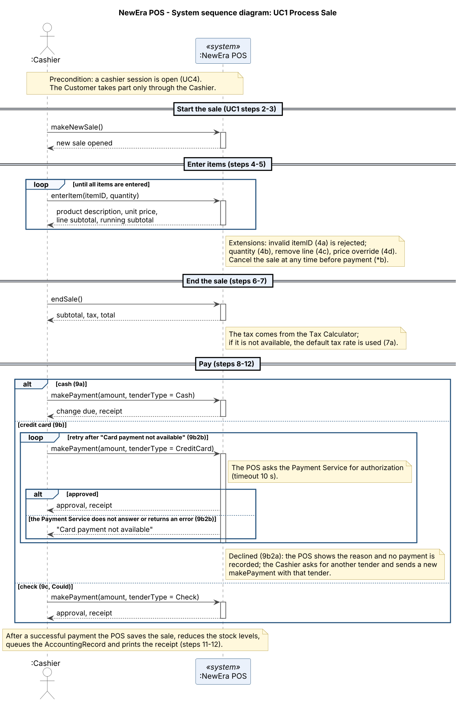

# System Sequence Diagrams – NewEra POS

| | |
| --- | --- |
| **Maintainer** | Borja Nicolás |
| **Version** | 0.2 (draft for review; UC1 extensions \*b and 9b2b updated to SRS v1.0) |
| **Last updated** | W07 |
| **Part of** | Increment 2 (Design); input to the [operation contracts](operation_contracts.md) |

## 1. Purpose

A system sequence diagram (SSD) shows, for one use case scenario, the events that the actor sends to the system and the answers of the system, with the system treated as a **black box**. Each event is a **system operation**; the [operation contracts](operation_contracts.md) then describe what each operation changes in the [domain model](domain_model.md). The SSDs are drawn from the fully dressed use cases of the [SRS](../requirements/SRS.md). This version contains UC1; the other use cases follow in the next iterations.

## 2. UC1 Process Sale

*Editable source: [`assets/ssd_uc1.puml`](../../assets/ssd_uc1.puml) (PlantUML).*

The diagram shows the **main success scenario** (UC1 steps 1–13), the three payment variants of step 9 and the retry of the card payment when the Payment Service does not answer (extension 9b2b). The only actor is the Cashier: the Customer is a stakeholder who acts through the Cashier (SRS, section 1.3.1). The external systems (Payment Service, Tax Calculator, Accounting System) are not drawn, because they are inside the black box from the point of view of the Cashier; a note shows where they are used.

### 2.1 System operations

| Operation | UC1 steps | Returns to the Cashier | Contract |
| --- | --- | --- | --- |
| `makeNewSale()` | 2–3 | Confirmation that a new sale is open | Contract 1 |
| `enterItem(itemID, quantity)` | 4–5 (repeated) | Product description, unit price, line subtotal and running subtotal | Contract 2 |
| `endSale()` | 6–7 | Subtotal, tax and total | Contract 3 |
| `makePayment(amount, tenderType)` | 9–12 | Cash: change due. Credit card or check: approval. In all cases the receipt | Contract 4 |

The names and parameters are those of the contracts. The only difference is the type of `tenderType`: the diagram uses the values `Cash`, `CreditCard` and `Check` (the `TenderType` of the domain model) instead of a free `String`.

### 2.2 What is not in the diagram

The extensions of UC1 that are not part of the main scenario are mentioned in the notes of the diagram but have no system operation of their own yet and no contract. They are candidates for the next iteration:

| Extension | Possible operation |
| --- | --- |
| 4c Remove a line item | `removeItem(lineNumber)` |
| 6a Complete a sale with no line items | none (the System refuses `endSale()`; see the precondition of Contract 3) |
| 4d Price override by the store manager | `overridePrice(lineNumber, newPrice, managerID)` |
| \*b Cancel the sale at any time before payment | `cancelSale()` |
| 12a Reprint the receipt (FR-17) | `reprintReceipt()` |

### 2.3 Open points

1. **Payment declined (9b2a).** The Cashier asks for another tender and sends a new `makePayment` with it (note in the diagram). The retry of the same card payment after "Card payment not available" (9b2b) is the loop in the card variant.
2. **Several tenders for one sale.** The SRS working assumption is one tender per transaction (SRS section 5.3, question 3), so `makePayment` is called once per successful payment. If the team changes this, the diagram needs a loop around the payment section.
3. **Tax Calculator failure (7a).** The contract of `endSale()` assumes the tax is the value returned by the Tax Calculator; the default tax rate and the flag *tax to be corrected* are not in the contract.
