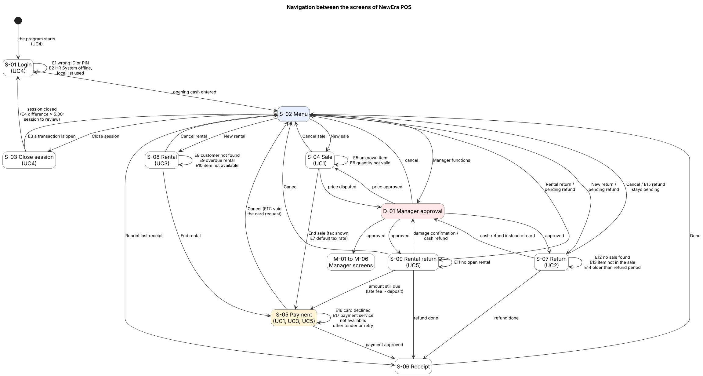
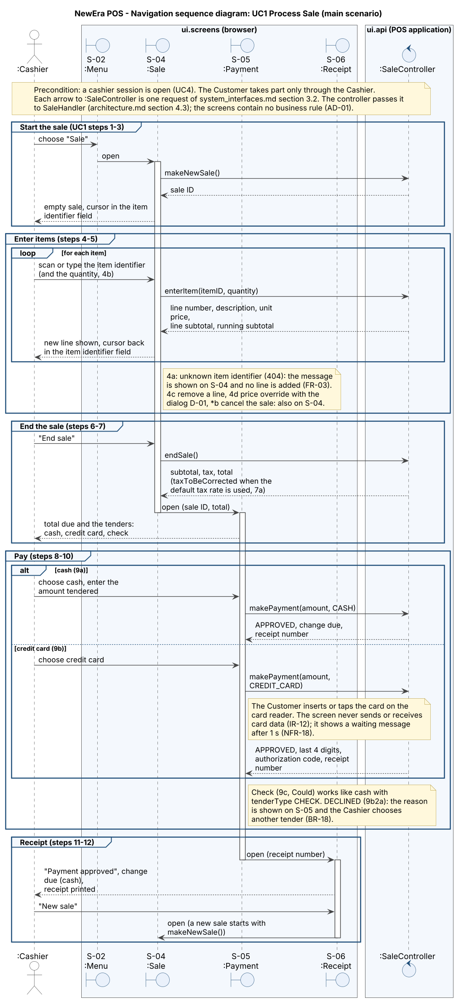
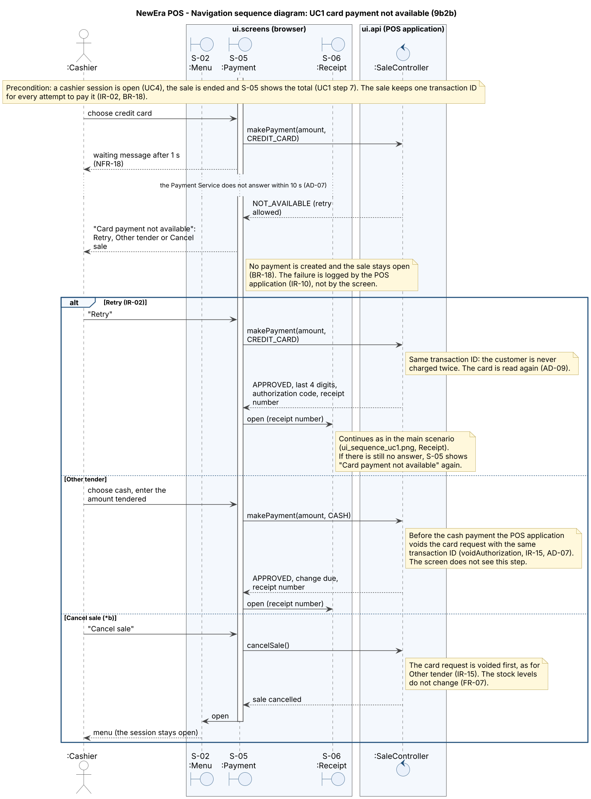

# UI Design – NewEra POS

|                  |                                                                                                                                                             |
| ---------------- | ----------------------------------------------------------------------------------------------------------------------------------------------------------- |
| **Maintainer**   | Yasmine Chkoundali                                                                                                                                          |
| **Version** | 1.0 |
| **Last updated** | W11 |
| **Part of**      | Increment 2 – Design (W10, user interface design)                                                                                                           |
| **Inputs**       | SRS v1.3 (§3.1.1, §3.3), [`ui_prototype.md`](ui_prototype.md), [`system_interfaces.md`](system_interfaces.md) §3, [`architecture.md`](architecture.md) §4.2 |

### Version history

| Version | Changes                                                                                                                    |
| ------- | -------------------------------------------------------------------------------------------------------------------------- |
| 0.1     | §1 Screens: the screens of the cashier and of the store manager, with their use case and system operations.                |
| 0.2     | §2 Navigation between the screens of UC1 to UC5 with the error and fallback messages; §3 UI rules from the usability NFRs. |
| 1.0     | Milestone version (W11): pending refund mode of S-07 and S-09, S-05 with the tenders and the cancel of the three use cases, reprint of the last receipt from the menu S-02, prototype column updated, open points of §1 to §3 closed. |

This document describes the user interface of NewEra POS: the screens, how the user moves between them, the rules that every screen follows, the classes of the UI and the navigation sequence of UC1. Each section has one owner. The names of the screens and of the controllers are those of the logical view (`ui.screens` and `ui.api`, [`architecture.md`](architecture.md) §4.2), and the operations are those of [`system_interfaces.md`](system_interfaces.md) §3.

## 1. Screens

### 1.1 How to read the table

- A **screen** is one web page of `ui.screens`, shown in the browser of the register. It shows data and sends the actions of the user. It contains no business rule (AD-01).
- The **system operations** are the requests that the screen sends to the controller of its use case (one request for each operation, system_interfaces.md §3).
- The **prototype** column gives the file of the [UI prototype](ui_prototype.md) that already shows the screen. A screen marked _new_ is not in the prototype yet.
- The cashier screens are used after the cashier has logged in (UC4). Every operation that needs a store manager carries the manager ID and the PIN (BR-04), and is entered in the dialog of section 1.3.

### 1.2 Cashier screens

| ID   | Screen            | Use case                               | System operations (system_interfaces.md §3)                                                                                                                                                                                                                                                                    | Controller                                                     | Prototype                                          |
| ---- | ----------------- | -------------------------------------- | -------------------------------------------------------------------------------------------------------------------------------------------------------------------------------------------------------------------------------------------------------------------------------------------------------------- | -------------------------------------------------------------- | -------------------------------------------------- |
| S-01 | **Login** | UC4 Start Up | `logIn(employeeID, pin)`, `enterOpeningCash(amount)`. S-01 does not send `startUp()`: the POS program sends it once when it starts (system_interfaces.md §3.1) and S-01 shows its result: the login form, the error of UC4 2a (catalog or stored data not available: no login form, call the store manager) or the warning of UC4 6c (HR System not available: the saved employee list is used) | `SessionController` | `index.html` |
| S-02 | **Menu** | UC4 (end), entry to UC1, UC2, UC3, UC5 | `getSystemStatus()`, `listPendingRefunds()` (system_interfaces.md §3.8) and `reprintLastReceipt()` (§3.2). It shows the cashier, the register ID and the status of the external systems. Entries: _New sale_ (S-04), _New return_ (S-07), _New rental_ (S-08), _Rental return_ (S-09), _Pending refunds_ (S-07 or S-09), _Reprint last receipt_ (sends `reprintLastReceipt()` itself and shows the state of the printer; S-06 does not open), _Close session_ (S-03), _Manager functions_ (D-01, then M-01 to M-06) | `SessionController` | `menu.html` |
| S-03 | **Close session** | UC4 close session                      | `closeSession()`, `enterClosingCash(amount)`, `confirmCloseSession()`                                                                                                                                                                                                                                          | `SessionController`                                            | new                                                |
| S-04 | **Sale**          | UC1 Process Sale                       | `makeNewSale()`, `enterItem(itemID, quantity)`, `removeItem(lineNumber)`, `endSale()`, `cancelSale()`; price change: `overridePrice(...)` with the dialog D-01                                                                                                                                                 | `SaleController`                                               | `sale.html`                                        |
| S-05 | **Payment**       | UC1, UC3 and UC5 (amount still due)    | `getAvailableTenders()` when it opens (always to `SaleController`); `makePayment(amount, tenderType)` for a sale, a rental or a rental return; _Cancel_: `cancelSale()`, `cancelRental()` or `cancelRentalReturn()` for the transaction that opened it | `SaleController`, `RentalController`, `RentalReturnController` | `payment.html`                                     |
| S-06 | **Receipt** | UC1, UC2, UC3, UC5 | `reprintReceipt(receiptNumber)` (_Print again_). The data of the receipt come from the answers of `makePayment`, `confirmReturn`, `confirmRentalReturn` and `approveCashRefund`. S-06 opens after a payment or a refund; the reprint of the last receipt from the menu S-02 does not open it (FR-17) | The controller of the use case that made the receipt: `SaleController`, `ReturnController`, `RentalController` or `RentalReturnController` | `receipt.html` |
| S-07 | **Return**        | UC2 Handle Returns                     | `makeNewReturn()`, `findSale(receiptNumber)`, `enterReturnItem(itemID, quantity, condition)`, `removeReturnItem(lineNumber)`, `confirmReturn()`, `checkRefundStatus()`, `cancelReturn()`; cash refund: `approveCashRefund(...)` with D-01. _Pending refund_ mode (opened from S-02): it shows the saved return and sends only `checkRefundStatus()` and, when the state is _needs approval_, `approveCashRefund(...)` with D-01 | `ReturnController` | `return.html` |
| S-08 | **Rental**        | UC3 Process Rental                     | `makeNewRental()`, `enterCustomerID(customerID)`, `registerCustomer()`, `enterRentalItem(serialNumber)`, `selectRentalPeriod(days)`, `endRental()`, `cancelRental()`                                                                                                                                           | `RentalController`                                             | `rental.html`                                      |
| S-09 | **Rental return** | UC5 Return Rental                      | `makeNewRentalReturn()`, `findRental(code)`, `findRentalsOfCustomer(customerID)`, `selectRental(rentalID)`, `recordCondition(condition, damageNote)`, `confirmRentalReturn()`, `checkRefundStatus()`, `cancelRentalReturn()`; damage and cash refund: `confirmDamage(...)`, `approveCashRefund(...)` with D-01. _Pending refund_ mode (opened from S-02): only `checkRefundStatus()` and `approveCashRefund(...)` | `RentalReturnController` | `return-rental.html` |

### 1.3 Dialog of the store manager

| ID   | Dialog                                                               | Used by                                                                                                      | System operations                                                                                                  | Controller                                 | Prototype |
| ---- | -------------------------------------------------------------------- | ------------------------------------------------------------------------------------------------------------ | ------------------------------------------------------------------------------------------------------------------ | ------------------------------------------ | --------- |
| D-01 | **Manager approval** (employee ID, PIN and, when needed, the reason) | S-04 price change (UC1 4d), S-07 and S-09 cash refund (UC2 9b2a, 9c; UC5), S-09 damage confirmation (UC5 6a) | Always carries `managerID` and `pin` of `overridePrice(...)`, `approveCashRefund(...)` and `confirmDamage(...)`; it carries `reason` only for `approveCashRefund(...)` | The controller of the screen that opens it | new |

### 1.4 Store manager screens

These are the "Manager screens" of the logical view. Each operation carries the manager ID and the PIN, because there is no manager session (system_interfaces.md §3.6, see open point 2).

| ID   | Screen                                               | Requirement                | System operations (system_interfaces.md §3.6)                                       | Controller          | Prototype |
| ---- | ---------------------------------------------------- | -------------------------- | ----------------------------------------------------------------------------------- | ------------------- | --------- |
| M-01 | **Reorder and stock-check list** | FR-68, BR-09 | `listFlaggedProducts(managerID, pin)`; also the rental conflicts: `listRentalConflicts(managerID, pin)`, `resolveRentalConflict(conflictID, managerID, pin, reason)` | `ManagerController` | new |
| M-02 | **Sessions to review**                               | FR-74, FR-75, BR-17        | `listSessionsToReview()`, `confirmSessionReview(sessionID, managerID, pin, reason)` | `ManagerController` | new       |
| M-03 | **Default tax rate** | FR-69, IR-05 | `changeDefaultTaxRate(rate, managerID, pin)` | `ManagerController` | new |
| M-04 | **Catalog import** | IR-17 | `importCatalog(file, managerID, pin)` | `ManagerController` | new |
| M-05 | **Local employees** | FR-70, IR-09 | `disableEmployee(employeeID, managerID, pin)` | `ManagerController` | new |
| M-06 | **Accounting queue** | FR-76 | `getAccountingQueueStatus(managerID, pin)` | `ManagerController` | new |

### 1.5 Summary

- **9 cashier screens** (S-01 to S-09), **1 dialog** (D-01) and **6 store manager screens** (M-01 to M-06).
- Every system operation of the use cases UC1 to UC5 is used by exactly one screen, except `makePayment`, which the screen S-05 sends for three controllers, and `checkRefundStatus()` and `approveCashRefund(...)`, which UC2 and UC5 share.
- The prototype (guide v0.3) shows all 16 screens and dialogs, including S-03, D-01, the condition of a returned item (S-07) and the damage confirmation (S-09). Some share a page: M-03 and M-05 are in the _Settings_ tab of `manager.html`, and M-06 is the panel _Accounting System queue_ next to the tabs. The prototype stays a throw-away prototype (process model).

### 1.6 Open points

1. ~~**Status of the external systems (NFR-15).**~~ Closed (W10): `getSystemStatus()` (system_interfaces.md §3.8), sent by S-02.
2. ~~**How a store manager opens M-01 to M-06.**~~ Closed (W10): the menu S-02 has the entry _Manager functions_; D-01 asks for the manager ID and the PIN, and each screen M-xx repeats them with its action (BR-04; system_interfaces.md §3.6).
3. ~~**Pending card refund.**~~ **Closed in W11.** `listPendingRefunds()` returns the kind and the ID of each return (system_interfaces.md §3.8), and S-07 and S-09 have the _pending refund_ mode (section 1.2; system_interfaces.md §3.8 and §3.9).
4. ~~**Reprint last receipt (review #57).**~~ **Closed in W11.** `reprintLastReceipt()` (`POST /api/receipts/last/print`, system_interfaces.md §3.2) is sent by the menu S-02; S-06 sends `reprintReceipt(receiptNumber)`.
5. ~~**Changes for the other sections (review #57).**~~ **Closed in W11.** The split of M-03 is in the class diagram of section 4 (22 classes) and in the screen table of system_interfaces.md §3.9; D-01 carries `reason` only for `approveCashRefund(...)`.

## 2. Navigation between the screens

The diagram shows how the cashier moves between the screens of section 1 for UC1 to UC5. The Menu S-02 is the centre: every use case starts there and ends there, so the cashier always knows where to go back to (NFR-16). The dialog D-01 opens on top of the screen that needs a store manager and returns to it. A loop on a screen is an error or a fallback that keeps the cashier on the same screen, with a message (section 2.2).

Source: [`assets/ui_navigation.puml`](../../assets/ui_navigation.puml).

### 2.1 Paths of the use cases

| Use case                       | Path                                                                             | Source                         |
| ------------------------------ | -------------------------------------------------------------------------------- | ------------------------------ |
| UC4 Start up and close session | Start → S-01 → S-02; later S-02 → S-03 → S-01                                    | UC4                            |
| UC1 Process sale               | S-02 → S-04 → (D-01) → S-05 → S-06 → S-02                                        | UC1                            |
| UC2 Handle returns             | S-02 → S-07 → (D-01) → S-06 → S-02                                               | UC2                            |
| UC3 Process rental             | S-02 → S-08 → S-05 → S-06 → S-02                                                 | UC3                            |
| UC5 Return rental              | S-02 → S-09 → (D-01) → S-06 → S-02; with an amount still due: S-09 → S-05 → S-06 | UC5                            |
| Manager functions              | S-02 → D-01 → M-01 to M-06 → S-02                                                | FR-68 to FR-70, FR-74 to FR-76 |

The cashier can cancel from S-04, S-05, S-07, S-08 and S-09 at any time before the payment or the refund is completed; the cancel always leads back to S-02 and the cashier session stays open. A pending card refund (UC2 and UC5, ext. 9b2b) is found again from S-02 with the entry _Pending refunds_.

### 2.2 Error and fallback messages

Every message is shown on the screen where the error happens, says what happened and what the cashier can do next, and has no technical code (NFR-14). The code E1 to E17 is only the reference of the diagram; it is never shown to the cashier.

| Ref | Screen                 | Situation                                                  | Message shown (proposal)                                                                                              | What the cashier can do                                       | Source                               |
| --- | ---------------------- | ---------------------------------------------------------- | --------------------------------------------------------------------------------------------------------------------- | ------------------------------------------------------------- | ------------------------------------ |
| E1  | S-01                   | Employee ID not found, not an active cashier, or PIN wrong | "Employee ID not found or not an active cashier." / "The PIN is not correct."                                         | Enter the data again, or ask the store manager                | UC4 6a, 6b                           |
| E2  | S-01                   | HR System does not answer                                  | "The HR System does not answer. The list saved on [date and time] is used."                                           | Log in as usual                                               | UC4 6c, FR-45                        |
| E3  | S-03                   | A sale, return, rental or rental return is still open      | "A transaction is still open. Finish it or cancel it before closing the session."                                     | Go back to the menu and finish or cancel it                   | UC4 close 2a, FR-60                  |
| E4  | S-03                   | Difference larger than 5.00                                | "The difference is [amount]. The store manager will review this session."                                             | Close the session; the manager reviews it later               | UC4 close 4b, BR-17                  |
| E5  | S-04                   | Item ID not in the catalog                                 | "This item is not in the catalog. Check the code and type it again."                                                  | Type it again, or put the item aside                          | UC1 4a                               |
| E6  | S-04                   | Quantity zero, negative or not a whole number              | "The quantity must be a whole number larger than zero."                                                               | Enter the quantity again                                      | UC1 4b1                              |
| E7  | S-04, S-05, S-08, S-09 | Tax Calculator not available                               | "The Tax Calculator does not answer. The default tax rate is used and the sale will be corrected later."              | Continue                                                      | UC1, UC3 11a, UC5 7a1, BR-02, NFR-15 |
| E8  | S-08                   | Customer ID not found                                      | "Customer ID not found."                                                                                              | Check the ID, or register a new customer                      | UC3 4a                               |
| E9  | S-08                   | Customer has an overdue rental                             | "This customer has an overdue rental and cannot start a new one."                                                     | Ask the customer to return the item first (UC5)               | UC3 5a, BR-12                        |
| E10 | S-08                   | Item is not available                                      | "This item is [rented / under maintenance]."                                                                          | Choose another item                                           | UC3 7a, 7b, BR-11                    |
| E11 | S-09                   | No open rental for the number                              | "No open rental for this item."                                                                                       | Check the number, or search with the customer ID              | UC5 5a, 5b                           |
| E12 | S-07                   | No sale with this receipt number                           | "No sale found with this receipt number."                                                                             | Check the number and enter it again                           | UC2 4a                               |
| E13 | S-07                   | Item not in the sale, or quantity too large                | "This item is not in the sale, or the quantity is larger than what is left to return."                                | Correct the item or the quantity                              | UC2 6a                               |
| E14 | S-07                   | Sale older than the refund period                          | "This sale is older than the refund period. No refund is possible."                                                   | Explain to the customer and go back to the menu               | UC2 5a, BR-07                        |
| E15 | S-07, S-09             | Payment Service does not answer for a card refund          | "The card refund is not confirmed yet. Nothing was paid. Ask again later from the menu."                              | Go back to the menu; ask again from "Pending refunds"         | UC2 and UC5 9b2b, FR-26              |
| E16 | S-05                   | Card declined                                              | "The card was declined ([reason]). Choose another way to pay."                                                        | Another tender or another card                                | UC1 9b2a                             |
| E17 | S-05                   | Payment Service does not answer                            | "The Payment Service does not answer. Nothing was charged. Try again, choose another way to pay, or cancel the sale." | Retry, another tender, or cancel (the card request is voided) | UC1 9b2b, AD-07, IR-15               |

### 2.3 Open points

1. ~~**Pending card refund.**~~ **Closed in W11.** The list returns the kind and the ID of each return, and S-07 and S-09 have the _pending refund_ mode (section 1.2).
2. ~~**E7 on S-09.**~~ **Closed in W11.** The warning of the default tax rate comes from the answer of `recordCondition()`, which carries `taxToBeCorrected` (system_interfaces.md §6 point 8).

## 3. UI rules

These rules apply to every screen of section 1. Each rule comes from one usability requirement of the SRS, so that the UI class diagram (section 4) and the tests of the NFRs (SRS §4, Inspection / Demonstration) can check it.

| Rule                                        | What every screen does                                                                                                                                                                                                                                                                                                                                                                           | Requirement           |
| ------------------------------------------- | ------------------------------------------------------------------------------------------------------------------------------------------------------------------------------------------------------------------------------------------------------------------------------------------------------------------------------------------------------------------------------------------------ | --------------------- |
| UI-01 Size of buttons                       | Every button and every touch target is at least 10 mm × 10 mm on the register screen, with a gap between two buttons that cannot be mistaken (at least 3 mm). On the register screen (15 inches, 1366 × 768 pixels, about 135 pixels per inch) this is a minimum of 56 × 56 pixels.                                                                                                              | NFR-13                |
| UI-02 Size of text                          | Text is readable at 1 m: body text at least 20 px, amounts and totals at least 28 px, dark text on a light background with a contrast of at least 4.5 : 1.                                                                                                                                                                                                                                       | NFR-13                |
| UI-03 One main task                         | A screen has one main task, named in its title (for example "Payment"). The main action is the largest button. Nothing else on the screen competes with it.                                                                                                                                                                                                                                      | NFR-16                |
| UI-04 Same action, same place               | Confirm is at the bottom right (green), Cancel at the bottom left (grey), and Back to menu at the top left, with the same words on all screens. D-01 follows the same rule.                                                                                                                                                                                                                      | NFR-16                |
| UI-05 Three clicks for a sale               | After the last item: End sale (click 1), the tender button (click 2), Confirm the amount (click 3). The amount is already filled in with the total, so a card or exact cash payment needs no typing. The receipt (S-06) opens by itself and needs no click.                                                                                                                                      | NFR-06                |
| UI-06 Standard tasks without help           | A standard sale is S-02 → S-04 → S-05 → S-06 and a standard return is S-02 → S-07 → S-06. The menu has one button for each use case with its name, and no screen of these tasks has more than one step that the cashier must find alone.                                                                                                                                                         | NFR-05                |
| UI-07 Errors where they happen              | An error is shown in a red box at the top of the screen where it happens, in plain words, with what the cashier can do next (section 2.2). It has no code, no technical term and no pop-up that hides the screen. The data already entered is kept.                                                                                                                                              | NFR-14                |
| UI-08 System status                         | The menu S-02 shows the four external systems (Payment Service, Tax Calculator, Accounting System, HR System) with a coloured dot and the word "online" or "offline", from `getSystemStatus()`. The colour is never the only sign. When the default tax rate is used, S-04, S-05, S-08 and S-09 show a warning that stays visible until the end of the transaction (E7).                         | NFR-15                |
| UI-09 Waiting message                       | When a request to an external system takes more than 1 second, the screen shows "Waiting for [the Payment Service / the HR System / the Tax Calculator]…" with a moving sign. The buttons that would send a second request are disabled. When the answer arrives, or the timeout is over (10 s Payment Service, 5 s the others), the message is replaced by the result or by E2, E7, E15 or E17. | NFR-18, NFR-19, AD-07 |
| UI-10 Amount and calculation before the end | Before a payment or a refund is completed, the screen shows the amount and each part: price, tax, deposit, late fee, refund. The cashier must press Confirm; no payment or refund is completed without it.                                                                                                                                                                                       | NFR-17                |
| UI-11 Manager approval                      | An action that needs a store manager (price change, cash refund instead of a card or check refund, damaged rental) opens D-01. D-01 asks for the employee ID, the PIN and, when needed, a reason. The PIN is hidden while typed and is never shown again.                                                                                                                                        | BR-04, NFR-08         |
| UI-12 Language                              | All texts of the screens are in English and use the words of the SRS glossary (sale, return, rental, deposit, refund).                                                                                                                                                                                                                                                                           | SRS §3.1.1            |

### 3.1 How the rules are checked

| Rule                                     | Check                                                                                      | Where                     |
| ---------------------------------------- | ------------------------------------------------------------------------------------------ | ------------------------- |
| UI-01, UI-02                             | Inspection of the screens in the browser on the register screen; sizes measured            | SRS §4 (NFR-13)           |
| UI-03, UI-04, UI-07, UI-08, UI-10, UI-11 | Inspection of every screen against the prototype and against sections 1 and 2              | SRS §4 (NFR-14 to NFR-17) |
| UI-05, UI-06                             | Demonstration with five new cashiers after 15 minutes of training; clicks and time counted | SRS §4 (NFR-05, NFR-06)   |
| UI-09                                    | Demonstration with a stub in `TIMEOUT` mode (system_interfaces.md §5)                      | SRS §4 (NFR-18)           |

### 3.2 Open points

1. ~~**Sizes (UI-01, UI-02).**~~ **Closed in W11.** The sizes are design decisions for the register screen of 15 inches (about 135 pixels per inch); they are checked on the real screen in the verification of NFR-13 (increment 3).
2. ~~**UI-04.**~~ **Closed in W11.** The place of Confirm, Cancel and Back to menu is a rule of the real screens of increment 3; the prototype ([`ui_prototype.md`](ui_prototype.md)) stays a throw-away prototype and is not changed (process model).

## 4. UML class diagram of the UI

Owner: Josué (A3). The class diagram shows the 22 classes of the user interface: the 15 screens and the dialog of `ui.screens` (S-01 to S-09, D-01, M-01 to M-06 of section 1) and the 6 controllers of `ui.api`. The attributes of a screen are the data that the user enters (_input_) and the data that the screen shows from the answers of the system API (_shown_). The operations of a controller are the system operations of [`system_interfaces.md`](system_interfaces.md) §3, with the parameters of the SSDs and of the operation contracts. The diagram stops at the controllers: what happens behind them (handlers, adapters, external systems) is in the logical view and the interaction view of [`architecture.md`](architecture.md) §4.2 and §4.3. The names are those of sections 1 and 5, of the logical view and of the system interfaces.

### 4.1 Class diagram

_Editable source: [`assets/ui_classes.puml`](../../assets/ui_classes.puml) (PlantUML)._

What the diagram shows:

- **Screens and dialog (`ui.screens`).** One class for each screen of section 1: S-01 to S-09 for the cashier, M-01 to M-06 for the store manager and the dialog D-01. M-01 handles both flagged products and rental conflicts. A screen contains no business rule (AD-01).
- **Calls (`<<calls>>`).** A dashed arrow from a screen to a controller lists the system operations that the screen sends. Every operation of a controller is sent by exactly one screen, except `makePayment`, `approveCashRefund`, `checkRefundStatus` and `cancelSale`, which are shared (see the next point).
- **Shared screens.** S-05 Payment sends `getAvailableTenders()` to `SaleController` when it opens, and `makePayment` to three controllers: `SaleController` (UC1), `RentalController` (UC3) and `RentalReturnController` (UC5, amount still due). It also sends `cancelSale()` to `SaleController` itself, so the cashier does not go back to S-04 first; S-04 keeps `cancelSale()` for a sale that is cancelled before the payment. S-06 Receipt is used by UC1, UC2, UC3 and UC5, and from the menu entry _Reprint last receipt_.
- **Manager approval (D-01).** D-01 sends nothing itself: it returns `managerID` and `pin` to the screen that opened it (S-04, S-07 or S-09), and that screen adds them to its request (BR-04). The `reason` is entered and passed only when the action is `approveCashRefund`; a price change (`overridePrice`) and a damage confirmation (`confirmDamage`) carry no reason. From the menu entry _Manager functions_ D-01 opens M-01 to M-06, and each of them repeats `managerID` and `pin` with its action.
- **Navigation (`<<opens>>`).** The solid arrows are the moves between screens of sections 1 and 2. The complete navigation, with the error and fallback messages, is in section 2.
- **Controllers (`ui.api`).** One controller for each use case (`SessionController`, `SaleController`, `ReturnController`, `RentalController`, `RentalReturnController`) and `ManagerController` for the six store manager screens. They receive the requests and only call the application layer (AD-01).
- **Slides.** The diagram is complete (22 classes). In the W10 slides one part is shown, for example S-04, S-05, S-06, D-01 and `SaleController`, with the note _"N of 22 classes shown, full diagram in docs/design/ui_design.md §4"_.

### 4.2 Traceability of the usability NFRs

The table links each usability requirement of SRS §3.3 with the screens of section 1, the element of the class diagram that carries it and the rule of section 3 that the screen follows.

| NFR | Requirement (short) | Screens (§1) | Element in the class diagram | UI rule (§3) |
| --- | --- | --- | --- | --- |
| NFR-05 | After 15 minutes of training, 4 of 5 new cashiers do a standard sale and a standard return alone, each in less than 3 minutes | S-02, S-04, S-05, S-06, S-07 | S-02 opens each use case; the sale is S-04 → S-05 → S-06 and the return is S-07 → S-06; S-05, S-06 and D-01 are shared by several use cases, so the cashier learns each of them once | UI-06 Standard tasks without help; UI-03 One main task; the cursor goes back to the item identifier field after each line (§5.1) |
| NFR-06 | A standard sale needs 3 clicks or fewer after the items are entered | S-04, S-05 | `endSale()` on S-04 (click 1); on S-05 one of the `availableTenders` (click 2) and `makePayment(amount, tenderType)` after the confirmation of the amount (click 3); `amount` is already filled in with the total; S-06 needs no click | UI-05 Three clicks for a sale |
| NFR-13 | Text readable at 1 m; buttons at least 10 mm × 10 mm | S-01 to S-09, D-01, M-01 to M-06 | Every class of `ui.screens` | UI-01 Size of buttons; UI-02 Size of text |
| NFR-14 | Error message on the screen where the error happens, in plain words, with what the cashier can do next, without technical codes | S-01, S-03, S-04, S-05, S-07, S-08, S-09, D-01, M-02 to M-06; S-06 for the printer | Attribute `errorMessage` of these screens, filled with the message for the cashier of the answer (`400`, `403`, `404`, `409`, `422`, system_interfaces.md §2); attribute `printerStatus` of S-06 | UI-07 Errors where they happen |
| NFR-15 | The menu shows whether each of the four external systems is available; the transaction screens warn when the default tax rate is used | S-02, S-04, S-05, S-08, S-09 | S-02: `externalSystemStatus` (answer of `getSystemStatus()`, §1.2); S-04, S-05, S-08 and S-09: `taxToBeCorrected` | UI-08 System status |
| NFR-16 | One main task for each screen; the same action has the same label and position on all screens | S-01 to S-09, D-01, M-01 to M-06 | One class for each step of a use case; shared screens S-05 (UC1, UC3, UC5), S-06 (UC1, UC2, UC3, UC5) and D-01 (price change, cash refund, damage) | UI-03 One main task; UI-04 Same action, same place (D-01 follows it too); UI-11 Manager approval |
| NFR-17 | Before a payment or a refund is completed, the screen shows the amount and each part of its calculation and asks for confirmation | S-05, S-07, S-08, S-09 | S-05: `total` with its parts, then `makePayment`; S-07: `refundTotal`, then `confirmReturn()`; S-08: `rentalFee`, `tax`, `deposit`, `total`, then S-05; S-09: `deposit`, `lateFee`, `lateFeeTax`, `refundTotal`, `amountDue`, then `confirmRentalReturn()` | UI-10 Amount and calculation before the end |
| NFR-18 | A waiting message when an operation with an external system takes longer than 1 second | S-01, S-04, S-05, S-07, S-08, S-09 | Attribute `waitingMessage` for `logIn()` (HR System), `endSale()`, `endRental()` and `recordCondition()` (Tax Calculator), `makePayment()` (Payment Service), `confirmReturn()`, `confirmRentalReturn()` and `checkRefundStatus()` (card refund) | UI-09 Waiting message (with NFR-19 and AD-07) |

Verification: as in section 3.1 and SRS §4. NFR-13 to NFR-17 by inspection of the screens (sizes measured for UI-01 and UI-02), NFR-05 and NFR-06 by demonstration with five new cashiers, and NFR-18 by demonstration with a stub in `TIMEOUT` mode.

### 4.3 Open points

1. ~~**Names of two manager operations.**~~ **Closed in W10.** `listFlaggedProducts(managerID, pin)` (M-01) and `importCatalog(file, managerID, pin)` (M-04) are named in system_interfaces.md v0.5 §3.6, together with all the other manager operations. The diagram uses these names and adds `listRentalConflicts`, `resolveRentalConflict` (M-01) and `enableEmployee` (M-05).
2. **Operations of the menu S-02.** `getSystemStatus()`, `listPendingRefunds()` and `reprintLastReceipt()` (system_interfaces.md §3.2, §3.8 and §3.9) are now in `SessionController`, and the diagram has the arrow S-02 → `SessionController`. No new controller is needed: the diagram keeps its 22 classes (16 in `ui.screens`, 6 in `ui.api`). To confirm with Alfonso that `SessionController` is the right place for them.
3. ~~**`getAvailableTenders()` for rentals and rental returns.**~~ **Closed in W10.** system_interfaces.md v0.5 §3.2 gives one operation, `GET /api/tenders`, with the same answer for a sale, a rental and a rental return. S-05 sends it to `SaleController` when it opens, and `RentalController` and `RentalReturnController` need no operation of their own. S-05 also sends `cancelRental()` and `cancelRentalReturn()` to their controllers.
4. ~~**Tax warning on S-08 and S-09.**~~ **Closed in W10.** The answers of `endRental()` (§3.4) and `recordCondition()` (§3.5) return `taxToBeCorrected`, as `endSale()` does, so S-08 and S-09 keep this attribute.
5. ~~**Content of M-06.**~~ **Closed in W10.** The fields of the answer of `getAccountingQueueStatus(managerID, pin)` are defined in system_interfaces.md v0.5 §3.6: the number of records waiting, the time the oldest has waited, the warning when it is older than the configured limit, and, if the first record was refused, its transaction ID and the reason. The attribute `queueStatus` of M-06 shows them.
6. **Closed in W10.** `startUp()` is not sent by S-01 (section 1.2 and the note in the diagram); the IDs of the rules of section 3 are in the table of 4.2; the entries of the menu are in the diagram (S-02 → D-01 → M-01 to M-06, S-02 → S-06).

## 5. Navigation sequence diagram of UC1

Owner: Avni (A4). The navigation sequence diagram shows how the Cashier moves through the screens of UC1 Process Sale and which request each screen sends to its controller. It stops at the controller of `ui.api`: what happens behind the controller (handler, adapters, external systems) is in the interaction view of [`architecture.md`](architecture.md) §4.3. The screens are those of section 1, the operations and answers those of [`system_interfaces.md`](system_interfaces.md) §3.2, and the steps those of SRS UC1 and its SSD.

### 5.1 Main scenario

_Editable source: [`assets/ui_sequence_uc1.puml`](../../assets/ui_sequence_uc1.puml) (PlantUML)._

What the diagram shows:

- **Screens used.** S-02 Menu → S-04 Sale → S-05 Payment → S-06 Receipt, and back to S-04 for the next sale. All requests go to `SaleController`.
- **Start and items (steps 1–5).** S-04 sends `makeNewSale()` when it opens and `enterItem(itemID, quantity)` for each scanned or typed item. After each line the cursor goes back to the item identifier field, so the Cashier can scan item after item (SRS §3.1.1). An unknown item (4a) is shown on S-04, in plain words, and adds no line (FR-03, NFR-14). Remove a line (4c), price override with the dialog D-01 (4d) and cancel the sale (\*b) also stay on S-04.
- **End of the sale (steps 6–7).** S-04 sends `endSale()` and receives the subtotal, the tax and the total, with `taxToBeCorrected` when the default tax rate was used (7a). Then S-05 opens with the total and its parts before the Cashier confirms the payment (NFR-17).
- **Payment (steps 8–10).** S-05 sends one `makePayment(amount, tenderType)`. For a card the screen only sends the tender: the card is read by the card reader and the screen never sends or receives card data (IR-12); it shows a waiting message after 1 s (NFR-18). A declined card (9b2a) is shown on S-05 and the Cashier chooses another tender (BR-18).
- **Receipt (steps 11–12).** After `APPROVED`, S-06 shows the result and the change due (cash). The receipt is printed by the POS application. _New sale_ opens S-04 again. After the items, the Cashier needs three actions: _End sale_, the tender and the confirmation of the amount (NFR-06).

### 5.2 Card payment not available (UC1 extension 9b2b)

_Editable source: [`assets/ui_sequence_uc1_payment_unavailable.puml`](../../assets/ui_sequence_uc1_payment_unavailable.puml) (PlantUML)._

What the diagram shows:

- **Waiting and message.** S-05 shows a waiting message after 1 s (NFR-18). When the Payment Service does not answer within 10 s (AD-07), `makePayment` returns `NOT_AVAILABLE` and S-05 shows _"Card payment not available"_ with three choices: _Retry_, _Other tender_ and _Cancel sale_ (NFR-14). The failure is logged by the POS application (IR-10), not by the screen. No payment is created and the sale stays open (BR-18).
- **Retry (IR-02).** S-05 sends the same `makePayment(amount, CREDIT_CARD)` again. The sale keeps its transaction ID, so the customer is never charged twice; the card is read again (AD-09).
- **Other tender.** S-05 sends `makePayment` with the new tender. The POS application first voids the card request (`voidAuthorization`, IR-15); the screen does not see this step.
- **Cancel sale (\*b).** S-05 sends `cancelSale()` itself to `SaleController`, so the cashier does not go back to S-04 first (review #58). The card request is voided first, the stock levels do not change (FR-07) and the Menu S-02 opens; the cashier session stays open.

### 5.3 Open points

1. **Where the total is shown.** The diagram shows the total on S-04 after `endSale()` and then opens S-05. To align with the navigation diagram of section 2.
2. **Cancel from S-05 (review #58).** S-05 now sends `cancelSale()` itself (section 5.2). Section 1.2 (row S-05) and the UI class diagram of section 4 (`S-05 ..> SaleController`) still list `cancelSale()` only for S-04; to add it to S-05 there (Yasmine, Josué).
3. **Screen after a cancelled sale.** The diagram opens the Menu S-02. Opening an empty S-04 for the next customer is also possible. To align with section 2.
