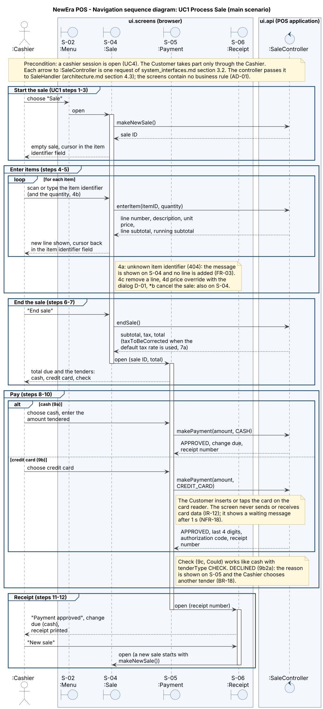
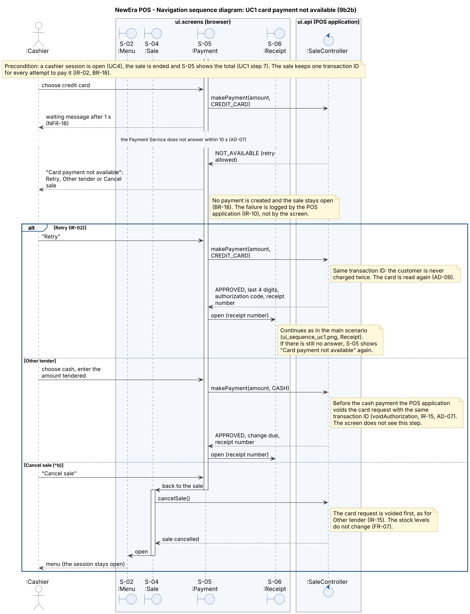

# UI Design – NewEra POS

| | |
| --- | --- |
| **Maintainer** | Yasmine Chkoundali |
| **Version** | 0.1 |
| **Last updated** | W10 (screens first part) |
| **Part of** | Increment 2 – Design (W10, user interface design) |
| **Inputs** | SRS v1.2 (§3.1.1, §3.3), [`ui_prototype.md`](ui_prototype.md), [`system_interfaces.md`](system_interfaces.md) §3, [`architecture.md`](architecture.md) §4.2 |

### Version history

| Version | Changes |
| --- | --- |
| 0.1 | §1 Screens: the screens of the cashier and of the store manager, with their use case and system operations. |

This document describes the user interface of NewEra POS: the screens, how the user moves between them, the rules that every screen follows, the classes of the UI and the navigation sequence of UC1. Each section has one owner. The names of the screens and of the controllers are those of the logical view (`ui.screens` and `ui.api`, [`architecture.md`](architecture.md) §4.2), and the operations are those of [`system_interfaces.md`](system_interfaces.md) §3.

## 1. Screens

### 1.1 How to read the table

- A **screen** is one web page of `ui.screens`, shown in the browser of the register. It shows data and sends the actions of the user. It contains no business rule (AD-01).
- The **system operations** are the requests that the screen sends to the controller of its use case (one request for each operation, system_interfaces.md §3).
- The **prototype** column gives the file of the [UI prototype](ui_prototype.md) that already shows the screen. A screen marked *new* is not in the prototype yet.
- The cashier screens are used after the cashier has logged in (UC4). Every operation that needs a store manager carries the manager ID and the PIN (BR-04), and is entered in the dialog of section 1.3.

### 1.2 Cashier screens

| ID | Screen | Use case | System operations (system_interfaces.md §3) | Controller | Prototype |
| --- | --- | --- | --- | --- | --- |
| S-01 | **Login** | UC4 Start Up | `startUp()`, `logIn(employeeID, pin)`, `enterOpeningCash(amount)` | `SessionController` | `index.html` |
| S-02 | **Menu** | UC4 (end), entry to UC1, UC2, UC3, UC5 | None. It shows the cashier, the register ID and the status of the external systems (see open point 1) | – | `menu.html` |
| S-03 | **Close session** | UC4 close session | `closeSession()`, `enterClosingCash(amount)`, `confirmCloseSession()` | `SessionController` | new |
| S-04 | **Sale** | UC1 Process Sale | `makeNewSale()`, `enterItem(itemID, quantity)`, `removeItem(lineNumber)`, `endSale()`, `cancelSale()`; price change: `overridePrice(...)` with the dialog D-01 | `SaleController` | `sale.html` |
| S-05 | **Payment** | UC1, UC3 and UC5 (amount still due) | `makePayment(amount, tenderType)` for a sale, a rental or a rental return | `SaleController`, `RentalController`, `RentalReturnController` | `payment.html` |
| S-06 | **Receipt** | UC1, UC2, UC3, UC5 | `reprintReceipt()`. The data of the receipt come from the answers of `makePayment`, `confirmReturn` and `confirmRentalReturn` | `SaleController` | `receipt.html` |
| S-07 | **Return** | UC2 Handle Returns | `makeNewReturn()`, `findSale(receiptNumber)`, `enterReturnItem(itemID, quantity, condition)`, `removeReturnItem(lineNumber)`, `confirmReturn()`, `checkRefundStatus()`, `cancelReturn()`; cash refund: `approveCashRefund(...)` with D-01 | `ReturnController` | `return.html` (without the condition of the item) |
| S-08 | **Rental** | UC3 Process Rental | `makeNewRental()`, `enterCustomerID(customerID)`, `registerCustomer()`, `enterRentalItem(serialNumber)`, `selectRentalPeriod(days)`, `endRental()`, `cancelRental()` | `RentalController` | `rental.html` |
| S-09 | **Rental return** | UC5 Return Rental | `makeNewRentalReturn()`, `findRental(code)`, `findRentalsOfCustomer(customerID)`, `selectRental(rentalID)`, `recordCondition(condition, damageNote)`, `confirmRentalReturn()`, `checkRefundStatus()`, `cancelRentalReturn()`; damage and cash refund: `confirmDamage(...)`, `approveCashRefund(...)` with D-01 | `RentalReturnController` | `return-rental.html` (without damage confirmation) |

### 1.3 Dialog of the store manager

| ID | Dialog | Used by | System operations | Controller | Prototype |
| --- | --- | --- | --- | --- | --- |
| D-01 | **Manager approval** (employee ID, PIN and, when needed, the reason) | S-04 price change (UC1 4d), S-07 and S-09 cash refund (UC2 9b2a, 9c; UC5), S-09 damage confirmation (UC5 6a) | Carries `managerID`, `pin` and `reason` of `overridePrice(...)`, `approveCashRefund(...)` and `confirmDamage(...)` | The controller of the screen that opens it | new |

### 1.4 Store manager screens

These are the "Manager screens" of the logical view. Each operation carries the manager ID and the PIN, because there is no manager session (system_interfaces.md §3.6, see open point 2).

| ID | Screen | Requirement | System operations (system_interfaces.md §3.6) | Controller | Prototype |
| --- | --- | --- | --- | --- | --- |
| M-01 | **Reorder and stock-check list** | FR-68, BR-09 | Reorder and stock-check list (`GET /api/products/flagged`) | `ManagerController` | new |
| M-02 | **Sessions to review** | FR-74, FR-75, BR-17 | `listSessionsToReview()`, `confirmSessionReview(sessionID, managerID, pin, reason)` | `ManagerController` | new |
| M-03 | **Settings** (default tax rate, disable an employee) | FR-69, FR-70, IR-05, IR-09 | Change the default tax rate, disable an employee in the local list | `ManagerController` | new |
| M-04 | **Catalog import** | IR-17 | Import the catalog (file and manager) | `ManagerController` | new |

### 1.5 Summary

- **9 cashier screens** (S-01 to S-09), **1 dialog** (D-01) and **4 store manager screens** (M-01 to M-04).
- Every system operation of the use cases UC1 to UC5 is used by exactly one screen, except `makePayment`, which the screen S-05 sends for three controllers, and `checkRefundStatus()` and `approveCashRefund(...)`, which UC2 and UC5 share.
- The prototype shows 8 of the 14 screens and dialogs. It does not show S-03, D-01, M-01 to M-04, and it does not show the condition of a returned item (S-07) nor the damage confirmation (S-09). The prototype stays a throw-away prototype (process model).

### 1.6 Open points

1. **Status of the external systems (NFR-15).** The menu S-02 and the warnings of S-04 and S-05 show whether each external system is available and whether the default tax rate is used. No operation of system_interfaces.md §3 returns this status. To decide with Alfonso (screen ↔ API table).
2. **How a store manager opens M-01 to M-04.** The system interfaces have no manager session. Proposal: the menu S-02 has an entry *Manager functions* that asks for the manager ID and the PIN, and each screen M-xx repeats them with its action (BR-04). To confirm.
3. **Pending card refund.** `checkRefundStatus()` needs the ID of the return or rental return. A refund that stays *pending* after the cashier has left the screen has no list to find it again. To decide with Alfonso.

## 2. Navigation between the screens

*To do (W10) – Yasmine, draft Sun 15 Nov: navigation diagram for UC1 to UC5 (`assets/ui_navigation.puml`), with the error and fallback messages.*

## 3. UI rules

*To do (W10) – Yasmine, draft Sun 15 Nov: rules from the usability NFRs (NFR-05, NFR-06, NFR-13 to NFR-18).*

## 4. UML class diagram of the UI

*To do (W10) – Josué (A3): the screens of `ui.screens`, the controllers of `ui.api` and the data each screen shows (`assets/ui_classes.puml`), traceability of the usability NFRs to the screens.*

## 5. Navigation sequence diagram of UC1

Owner: Avni (A4). The navigation sequence diagram shows how the Cashier moves through the screens of UC1 Process Sale and which request each screen sends to its controller. It stops at the controller of `ui.api`: what happens behind the controller (handler, adapters, external systems) is in the interaction view of [`architecture.md`](architecture.md) §4.3. The screens are those of section 1, the operations and answers those of [`system_interfaces.md`](system_interfaces.md) §3.2, and the steps those of SRS UC1 and its SSD.

### 5.1 Main scenario

_Editable source: [`assets/ui_sequence_uc1.puml`](../../assets/ui_sequence_uc1.puml) (PlantUML)._

What the diagram shows:

- **Screens used.** S-02 Menu → S-04 Sale → S-05 Payment → S-06 Receipt, and back to S-04 for the next sale. All requests go to `SaleController`.
- **Start and items (steps 1–5).** S-04 sends `makeNewSale()` when it opens and `enterItem(itemID, quantity)` for each scanned or typed item. After each line the cursor goes back to the item identifier field, so the Cashier can scan item after item (SRS §3.1.1). An unknown item (4a) is shown on S-04, in plain words, and adds no line (FR-03, NFR-14). Remove a line (4c), price override with the dialog D-01 (4d) and cancel the sale (\*b) also stay on S-04.
- **End of the sale (steps 6–7).** S-04 sends `endSale()` and receives the subtotal, the tax and the total, with `taxToBeCorrected` when the default tax rate was used (7a). Then S-05 opens with the total and its parts before the Cashier confirms the payment (NFR-17).
- **Payment (steps 8–10).** S-05 sends one `makePayment(amount, tenderType)`. For a card the screen only sends the tender: the card is read by the card reader and the screen never sends or receives card data (IR-12); it shows a waiting message after 1 s (NFR-18). A declined card (9b2a) is shown on S-05 and the Cashier chooses another tender (BR-18).
- **Receipt (steps 11–12).** After `APPROVED`, S-06 shows the result and the change due (cash). The receipt is printed by the POS application. *New sale* opens S-04 again. After the items, the Cashier needs three actions: *End sale*, the tender and the confirmation of the amount (NFR-06).

### 5.2 Card payment not available (UC1 extension 9b2b)

_Editable source: [`assets/ui_sequence_uc1_payment_unavailable.puml`](../../assets/ui_sequence_uc1_payment_unavailable.puml) (PlantUML)._

What the diagram shows:

- **Waiting and message.** S-05 shows a waiting message after 1 s (NFR-18). When the Payment Service does not answer within 10 s (AD-07), `makePayment` returns `NOT_AVAILABLE` and S-05 shows *"Card payment not available"* with three choices: *Retry*, *Other tender* and *Cancel sale* (NFR-14). The failure is logged by the POS application (IR-10), not by the screen. No payment is created and the sale stays open (BR-18).
- **Retry (IR-02).** S-05 sends the same `makePayment(amount, CREDIT_CARD)` again. The sale keeps its transaction ID, so the customer is never charged twice; the card is read again (AD-09).
- **Other tender.** S-05 sends `makePayment` with the new tender. The POS application first voids the card request (`voidAuthorization`, IR-15); the screen does not see this step.
- **Cancel sale (\*b).** S-05 goes back to S-04, which sends `cancelSale()` (the operation belongs to S-04 in section 1.2). The card request is voided first, the stock levels do not change (FR-07) and the Menu S-02 opens; the cashier session stays open.

### 5.3 Open points

1. **Where the total is shown.** The diagram shows the total on S-04 after `endSale()` and then opens S-05. To align with the navigation diagram of section 2.
2. **Cancel from S-05.** *Cancel sale* goes back to S-04, because `cancelSale()` is an operation of S-04 (section 1.2). If S-05 should send it directly, section 1.2 and the diagram change together.
3. **Screen after a cancelled sale.** The diagram opens the Menu S-02. Opening an empty S-04 for the next customer is also possible. To align with section 2.
