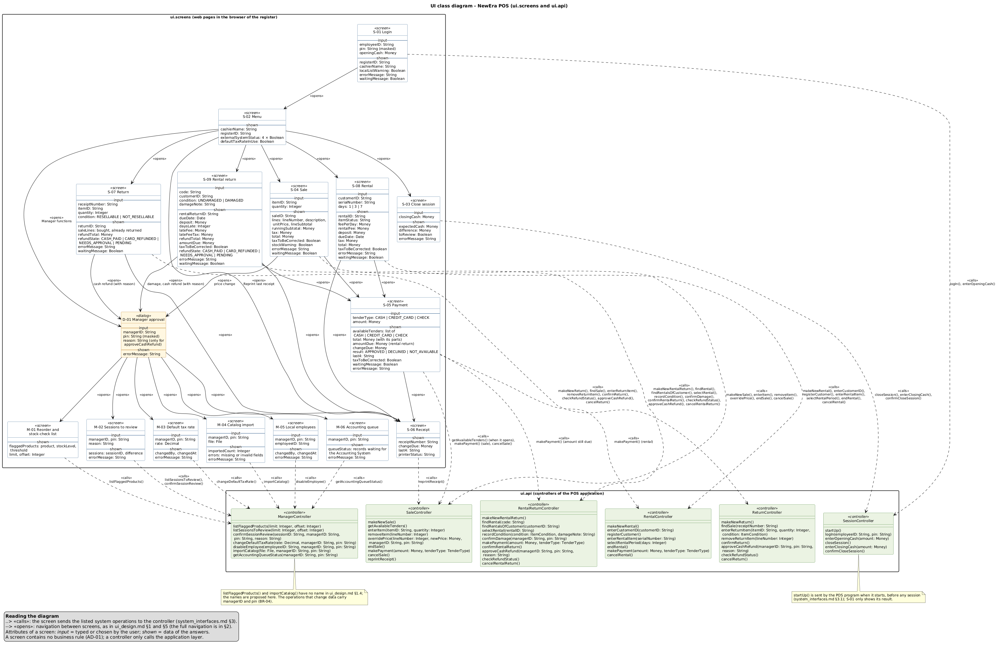

# UI Design – NewEra POS

| | |
| --- | --- |
| **Maintainer** | Yasmine Chkoundali |
| **Version** | 0.1 |
| **Last updated** | W10 (screens first part) |
| **Part of** | Increment 2 – Design (W10, user interface design) |
| **Inputs** | SRS v1.2 (§3.1.1, §3.3), [`ui_prototype.md`](ui_prototype.md), [`system_interfaces.md`](system_interfaces.md) §3, [`architecture.md`](architecture.md) §4.2 |

### Version history

| Version | Changes |
| --- | --- |
| 0.1 | §1 Screens: the screens of the cashier and of the store manager, with their use case and system operations. |

This document describes the user interface of NewEra POS: the screens, how the user moves between them, the rules that every screen follows, the classes of the UI and the navigation sequence of UC1. Each section has one owner. The names of the screens and of the controllers are those of the logical view (`ui.screens` and `ui.api`, [`architecture.md`](architecture.md) §4.2), and the operations are those of [`system_interfaces.md`](system_interfaces.md) §3.

## 1. Screens

### 1.1 How to read the table

- A **screen** is one web page of `ui.screens`, shown in the browser of the register. It shows data and sends the actions of the user. It contains no business rule (AD-01).
- The **system operations** are the requests that the screen sends to the controller of its use case (one request for each operation, system_interfaces.md §3).
- The **prototype** column gives the file of the [UI prototype](ui_prototype.md) that already shows the screen. A screen marked *new* is not in the prototype yet.
- The cashier screens are used after the cashier has logged in (UC4). Every operation that needs a store manager carries the manager ID and the PIN (BR-04), and is entered in the dialog of section 1.3.

### 1.2 Cashier screens

| ID | Screen | Use case | System operations (system_interfaces.md §3) | Controller | Prototype |
| --- | --- | --- | --- | --- | --- |
| S-01 | **Login** | UC4 Start Up | `startUp()`, `logIn(employeeID, pin)`, `enterOpeningCash(amount)` | `SessionController` | `index.html` |
| S-02 | **Menu** | UC4 (end), entry to UC1, UC2, UC3, UC5 | None. It shows the cashier, the register ID and the status of the external systems (see open point 1) | – | `menu.html` |
| S-03 | **Close session** | UC4 close session | `closeSession()`, `enterClosingCash(amount)`, `confirmCloseSession()` | `SessionController` | new |
| S-04 | **Sale** | UC1 Process Sale | `makeNewSale()`, `enterItem(itemID, quantity)`, `removeItem(lineNumber)`, `endSale()`, `cancelSale()`; price change: `overridePrice(...)` with the dialog D-01 | `SaleController` | `sale.html` |
| S-05 | **Payment** | UC1, UC3 and UC5 (amount still due) | `makePayment(amount, tenderType)` for a sale, a rental or a rental return | `SaleController`, `RentalController`, `RentalReturnController` | `payment.html` |
| S-06 | **Receipt** | UC1, UC2, UC3, UC5 | `reprintReceipt()`. The data of the receipt come from the answers of `makePayment`, `confirmReturn` and `confirmRentalReturn` | `SaleController` | `receipt.html` |
| S-07 | **Return** | UC2 Handle Returns | `makeNewReturn()`, `findSale(receiptNumber)`, `enterReturnItem(itemID, quantity, condition)`, `removeReturnItem(lineNumber)`, `confirmReturn()`, `checkRefundStatus()`, `cancelReturn()`; cash refund: `approveCashRefund(...)` with D-01 | `ReturnController` | `return.html` (without the condition of the item) |
| S-08 | **Rental** | UC3 Process Rental | `makeNewRental()`, `enterCustomerID(customerID)`, `registerCustomer()`, `enterRentalItem(serialNumber)`, `selectRentalPeriod(days)`, `endRental()`, `cancelRental()` | `RentalController` | `rental.html` |
| S-09 | **Rental return** | UC5 Return Rental | `makeNewRentalReturn()`, `findRental(code)`, `findRentalsOfCustomer(customerID)`, `selectRental(rentalID)`, `recordCondition(condition, damageNote)`, `confirmRentalReturn()`, `checkRefundStatus()`, `cancelRentalReturn()`; damage and cash refund: `confirmDamage(...)`, `approveCashRefund(...)` with D-01 | `RentalReturnController` | `return-rental.html` (without damage confirmation) |

### 1.3 Dialog of the store manager

| ID | Dialog | Used by | System operations | Controller | Prototype |
| --- | --- | --- | --- | --- | --- |
| D-01 | **Manager approval** (employee ID, PIN and, when needed, the reason) | S-04 price change (UC1 4d), S-07 and S-09 cash refund (UC2 9b2a, 9c; UC5), S-09 damage confirmation (UC5 6a) | Carries `managerID`, `pin` and `reason` of `overridePrice(...)`, `approveCashRefund(...)` and `confirmDamage(...)` | The controller of the screen that opens it | new |

### 1.4 Store manager screens

These are the "Manager screens" of the logical view. Each operation carries the manager ID and the PIN, because there is no manager session (system_interfaces.md §3.6, see open point 2).

| ID | Screen | Requirement | System operations (system_interfaces.md §3.6) | Controller | Prototype |
| --- | --- | --- | --- | --- | --- |
| M-01 | **Reorder and stock-check list** | FR-68, BR-09 | Reorder and stock-check list (`GET /api/products/flagged`) | `ManagerController` | new |
| M-02 | **Sessions to review** | FR-74, FR-75, BR-17 | `listSessionsToReview()`, `confirmSessionReview(sessionID, managerID, pin, reason)` | `ManagerController` | new |
| M-03 | **Settings** (default tax rate, disable an employee) | FR-69, FR-70, IR-05, IR-09 | Change the default tax rate, disable an employee in the local list | `ManagerController` | new |
| M-04 | **Catalog import** | IR-17 | Import the catalog (file and manager) | `ManagerController` | new |

### 1.5 Summary

- **9 cashier screens** (S-01 to S-09), **1 dialog** (D-01) and **4 store manager screens** (M-01 to M-04).
- Every system operation of the use cases UC1 to UC5 is used by exactly one screen, except `makePayment`, which the screen S-05 sends for three controllers, and `checkRefundStatus()` and `approveCashRefund(...)`, which UC2 and UC5 share.
- The prototype shows 8 of the 14 screens and dialogs. It does not show S-03, D-01, M-01 to M-04, and it does not show the condition of a returned item (S-07) nor the damage confirmation (S-09). The prototype stays a throw-away prototype (process model).

### 1.6 Open points

1. **Status of the external systems (NFR-15).** The menu S-02 and the warnings of S-04 and S-05 show whether each external system is available and whether the default tax rate is used. No operation of system_interfaces.md §3 returns this status. To decide with Alfonso (screen ↔ API table).
2. **How a store manager opens M-01 to M-04.** The system interfaces have no manager session. Proposal: the menu S-02 has an entry *Manager functions* that asks for the manager ID and the PIN, and each screen M-xx repeats them with its action (BR-04). To confirm.
3. **Pending card refund.** `checkRefundStatus()` needs the ID of the return or rental return. A refund that stays *pending* after the cashier has left the screen has no list to find it again. To decide with Alfonso.

## 2. Navigation between the screens

*To do (W10) – Yasmine, draft Sun 15 Nov: navigation diagram for UC1 to UC5 (`assets/ui_navigation.puml`), with the error and fallback messages.*

## 3. UI rules

*To do (W10) – Yasmine, draft Sun 15 Nov: rules from the usability NFRs (NFR-05, NFR-06, NFR-13 to NFR-18).*

## 4. UML class diagram of the UI

Owner: Josué (A3). The class diagram shows the 20 classes of the user interface: the 13 screens and the dialog of `ui.screens` (S-01 to S-09, D-01, M-01 to M-04 of section 1) and the 6 controllers of `ui.api`. The attributes of a screen are the data that the user enters (*input*) and the data that the screen shows from the answers of the system API (*shown*). The operations of a controller are the system operations of [`system_interfaces.md`](system_interfaces.md) §3, with the parameters of the SSDs and of the operation contracts. The diagram stops at the controllers: what happens behind them (handlers, adapters, external systems) is in the logical view and the interaction view of [`architecture.md`](architecture.md) §4.2 and §4.3. The names are those of sections 1 and 5, of the logical view and of the system interfaces.

### 4.1 Class diagram

_Editable source: [`assets/ui_classes.puml`](../../assets/ui_classes.puml) (PlantUML)._

What the diagram shows:

- **Screens and dialog (`ui.screens`).** One class for each screen of section 1: S-01 to S-09 for the cashier, M-01 to M-04 for the store manager and the dialog D-01. A screen contains no business rule (AD-01).
- **Calls (`<<calls>>`).** A dashed arrow from a screen to a controller lists the system operations that the screen sends. Every operation of `system_interfaces.md` §3.1 to §3.6 is sent by exactly one screen, except `makePayment`, `approveCashRefund` and `checkRefundStatus`, which are shared (see the next point).
- **Shared screens.** S-05 Payment sends `makePayment` to three controllers: `SaleController` (UC1), `RentalController` (UC3) and `RentalReturnController` (UC5, amount still due). S-06 Receipt is used by UC1, UC2, UC3 and UC5. D-01 sends nothing itself: it returns `managerID`, `pin` and `reason` to the screen that opened it (S-04, S-07 or S-09), and that screen adds them to its request (BR-04).
- **Navigation (`<<opens>>`).** The solid arrows are the moves between screens of sections 1 and 5. The complete navigation, with the error and fallback messages, is in section 2.
- **Controllers (`ui.api`).** One controller for each use case (`SessionController`, `SaleController`, `ReturnController`, `RentalController`, `RentalReturnController`) and `ManagerController` for the store manager functions. They receive the requests and only call the application layer (AD-01).
- **Slides.** The diagram is complete (20 classes). In the W10 slides one part is shown, for example S-04, S-05, S-06, D-01 and `SaleController`, with the note *"N of 20 classes shown, full diagram in docs/design/ui_design.md §4"*.

### 4.2 Traceability of the usability NFRs

The table links each usability requirement of SRS §3.3 with the screens of section 1, the element of the class diagram that carries it and the rule or behaviour that the screen follows. The rules are given in words, with their source, until the rules of section 3 have IDs (see open point 4).

| NFR | Requirement (short) | Screens (§1) | Element in the class diagram | UI rule or behaviour (source) |
| --- | --- | --- | --- | --- |
| NFR-05 | After 15 minutes of training, 4 of 5 new cashiers do a standard sale and a standard return alone, each in less than 3 minutes | S-02, S-04, S-05, S-06, S-07 | S-02 opens each use case; the sale is S-04 → S-05 → S-06 and the return is S-07 → S-06; S-05, S-06 and D-01 are shared by several use cases, so the cashier learns each of them once | After each line the cursor goes back to the item identifier field (§5.1); one payment screen and one receipt screen for UC1, UC3 and UC5 (§1.2); rules of NFR-16 (§3) |
| NFR-06 | A standard sale needs 3 clicks or fewer after the items are entered | S-04, S-05 | `endSale()` on S-04 (click 1); `makePayment(amount, tenderType)` on S-05 with the tender (click 2) and the confirmation of the amount (click 3); S-06 needs no click | After the items the cashier needs three actions: *End sale*, the tender and the confirmation of the amount (§5.1); scanning and typing an amount are not clicks (SRS §3.3) |
| NFR-13 | Text readable at 1 m; buttons at least 10 mm × 10 mm | S-01 to S-09, D-01, M-01 to M-04 | Every class of `ui.screens` | Text size and button size are set once for all screens (§3); checked on the register screen |
| NFR-14 | Error message on the screen where the error happens, in plain words, with what the cashier can do next, without technical codes | S-01, S-03, S-04, S-05, S-07, S-08, S-09, D-01, M-02, M-03, M-04; S-06 for the printer | Attribute `errorMessage` of these screens, filled with the message for the cashier of the answer (`400`, `403`, `404`, `409`, `422`, system_interfaces.md §2); attribute `printerStatus` of S-06 | The error is shown on the screen that sent the request: unknown item on S-04, declined card on S-05 (§5.1); the screen never shows the error code (§3) |
| NFR-15 | The menu shows whether each of the four external systems is available; the transaction screens warn when the default tax rate is used | S-02, S-04, S-05 | S-02: `externalSystemStatus`, `defaultTaxRateInUse`; S-04 and S-05: `taxToBeCorrected` (from the answer of `endSale()`) | Status in the menu at all times; warning on the transaction screens while the default rate is used (§1.6 point 1, §5.1 step 7a) |
| NFR-16 | One main task for each screen; the same action has the same label and position on all screens | S-01 to S-09, D-01, M-01 to M-04 | One class for each step of a use case; shared screens S-05 (UC1, UC3, UC5), S-06 (UC1, UC2, UC3, UC5) and D-01 (price change, cash refund, damage) | Confirm, cancel and back to the menu keep the same label and position on every screen (§3); one manager dialog for every approval (§1.3) |
| NFR-17 | Before a payment or a refund is completed, the screen shows the amount and each part of its calculation and asks for confirmation | S-05, S-07, S-08, S-09 | S-05: `total` with its parts, then `makePayment`; S-07: `refundTotal`, then `confirmReturn()`; S-08: `rentalFee`, `tax`, `deposit`, `total`, then S-05; S-09: `deposit`, `lateFee`, `lateFeeTax`, `refundTotal`, `amountDue`, then `confirmRentalReturn()` | The cashier confirms the amount on S-05 (§5.1); a refund is paid only after the confirmation on S-07 or S-09 (§1.2) |
| NFR-18 | A waiting message when an operation with an external system takes longer than 1 second | S-01, S-04, S-05, S-07, S-08, S-09 | Attribute `waitingMessage` for `logIn()` (HR System), `endSale()`, `endRental()` and `recordCondition()` (Tax Calculator), `makePayment()` (Payment Service), `confirmReturn()`, `confirmRentalReturn()` and `checkRefundStatus()` (card refund) | The screen shows the message after 1 s, before the answer arrives (§5.1); the timeouts are 10 s and 5 s (AD-07) |

Verification (SRS §4): NFR-05 and NFR-06 by demonstration and test (user test with 5 new cashiers, click counting TC-NFR-06); NFR-13 to NFR-18 by inspection of the screens against the prototype and demonstration with a cashier.

### 4.3 Open points

1. **Names of the store manager operations.** `system_interfaces.md` §3.6 does not name them. The diagram proposes `listFlaggedProducts`, `changeDefaultTaxRate`, `disableEmployee` and `importCatalog` (the other two already have a name). To confirm with Alfonso and to add to §3.6.
2. **`startUp()`.** Section 1.2 lists it for S-01, but `system_interfaces.md` §3.1 says the POS program sends it when it starts, before any session. The diagram keeps it in `SessionController` and no screen calls it; S-01 only shows its result. To align section 1.2 (Yasmine).
3. **Status of the external systems and default tax rate (NFR-15).** No operation returns the availability of the four systems, so `externalSystemStatus` and `defaultTaxRateInUse` of S-02 have no operation yet (section 1.6, point 1). Only `endSale()` returns `taxToBeCorrected`; S-08 and S-09 (tax of a rental and of a late fee, IR-05) also need the warning, to confirm.
4. **Rules of section 3 and navigation of section 2.** Both are still to do. The table of 4.2 describes the rules in words; when section 3 has rule IDs they replace these descriptions, and the `<<opens>>` arrows are aligned with the navigation diagram.
5. **Menu entries.** The arrow S-02 → S-03 (close session) is assumed, because section 1.2 only names the use cases UC1, UC2, UC3 and UC5 for the menu. M-01 to M-04 have no incoming arrow, because how a store manager reaches them is open (section 1.6, point 2).

## 5. Navigation sequence diagram of UC1

Owner: Avni (A4). The navigation sequence diagram shows how the Cashier moves through the screens of UC1 Process Sale and which request each screen sends to its controller. It stops at the controller of `ui.api`: what happens behind the controller (handler, adapters, external systems) is in the interaction view of [`architecture.md`](architecture.md) §4.3. The screens are those of section 1, the operations and answers those of [`system_interfaces.md`](system_interfaces.md) §3.2, and the steps those of SRS UC1 and its SSD.

### 5.1 Main scenario

_Editable source: [`assets/ui_sequence_uc1.puml`](../../assets/ui_sequence_uc1.puml) (PlantUML)._

What the diagram shows:

- **Screens used.** S-02 Menu → S-04 Sale → S-05 Payment → S-06 Receipt, and back to S-04 for the next sale. All requests go to `SaleController`.
- **Start and items (steps 1–5).** S-04 sends `makeNewSale()` when it opens and `enterItem(itemID, quantity)` for each scanned or typed item. After each line the cursor goes back to the item identifier field, so the Cashier can scan item after item (SRS §3.1.1). An unknown item (4a) is shown on S-04, in plain words, and adds no line (FR-03, NFR-14). Remove a line (4c), price override with the dialog D-01 (4d) and cancel the sale (\*b) also stay on S-04.
- **End of the sale (steps 6–7).** S-04 sends `endSale()` and receives the subtotal, the tax and the total, with `taxToBeCorrected` when the default tax rate was used (7a). Then S-05 opens with the total and its parts before the Cashier confirms the payment (NFR-17).
- **Payment (steps 8–10).** S-05 sends one `makePayment(amount, tenderType)`. For a card the screen only sends the tender: the card is read by the card reader and the screen never sends or receives card data (IR-12); it shows a waiting message after 1 s (NFR-18). A declined card (9b2a) is shown on S-05 and the Cashier chooses another tender (BR-18).
- **Receipt (steps 11–12).** After `APPROVED`, S-06 shows the result and the change due (cash). The receipt is printed by the POS application. *New sale* opens S-04 again. After the items, the Cashier needs three actions: *End sale*, the tender and the confirmation of the amount (NFR-06).

### 5.2 Card payment not available (UC1 extension 9b2b)

_Editable source: [`assets/ui_sequence_uc1_payment_unavailable.puml`](../../assets/ui_sequence_uc1_payment_unavailable.puml) (PlantUML)._

What the diagram shows:

- **Waiting and message.** S-05 shows a waiting message after 1 s (NFR-18). When the Payment Service does not answer within 10 s (AD-07), `makePayment` returns `NOT_AVAILABLE` and S-05 shows *"Card payment not available"* with three choices: *Retry*, *Other tender* and *Cancel sale* (NFR-14). The failure is logged by the POS application (IR-10), not by the screen. No payment is created and the sale stays open (BR-18).
- **Retry (IR-02).** S-05 sends the same `makePayment(amount, CREDIT_CARD)` again. The sale keeps its transaction ID, so the customer is never charged twice; the card is read again (AD-09).
- **Other tender.** S-05 sends `makePayment` with the new tender. The POS application first voids the card request (`voidAuthorization`, IR-15); the screen does not see this step.
- **Cancel sale (\*b).** S-05 sends `cancelSale()` itself to `SaleController`, so the cashier does not go back to S-04 first (review #58). The card request is voided first, the stock levels do not change (FR-07) and the Menu S-02 opens; the cashier session stays open.

### 5.3 Open points

1. **Where the total is shown.** The diagram shows the total on S-04 after `endSale()` and then opens S-05. To align with the navigation diagram of section 2.
2. **Cancel from S-05 (review #58).** S-05 now sends `cancelSale()` itself (section 5.2). Section 1.2 (row S-05) and the UI class diagram of section 4 (`S-05 ..> SaleController`) still list `cancelSale()` only for S-04; to add it to S-05 there (Yasmine, Josué).
3. **Screen after a cancelled sale.** The diagram opens the Menu S-02. Opening an empty S-04 for the next customer is also possible. To align with section 2.
