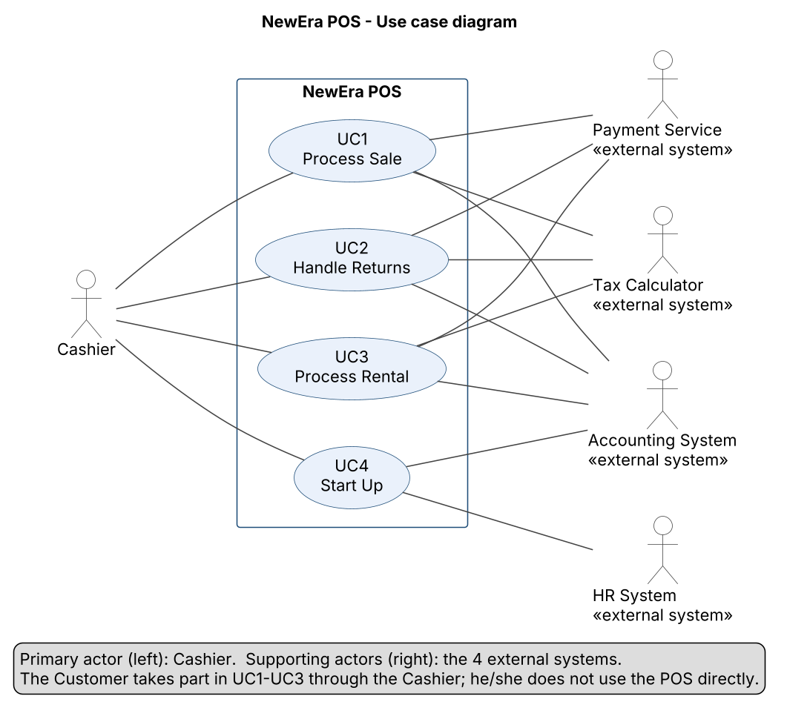

# Software Requirements Specification – NewEra POS

Team D · Software Engineering · BUAA
Structure based on ISO/IEC/IEEE 29148:2018

| Version | Date       | Author        | Changes                                                                                                                                                                                                                          |
| ------- | ---------- | ------------- | -------------------------------------------------------------------------------------------------------------------------------------------------------------------------------------------------------------------------------- |
| 0.1     | 2026-10-21 | Alfonso Pinto | First draft: sections 1 and 2; team decisions on actors, payment methods and UC5; links to the W06 requirement documents; UC1 Process Sale fully dressed; functional requirements FR-01 to FR-17 (UC1)                           |
| 0.2     | 2026-10-21 | Alfonso Pinto | Review #19 (Avni): goals in §1.2 linked to measurable requirements (NFR, FR, BR)                                                                                                                                                 |
| 0.3     | 2026-10-21 | Alfonso Pinto | Rest of review #19 (Avni): Customer change from the proposal explained (§1.3.1); store manager added as secondary user (§1.3.1, §1.3.3); assumption on Proposed rules and open questions rephrased (§1.5); owner of UC5 (§3.2.5) |
| 0.4     | 2026-10-27 | Alfonso Pinto | Review #23 (Borja): retry of the card payment added to UC1 ext. 9b2b and FR-11, as in IR-02                                                                                                                                      |
| 0.9     | 2026-10-27 | Alfonso Pinto | Integration of all sections; §1 aligned with §3; verification of IR-11–14, NFR-13–18, DR, DC; §5.3 open questions; review #23: UC1 ext. 4b1, 6a, 11c, \*b and FR-18, FR-19, priority rule (FR-30–39 Should), UC5 damaged item                                                                                                 |

> **Status: v0.9, complete draft for the final review.** All sections are written; the review findings are fixed in v1.0 (W07). Terms are used as defined in the [glossary](glossary.md); business rules (BR-xx) are defined there too. Interface requirements (IR-xx) are in §3.1, the full interface detail in [external_interfaces.md](external_interfaces.md). Open questions that are still to be confirmed are listed in §5.3.

---

## 1. Introduction

### 1.1 Purpose

This document specifies the software requirements of **NewEra POS**, a point-of-sale system for a retail store. It describes what the system must do, the quality it must have and the constraints it must respect.

It is written for:

- the development team (Team D), as the basis for design, implementation and testing;
- the teacher and the other teams, who review it as Assignment 1;
- the (simulated) customer, the owner of the store, to confirm that the system covers the store's needs.

### 1.2 Scope

NewEra POS is the application that a cashier uses at a store register to:

- record the items a customer buys and show the running subtotal;
- calculate the tax and the total;
- take payment in cash, by credit card or by check;
- update the stock levels and send every completed transaction to the Accounting System;
- print a receipt;
- process returns of items bought in the store;
- rent equipment and process the return of rented equipment;
- start up the register and open a cashier session.

The system **does not** cover: purchasing from suppliers, full inventory management, the store's website or online shop, or payroll. Payment authorization, tax calculation, accounting and human resources are provided by external systems; NewEra POS only communicates with them.

**Goals of the system**

Each goal is refined into measurable requirements in section 3 (functional requirements in §3.2.6, NFR-xx in §3.3, §3.4, §3.7 and §3.8; see [nfrs.md](nfrs.md)).

| Goal                                                                   | Measured by                                                                                                                  |
| ---------------------------------------------------------------------- | ---------------------------------------------------------------------------------------------------------------------------- |
| Fast checkout, so that customers do not wait                           | NFR-01 (a sale line item is registered in less than 1 second), NFR-06 (maximum number of clicks to complete a standard sale) |
| Correct taxes and payments, so that the store does not lose money      | FR-08 to FR-11 (tax from the Tax Calculator, cash and card payment rules), BR-01, BR-05, BR-06                               |
| Up-to-date stock levels and accounting records after every transaction | FR-14, FR-15, NFR-04 (a completed sale is saved even if the connection drops)                                                |
| Easy to learn for new cashiers                                         | NFR-05 (a new cashier can process a standard sale and a return after 15 minutes of training)                                 |

### 1.3 Product overview

#### 1.3.1 Product perspective

NewEra POS runs on the registers of the store. It is a new system that replaces manual checkout. It has **one primary actor**, the Cashier, and **four supporting actors**, the external systems. The Customer is a **stakeholder**, not an actor: the customer takes part in sales, returns and rentals only through the cashier and never uses the register directly. The W01 proposal listed the Customer as a primary actor; the team changed this in W06 for that reason (see [use_case_model.md](use_case_model.md), "Decided in W06").

| External element  | Type                               | Interaction                                                                                    |
| ----------------- | ---------------------------------- | ---------------------------------------------------------------------------------------------- |
| Cashier           | Primary actor                      | Operates the register in all use cases                                                         |
| Customer          | Stakeholder                        | Buys, returns or rents items and pays, through the cashier                                     |
| Store manager     | Secondary user                     | Approves price overrides (UC1 ext. 4d, BR-04), views the reorder list (UC1 ext. 11b, BR-09), changes the default tax rate (IR-05) and disables employees in the local list (IR-09) |
| Payment Service   | Supporting actor (external system) | Authorizes credit card and check payments and card refunds                                     |
| Tax Calculator    | Supporting actor (external system) | Calculates the tax of a transaction                                                            |
| Accounting System | Supporting actor (external system) | Receives every completed sale, return, rental and rental return                                |
| HR System         | Supporting actor (external system) | Checks the employee ID and PIN and confirms that the employee is a valid, active cashier or store manager |

The use case model, with a one-paragraph description of each use case, is in [use_case_model.md](use_case_model.md).

**System interfaces.** The four external systems are described in [external_interfaces.md](external_interfaces.md) and specified in section 3.1.3 (IR-01 to IR-10).

**User interfaces.** The cashier works with a screen, a keyboard, a barcode scanner, a card reader, a receipt printer and a cash drawer. See section 3.1.1.

**Hardware interfaces.** Barcode scanner, card reader, receipt printer and cash drawer connected to the register. See section 3.1.2 (IR-11 to IR-14).

**Operations.** The system is used during the store's opening hours. Each register is started at the beginning of the day (UC4) and is used by one cashier at a time, inside a cashier session.

#### 1.3.2 Product functions

| ID  | Use case       | Priority | Summary                                                                                                                                                         |
| --- | -------------- | -------- | --------------------------------------------------------------------------------------------------------------------------------------------------------------- |
| UC1 | Process Sale   | Must     | Register the items a customer buys, calculate the tax and total, take payment (cash, credit card or check), update stock, print the receipt and report the sale |
| UC2 | Handle Returns | Must     | Take back items bought in the store, check the return rules and refund the customer with the original tender                                                    |
| UC3 | Process Rental | Should   | Rent available equipment to a customer for a rental period, charging the rental fee and a deposit                                                               |
| UC4 | Start Up       | Must     | Start the register, send pending records and open a cashier session for a valid cashier                                                                         |
| UC5 | Return Rental  | Should   | Take back rented equipment, check its condition, apply the late fee if needed and refund the deposit                                                            |

**UC5 was added during the W06 analysis.** Returning rented equipment happens in a different visit and has a different goal and different rules (condition check, late fee, deposit refund, item becomes _Available_ again). It is therefore neither an extension of UC3 (one session, one goal) nor part of UC2 (which refunds a sale). The scope of the proposal grows from 4 to 5 use cases.

**Payment methods.** Three tenders are supported: **cash**, **credit card** and **check**. The proposal counted three methods but named only two; the case's domain model includes cash, credit and check payments. Check payments are authorized through the Payment Service (no new external system) and have priority _Could_.

#### 1.3.3 User characteristics

The main user is the **cashier**: basic computer skills, often new or temporary staff, works standing at the counter with customers waiting, especially at peak hours (lunch time, evenings, weekends). The system must therefore be usable with little training and few steps per task. The full stakeholder list and the cashier persona (Li Wei) are in [stakeholders.md](stakeholders.md).

The **store manager** is a secondary user: an experienced employee who uses the register only for exceptions, such as approving a price override (BR-04) or checking the products flagged for reorder (BR-09). The manager identifies himself or herself at the cashier's register, so these actions must be quick and must not close the cashier session.

#### 1.3.4 Limitations

- Credit card and check payments depend on the Payment Service; if it is not available, the cashier can retry the payment or take cash (IR-02).
- Real external systems are not available to the team; they will be simulated with stubs that follow the interface specification.
- Developed by a team of six students within a 16-week course.

### 1.4 Definitions, acronyms and abbreviations

| Term               | Definition                                                                                  |
| ------------------ | ------------------------------------------------------------------------------------------- |
| POS                | Point of sale: the system used at the counter to record transactions and take payments      |
| SRS                | Software Requirements Specification                                                         |
| UC                 | Use case                                                                                    |
| FR / NFR / BR / IR | Functional requirement / Non-functional requirement / Business rule / Interface requirement |
| DR / DC            | Logical database (data) requirement / Design constraint                                     |
| AC / TC            | Acceptance criterion / Test case                                                            |
| MoSCoW             | Priority scale: Must, Should, Could, Won't (this time)                                      |

All domain terms (register, sale line item, tender, cashier session…) are defined in the [glossary](glossary.md).

### 1.5 Assumptions and dependencies

- Each product has a unique item identifier (barcode) and a product description with its price in the product catalog.
- Tax rules are applied by the external Tax Calculator, not by NewEra POS (BR-01).
- The store has a network connection to the external systems during opening hours; when it fails, the fallbacks in [external_interfaces.md](external_interfaces.md) apply.
- Business rules marked _Proposed_ and the open questions in the [glossary](glossary.md), section 4, still have to be confirmed against the full case study; in particular the refund period, the deposit amount, the rental period and the late fee.

## 2. References

| ID  | Reference                                                                                                                                                                                                                                                                      |
| --- | ------------------------------------------------------------------------------------------------------------------------------------------------------------------------------------------------------------------------------------------------------------------------------ |
| [1] | ISO/IEC/IEEE 29148:2018 – Systems and software engineering – Life cycle processes – Requirements engineering                                                                                                                                                                   |
| [2] | ISO/IEC 25010 – Systems and software quality models                                                                                                                                                                                                                            |
| [3] | C. Larman, _Applying UML and Patterns_, NextGen POS case study                                                                                                                                                                                                                 |
| [4] | Team D, Project proposal (W01), [`docs/release/project_proposal.pdf`](../release/project_proposal.pdf)                                                                                                                                                                         |
| [5] | Team D, Project overview, [`docs/project_overview.md`](../project_overview.md)                                                                                                                                                                                                 |
| [6] | Team D, Process model, [`plans/process_model.md`](../../plans/process_model.md)                                                                                                                                                                                                |
| [7] | Team D, Project plan, [`plans/project_plan.md`](../../plans/project_plan.md)                                                                                                                                                                                                   |
| [8] | Team D, W06 requirement documents: [stakeholders](stakeholders.md), [elicitation plan](elicitation_plan.md), [use case model](use_case_model.md), [external interfaces](external_interfaces.md), [glossary and business rules](glossary.md), [quality goals](quality_goals.md) |

## 3. Specific requirements

### 3.1 External interfaces

#### 3.1.1 User interfaces

The cashier works on the register with a screen, a barcode scanner, a card reader, a receipt printer and a cash drawer (see 3.1.2). The screens were built as a clickable HTML prototype, described in the [UI prototype guide](../design/ui_prototype.md) and opened with [`index.html`](../design/prototype/index.html). The prototype is not the final design: every external system is simulated and the values of the refund period, the late fee, the rental fees and the deposits are only examples.

The usability needs that apply to all screens are in section 3.3 (NFR-05, NFR-06 and NFR-13 to NFR-18) and come from the cashier persona in [stakeholders.md](stakeholders.md). The subsections below list the needs of each screen.

**Start Up / login** (`index.html`) – UC4 – FR-40, FR-43, FR-44, FR-45, FR-47

- Employee ID, PIN and opening cash on one screen; the PIN is never shown (FR-44).
- When the HR System is not available, a warning shows the date of the last update of the local employee list (FR-45) and the cashier can continue.
- An employee ID that is not found, or that is not an active cashier, gives a message on this screen (NFR-14). The prototype does not check the PIN yet (FR-44).
- The register is ready for use in less than 30 seconds (NFR-02).

**Main menu** (`menu.html`) – end of UC4, entry to UC1, UC2, UC3 and UC5 – FR-49

- Shows the name of the cashier and the register ID (FR-49).
- One large button for each task: sale, return, rental and rental return.
- Shows the session (cashier, opening cash, number of transactions) and the status of the four external systems (online or offline), always visible (NFR-15).
- When the Tax Calculator is offline, its status changes to offline, and the sale and payment screens warn that the default tax rate is used (NFR-15).

**Sale** (`sale.html`) – UC1 – FR-02 to FR-05, FR-08

- After each item, the cursor returns to the item identifier field, so the cashier can scan item after item without touching the screen.
- Each line shows the item ID, description, quantity, price and line total; the number of items, the subtotal, the tax and the total are shown below the lines (FR-02, FR-08). An empty sale shows _No items yet. Scan the first item to start the sale._
- An unknown item identifier gives a message on this screen (FR-03, NFR-14).
- A line is removed with one action, the button next to it (FR-05).
- A sale line item is registered in less than 1 second (NFR-01).

**Payment** (`payment.html`) – UC1 and UC3 – FR-09 to FR-12, FR-35, FR-37

- The total and the tenders (cash, credit card, check) are visible together.
- For cash, an amount field with an _Exact_ button and quick amounts (20, 50, 100 and 200 €); the change due is shown, and the screen says when the amount tendered is less than the total (FR-09, NFR-06).
- The result of a card or check authorization is shown in words (approved, declined, service not available) with what the cashier can do next, for example another tender (FR-11, NFR-14).
- A waiting message (_Authorizing... please wait_) is shown while the Payment Service answers (NFR-18). The _Complete_ button stays disabled until the cash amount is enough or the card payment is approved (FR-09, FR-10).

**Receipt** (`receipt.html`) – UC1 and UC3 – FR-13, FR-16, FR-17, FR-39

- Shows the store, the date, the register and cashier, the lines, the subtotal, the tax, the total, the tender, the change (cash) and the authorization code (card or check) (FR-13, FR-16).
- The prototype shows no card number; the SRS allows only the last 4 digits (FR-16, NFR-08).
- For a rental, the deposit is marked as refundable and the due date is shown (FR-39).
- A _Print receipt_ button prints the receipt again (FR-17); _New sale_ and _Main menu_ lead to the next task.

**Return** (`return.html`) – UC2 – FR-20 to FR-29

- One field for the receipt number, scanned or typed (IR-11).
- A message for an unknown receipt number and for a sale older than the refund period (FR-21, NFR-14).
- A table of the items of the sale with the quantity bought and the price; the cashier ticks each returned item and enters the quantity returned (FR-22). The prototype does not show the quantity already returned yet (FR-21).
- The returned items, the tax and the refund are shown before the cashier confirms, together with the tender of the refund; for a card, only the last 4 digits (for example _Credit card \*\*\*\* 4821_) (FR-23, NFR-17).
- _Confirm refund_ stays disabled until at least one item is selected; _Back to menu_ leaves the screen without changing anything (FR-24). After the confirmation the screen says that the return receipt is printed.

**Rental** (`rental.html`) – UC3 – FR-30 to FR-36

- A customer with an overdue rental is blocked with a message that gives the reason (FR-31, NFR-14).
- The item list shows the status of each item, with a note that only items with the status _Available_ can be rented (FR-33).
- The rental period is chosen with one button (1, 3 or 7 days in the prototype); the rental fee, the tax, the due date, the deposit and the total are shown before the payment (FR-34, FR-35, NFR-17).

**Return rental** (`return-rental.html`) – UC5 – FR-50 to FR-59

- The rental is found by the serial number, scanned or typed. Finding it by the rental receipt number or the customer ID (FR-51) is not in the prototype yet.
- The condition of the item (undamaged or damaged) must be chosen before _Confirm return_ is enabled (FR-52).
- The calculation shows the deposit paid, the late fee, the amount kept for damage and the refund (FR-54, NFR-17). The tax of the late fee (FR-53) is not in the prototype yet.

#### 3.1.2 Hardware interfaces

Each register has the following devices, connected to the register computer. The POS uses them through standard drivers; the device models are not fixed by this SRS (NFR-10).

| Device                                 | Use cases                                       | The POS sends / receives                                                                                           | If the device fails                                                                       |
| -------------------------------------- | ----------------------------------------------- | ------------------------------------------------------------------------------------------------------------------ | ----------------------------------------------------------------------------------------- |
| **Barcode scanner**                    | UC1 step 4, UC2 step 4, UC3 step 6, UC5 step 4  | Receives the item identifier, serial number or receipt number as text, the same as if it was typed                 | The cashier types the identifier on the keyboard                                          |
| **Card reader** (chip and contactless) | UC1 ext. 9b, UC3 ext. 13b, UC5 ext. 7b          | Receives the card data (or a token) and passes it to the Payment Service; sends the amount to show to the customer | Card payment not possible; the cashier offers another tender (IR-02)                      |
| **Receipt printer** (thermal)          | UC1 step 12, UC2 step 11, UC3 step 16, UC5 step 11 | Sends the receipt text; receives the printer status (ready, no paper, error)                                       | The POS shows the error; the cashier fixes the printer and reprints (UC1 ext. 12a, FR-17) |
| **Cash drawer**                        | UC1 ext. 9a, UC2 ext. 9a, UC3 ext. 13a, UC5 ext. 9a | Sends the _open_ command                                                                                           | The cashier opens the drawer with the manual key; the transaction is not affected         |

| ID    | Requirement                                                                                                                                      | Device          | Priority | Source                        |
| ----- | ------------------------------------------------------------------------------------------------------------------------------------------------ | --------------- | -------- | ----------------------------- |
| IR-11 | The POS shall accept an item identifier, serial number or receipt number from the barcode scanner and from the keyboard in the same way.         | Barcode scanner | Must     | UC1 step 4, NFR-10            |
| IR-12 | The POS shall read credit cards with a chip and contactless card reader and shall not keep the card data after the Payment Service has answered. | Card reader     | Must     | UC1 ext. 9b, NFR-08, NFR-11   |
| IR-13 | The POS shall print receipts on a thermal receipt printer and shall show a message to the cashier when the printer reports no paper or an error. | Receipt printer | Must     | UC1 step 12, ext. 12a, NFR-10 |
| IR-14 | The POS shall open the cash drawer only for a cash payment or a cash refund.                                                                     | Cash drawer     | Must     | FR-09, BR-06, UC2 ext. 9a, UC5 ext. 9a |

#### 3.1.3 Software interfaces (external systems)

| External system   | Use cases               | Timeout | If not available                                                                       | Interface requirements |
| ----------------- | ----------------------- | ------- | -------------------------------------------------------------------------------------- | ---------------------- |
| Payment Service   | UC1, UC2, UC3, UC5      | 10 s    | Card/check payment refused; cashier can retry or offer cash; transaction stays open    | IR-01, IR-02, IR-03    |
| Tax Calculator    | UC1, UC2, UC3, UC5      | 5 s     | Default tax rate (changed only by a store manager), transaction flagged for correction | IR-04, IR-05           |
| Accounting System | UC1, UC2, UC3, UC5, UC4 | –       | Records queued locally and sent later in order                                         | IR-06, IR-07           |
| HR System         | UC4                     | 5 s     | Local copy of the employee list, refreshed at every start-up                           | IR-08, IR-09           |
| All               | –                       | –       | Every failed communication is logged without card or personal data                     | IR-10                  |

| ID    | Requirement                                                                                                                                                                                                                                                         | System            | Priority | Business rule |
| ----- | ------------------------------------------------------------------------------------------------------------------------------------------------------------------------------------------------------------------------------------------------------------------- | ----------------- | -------- | ------------- |
| IR-01 | The POS shall request authorization from the Payment Service for every credit card and check payment and shall complete the payment only if it is approved.                                                                                                         | Payment Service   | Must     | BR-05         |
| IR-02 | When the Payment Service does not answer within 10 seconds, returns an error or the connection drops during the request, the POS shall inform the cashier, keep the transaction open and let the cashier retry the payment or cancel it and use another tender.     | Payment Service   | Must     | BR-05         |
| IR-03 | The POS shall send card refunds of returns to the Payment Service, using the card of the original sale.                                                                                                                                                             | Payment Service   | Should   | BR-08         |
| IR-04 | The POS shall obtain the tax of every sale, return, rental and rental return from the Tax Calculator.                                                                                                                                                               | Tax Calculator    | Must     | BR-01         |
| IR-05 | When the Tax Calculator does not answer within 5 seconds, the POS shall apply the default tax rate and mark the transaction for later tax correction. Only a store manager shall be able to change the default tax rate.                                            | Tax Calculator    | Must     | BR-02, BR-04  |
| IR-06 | The POS shall send every completed sale, return, rental and rental return to the Accounting System.                                                                                                                                                                 | Accounting System | Must     | BR-14         |
| IR-07 | When the Accounting System is not available, the POS shall keep the records in a local queue and send them, in order and without loss, when the system is available again.                                                                                          | Accounting System | Must     | BR-14         |
| IR-08 | The POS shall send the employee ID and the PIN to the HR System, which checks the PIN and answers whether the employee is a valid, active cashier or store manager. The POS shall start a cashier session only for a valid, active cashier.                         | HR System         | Must     | BR-13, NFR-08 |
| IR-09 | The POS shall refresh the local copy of the employee list at every start-up; the local copy keeps the PIN only as a salted hash (DR-11). When the HR System does not answer within 5 seconds, the POS shall validate employees against this local copy; a store manager shall be able to disable an employee in the local copy. | HR System         | Should   | BR-13         |
| IR-10 | The POS shall log every failed communication with an external system (system, time, error) without logging card data or other personal data.                                                                                                                        | All               | Should   | –             |

The store manager actions in IR-05 (change the default tax rate) and IR-09 (disable an employee locally) need the store manager to identify at the register with employee ID and PIN, checked as in IR-08; the cashier session stays open.

Full detail (data sent and received, timing, open questions): [external_interfaces.md](external_interfaces.md) v0.2.

### 3.2 Functions

#### 3.2.1 UC1 Process Sale (fully dressed)

|                       |                                                                        |
| --------------------- | ---------------------------------------------------------------------- |
| **Use case**          | UC1 Process Sale                                                       |
| **Goal**              | Sell items to a customer, take payment and give the customer a receipt |
| **Level**             | User goal (primary use case)                                           |
| **Primary actor**     | Cashier                                                                |
| **Supporting actors** | Payment Service, Tax Calculator, Accounting System                     |
| **Priority**          | Must · build order 1                                                   |
| **Trigger**           | A customer arrives at the register with items to buy                   |

**Stakeholders and interests**

- _Cashier_: enter items quickly and without mistakes; clear messages when something fails; no cash shortages in the drawer.
- _Customer_: short wait, correct prices and tax, choice of tender, correct receipt, secure card payment.
- _Store manager_: every sale recorded correctly, stock levels up to date, products reordered in time.
- _Accountant_: every sale and its tax reported correctly to the Accounting System.
- _Owner_: no loss of sales or payments, even when an external system fails.

**Preconditions**

- The register has been started and a cashier session is open (UC4).

**Success guarantees (postconditions)**

- The sale is saved with its sale line items, tax, total and payment.
- The sale is linked to the cashier of the session (BR-13).
- The stock levels are updated; products below the reorder threshold are flagged for reorder (BR-09).
- The receipt is printed.
- The sale is sent, or queued to be sent, to the Accounting System (BR-14).

**Failure guarantees**

- If the sale is cancelled, nothing is saved as completed, the stock levels do not change and no payment is taken.
- No card payment is completed without authorization (BR-05).

**Main success scenario**

| Actor action                                                      | System responsibility                                                                                                   |
| ----------------------------------------------------------------- | ----------------------------------------------------------------------------------------------------------------------- |
| 1. The Customer arrives at the register with items to buy.        |                                                                                                                         |
| 2. The Cashier starts a new sale.                                 | 3. The System creates a new sale linked to the cashier session.                                                         |
| 4. The Cashier enters the item identifier (scan or keyboard).     | 5. The System records a sale line item and shows the product description, price, quantity and running subtotal (BR-03). |
| _The Cashier repeats steps 4–5 until all items are entered._      |                                                                                                                         |
| 6. The Cashier indicates that the sale is complete.               | 7. The System gets the tax from the Tax Calculator (BR-01) and shows the total.                                         |
| 8. The Cashier tells the Customer the total and asks for payment. |                                                                                                                         |
| 9. The Customer pays and the Cashier enters the payment.          | 10. The System handles the payment (see 9a–9c).                                                                         |
|                                                                   | 11. The System saves the completed sale, updates the stock levels and sends the sale to the Accounting System (BR-14).  |
|                                                                   | 12. The System prints the receipt.                                                                                      |
| 13. The Customer leaves with the receipt and the items.           |                                                                                                                         |

**Extensions (alternative flows)**

- **\*a. At any time, the System fails (crash or power cut):**
  1. The Cashier restarts the register (UC4).
  2. The System recovers the open sale, or reports that it was not completed; no completed sale or payment is lost.
- **4a. The item identifier is not valid (not in the product catalog):**
  1. The System shows an error and rejects the entry.
  2. The Cashier checks the code and types it again, or puts the item aside.
- **4b. The customer buys several units of the same product:**
  1. The Cashier enters the item identifier and the quantity.
  2. The System records one sale line item with that quantity.
  - **4b1. The quantity is not valid** (zero, negative or not a whole number): the System rejects it and asks for the quantity again.
- **4c. The Cashier removes a line item before payment** (customer changes their mind):
  1. The Cashier selects the line and removes it.
  2. The System updates the running subtotal.
- **4d. The customer disputes the price:**
  1. The Cashier asks a store manager.
  2. The store manager identifies himself or herself and enters the new price (BR-04).
  3. The System records the override and the manager who approved it.
- **\*b. At any time before the payment (steps 4 to 9), the customer cancels the sale:**
  1. The Cashier cancels the sale.
  2. The System discards the sale; stock levels do not change.
- **6a. The Cashier indicates that the sale is complete, but the sale has no line items:**
  1. The System does not end the sale and asks for the first item.
  2. The use case continues at step 4.
- **7a. The Tax Calculator is not available:**
  1. The System applies the default tax rate, marks the sale _tax to be corrected_ and shows a short warning (BR-02, IR-05).
  2. The use case continues at step 8.
- **9a. Cash payment:**
  1. The Cashier enters the amount tendered.
  2. If the amount is lower than the total, the System rejects it and asks for the full amount (BR-06).
  3. The System shows the change due and opens the cash drawer.
  4. The Cashier puts the cash in the drawer and gives the change to the Customer.
  5. The System records the cash payment.
- **9b. Credit card payment:**
  1. The Customer gives the card; the card reader reads it.
  2. The System sends an authorization request to the Payment Service (BR-05, IR-01).
  3. The System receives the approval and records the credit card payment with the authorization code.
  - **9b2a. The payment is declined:** the System shows the reason; the Cashier asks for another tender; the use case continues at step 9.
  - **9b2b. The Payment Service does not answer or returns an error:** the System shows _"Card payment not available"_, logs the failure (IR-10) and keeps the sale open (IR-02). The Cashier either retries the card payment (the use case continues at step 9b.2) or cancels it and asks for another tender (the use case continues at step 9).
- **9c. Check payment** _(Could)_:
  1. The Cashier enters the check data.
  2. The System asks the Payment Service to authorize the check.
  3. If approved, the System records the check payment; if not, as in 9b2a.
- **11a. The Accounting System is not available:**
  1. The System completes the sale normally and puts the record in the local queue (IR-07).
  2. The record is sent automatically when the Accounting System is back.
- **11b. The stock level of a product falls below the reorder threshold (10 units):**
  1. The System flags the product for reorder and shows it in the store manager's reorder list (BR-09).
- **11c. The stock level of a product would fall below zero** (the stock data is wrong):
  1. The System completes the sale, sets the stock level to zero and flags the product for a stock check by the store manager.
- **12a. The receipt printer has no paper or fails:**
  1. The System warns the Cashier and keeps the receipt.
  2. The Cashier fixes the printer and reprints the receipt.

**Special requirements**

- A sale line item is registered in less than 1 second (NFR-01).
- A standard sale is completed with 3 clicks or fewer after the items are entered (NFR-06; _standard sale_ and _click_ are defined in §3.3).
- The receipt shows only the last 4 digits of a card number (NFR-11).
- Large text and buttons, readable at a distance of 1 m (NFR-13).

**Technology and data variations**

- 4: the item identifier is read with a barcode scanner or typed on the keyboard.
- 9b: the card is read with the card reader (chip or contactless).
- 12: the receipt is printed on a thermal receipt printer.

**Frequency of occurrence:** continuous during opening hours; the most frequent use case of the system.

**Open issues**

- Discounts and promotions (glossary open question 6).
- Is an offline card authorization for small amounts allowed? ([external_interfaces.md](external_interfaces.md), open question 1)
- Can a single sale be paid with more than one tender (for example, part cash and part card)?

#### 3.2.2 UC2 Handle Returns

|                       |                                                                             |
| --------------------- | --------------------------------------------------------------------------- |
| **Use case**          | UC2 Handle Returns                                                          |
| **Goal**              | Take back items that a customer bought in the store and refund the customer |
| **Level**             | User goal                                                                   |
| **Primary actor**     | Cashier                                                                     |
| **Supporting actors** | Payment Service, Tax Calculator, Accounting System                          |
| **Priority**          | Must · build order 2                                                        |
| **Trigger**           | A customer comes to the register to bring back items bought in the store    |

**Stakeholders and interests**

- _Cashier_: finds the original sale quickly; sees clearly why a return is accepted or refused and how much is refunded; does not need the store manager for a normal return (BR-07).
- _Customer_: gets the money back quickly, in the same way as they paid (BR-08); gets a receipt for the return.
- _Store manager_: only valid returns are refunded (BR-07); the stock levels stay correct; no refund is paid twice for the same item.
- _Accountant_: every return and its refunded tax reach the Accounting System (BR-14).
- _Owner_: no losses from wrong or repeated refunds.

**Preconditions**

- The register has been started and a cashier session is open (UC4).
- The items were bought in the store with UC1, and the sale is saved.

**Success guarantees (postconditions)**

- A return is saved, linked to the original sale and to the cashier of the session (BR-07, BR-13), with its return line items, tax and refund.
- The refund is paid to the customer with the same tender used in the original sale (BR-08).
- The stock level of each returned product is increased by the returned quantity.
- The return receipt is printed.
- The return is sent, or queued to be sent, to the Accounting System (BR-14).

**Failure guarantees**

- If the return is refused or cancelled, nothing is saved as completed, the stock levels do not change and no refund is paid.
- The refund of an item is never larger than the price paid for it in the original sale, plus its tax, and an item is never refunded more times than it was bought.
- No refund to a card is made without the Payment Service (IR-03).

**Main success scenario**

| Actor action                                                                          | System responsibility                                                                                                                                                                                 |
| ------------------------------------------------------------------------------------- | ----------------------------------------------------------------------------------------------------------------------------------------------------------------------------------------------------- |
| 1. The Customer arrives at the register with the items and the receipt of the sale.   |                                                                                                                                                                                                       |
| 2. The Cashier starts a return.                                                       | 3. The System creates a return linked to the cashier session.                                                                                                                                         |
| 4. The Cashier identifies the original sale by the receipt number (scan or keyboard). | 5. The System finds the sale, checks that it is inside the refund period (BR-07) and shows its sale line items with the quantity bought and the quantity already returned.                            |
| 6. The Cashier selects the items and quantities that the Customer brings back.        | 7. The System records a return line item for each of them, gets the tax of the returned items from the Tax Calculator (BR-01) and shows the refund total and the tender of the original sale (BR-08). |
| 8. The Cashier tells the Customer the refund and confirms the return.                 | 9. The System pays the refund with the same tender used in the original sale (see 9a-9c).                                                                                                             |
|                                                                                       | 10. The System saves the return, increases the stock levels and sends the return to the Accounting System (BR-13, BR-14, IR-06).                                                                      |
|                                                                                       | 11. The System prints the return receipt.                                                                                                                                                             |
| 12. The Customer leaves with the receipt (and the cash refund, if any).               |                                                                                                                                                                                                       |

**Extensions (alternative flows)**

- **\*a. At any time, the System fails (crash or power cut):**
  1. The Cashier restarts the register (UC4).
  2. The System recovers the open return, or reports that it was not completed. A refund is never lost or paid twice.
- **4a. There is no sale with this receipt number:**
  1. The System shows _"No sale found with this receipt number"_ and rejects the entry.
  2. The Cashier checks the number and enters it again, or ends the use case.
- **4b. The customer has no receipt:**
  1. The System cannot find the sale, so no refund is given (BR-07).
  2. The Cashier explains this to the Customer and ends the use case (exceptions: see open issues).
- **5a. The sale is older than the refund period:**
  1. The System shows _"This sale is older than the refund period"_ and refuses the return (BR-07).
  2. The use case ends.
- **6a. The item is not in the original sale, or the quantity is larger than the quantity not yet returned:**
  1. The System shows an error and rejects the entry.
  2. The Cashier corrects the item or the quantity.
- **6b. The Cashier removes a returned line item before confirming** (customer changes their mind):
  1. The Cashier selects the line and removes it.
  2. The System updates the refund total.
- **7a. The Tax Calculator is not available:**
  1. The System applies the default tax rate, marks the return _tax to be corrected_ and shows a short warning (BR-02, IR-05).
  2. The use case continues at step 8.
- **8a. The Cashier cancels the return before confirming it:**
  1. The System discards the return. The original sale, the stock levels and the payments do not change.
- **9a. The sale was paid in cash:**
  1. The System shows the refund and opens the cash drawer (IR-14).
  2. The Cashier gives the refund to the Customer.
  3. The System records the cash refund.
- **9b. The sale was paid by credit card:**
  1. The System sends a refund request for the refund amount to the Payment Service, for the card used in the original sale (IR-03).
  2. The System receives the confirmation and records the card refund with its reference.
  - **9b2a. The Payment Service declines the refund or does not answer:** the System shows the reason and logs the failure (IR-10); the Cashier pays the refund in cash, as in 9a.
- **9c. The sale was paid by check** _(Could)_:
  1. The System pays the refund in cash, as in 9a (a refund cannot be made to a check).
- **10a. The Accounting System is not available:**
  1. The System completes the return normally and puts the record in the local queue (IR-07).
  2. The record is sent automatically when the Accounting System is available again.
- **11a. The receipt printer has no paper or fails:**
  1. The System warns the Cashier and keeps the receipt.
  2. The Cashier fixes the printer and reprints the receipt.

**Special requirements**

- Refund = price paid for the returned items in the original sale (BR-03) + tax of the returned items (BR-01). The screen shows each part of the calculation before the Cashier confirms.
- The return receipt shows the store, the date, the cashier, the receipt number of the original sale, the returned line items, the tax, the refund and the tender, showing only the last 4 digits of a card (NFR-08).
- A new cashier can process a standard return after 15 minutes of basic training (NFR-05).
- Large text and buttons, readable at a distance of 1 m (NFR-13).

**Technology and data variations**

- 4: the receipt number is read with a barcode scanner or typed on the keyboard (IR-11).
- 9b: the card refund does not need the card to be present; it uses the card reference saved with the sale (working assumption, see open issues).
- 11: the receipt is printed on a thermal receipt printer (NFR-10).

**Frequency of occurrence:** occasional during opening hours; much less frequent than UC1.

**Open issues**

- What is the refund period? The working value in the prototype is 30 days (glossary, open question 1).
- Can the store manager approve an exception, for example a return without receipt or after the refund period? Who decides? (Elicitation plan, questions M-07 and M-20.)
- Do all returned items go back to the stock, or are damaged or used items kept out of it? Who decides, the cashier or the store manager?
- Is the tax of the refund the tax of the original sale or the tax that the Tax Calculator gives on the day of the return?
- How are discounts and promotions refunded (glossary, open question 6)?
- If the original sale was paid with several tenders, how is the refund split (UC1, open issue)?
- Is a card refund allowed when the card is not present, or is the refund paid in cash ([external_interfaces.md](external_interfaces.md), open question 3)?
- Can the customer exchange an item for another one instead of getting a refund?

#### 3.2.3 UC3 Process Rental

|                       |                                                                                                                                                                       |
| --------------------- | --------------------------------------------------------------------------------------------------------------------------------------------------------------------- |
| **Use case**          | UC3 Process Rental                                                                                                                                                    |
| **Goal**              | Rent an available item to a customer for a limited rental period, charging the rental fee and a refundable deposit, and give the customer a receipt with the due date |
| **Level**             | User goal                                                                                                                                                             |
| **Primary actor**     | Cashier                                                                                                                                                               |
| **Supporting actors** | Payment Service, Tax Calculator, Accounting System                                                                                                                    |
| **Priority**          | Should · build order 3                                                                                                                                                |
| **Trigger**           | A customer comes to the register and wants to rent an item instead of buying it                                                                                       |

**Stakeholders and interests**

- _Cashier_: finds the item and the customer quickly; gets a clear message when the item or the customer cannot be accepted; knows the exact amounts to tell the customer.
- _Customer_: knows the rental fee, the deposit and the due date before paying; gets a correct receipt; a secure card payment; the deposit back when the item returns undamaged (BR-10).
- _Store manager_: an item is never rented twice (BR-11); customers with an overdue rental cannot rent again (BR-12); fee and deposit are recorded correctly.
- _Accountant_: every rental reaches the Accounting System, with fee, tax and deposit shown separately (BR-14).
- _Owner_: equipment is not lost, and the deposit protects the store.

**Preconditions**

- The register has been started and a cashier session is open (UC4).
- The product catalog contains the rentable products with their rental fee per day and deposit, and the item list contains each rentable item with its serial number and item status.

**Success guarantees (postconditions)**

- The rental is saved with its rental line item (item, rental period, rental fee, due date and deposit), tax, total, payment, customer and cashier (BR-13).
- The item status is changed from _Available_ to _Rented_ (BR-11).
- The rental receipt is printed, with the due date and the refundable deposit.
- The rental is sent, or queued to be sent, to the Accounting System (BR-14).

**Failure guarantees**

- If the rental is cancelled or the payment fails, the item stays _Available_, nothing is saved as completed and no payment is taken.
- No card payment is completed without authorization (BR-05).
- An item is never rented to two customers at the same time (BR-11).

**Main success scenario**

| Actor action                                                                                                                                                   | System responsibility                                                                                                                                                           |
| -------------------------------------------------------------------------------------------------------------------------------------------------------------- | ------------------------------------------------------------------------------------------------------------------------------------------------------------------------------- |
| 1. The Customer arrives at the register and asks to rent an item.                                                                                              |                                                                                                                                                                                 |
| 2. The Cashier starts a new rental.                                                                                                                            | 3. The System creates a new rental linked to the cashier session.                                                                                                               |
| 4. The Cashier enters the customer ID.                                                                                                                         | 5. The System checks that the customer has no overdue rental (BR-12).                                                                                                           |
| 6. The Cashier identifies the item by its serial number (scan or keyboard).                                                                                    | 7. The System checks that the item status is _Available_ (BR-11) and shows the description, the status, the rental fee per day and the deposit.                                 |
| 8. The Cashier selects the rental period.                                                                                                                      | 9. The System calculates the rental fee and the due date and records a rental line item with the item, the rental period, the rental fee, the due date and the deposit (BR-10). |
| 10. The Cashier indicates that the rental is complete.                                                                                                         | 11. The System gets the tax of the rental fee from the Tax Calculator (BR-01) and shows the total: rental fee plus tax plus deposit.                                            |
| 12. The Cashier tells the Customer the total and the due date, explains that the deposit is refunded when the item comes back undamaged, and asks for payment. |                                                                                                                                                                                 |
| 13. The Customer pays and the Cashier enters the payment.                                                                                                      | 14. The System handles the payment (see 13a–13c).                                                                                                                               |
|                                                                                                                                                                | 15. The System saves the completed rental, changes the item status to _Rented_ and sends the rental to the Accounting System (BR-14, IR-06).                                    |
|                                                                                                                                                                | 16. The System prints the rental receipt.                                                                                                                                       |
| 17. The Customer leaves with the item and the receipt.                                                                                                         |                                                                                                                                                                                 |

**Extensions (alternative flows)**

- **\*a. At any time, the System fails (crash or power cut):**
  1. The Cashier restarts the register (UC4).
  2. The System recovers the open rental, or reports that it was not completed. No completed rental or payment is lost, and the item status changes only for a completed rental.
- **5a. The customer has an overdue rental:**
  1. The System shows the message _"This customer has an overdue rental and cannot start a new one"_ (BR-12).
  2. The Cashier asks the Customer to return the overdue item first (UC5). The use case ends and no rental is made.
- **7a. The serial number is not in the item list:**
  1. The System shows an error and rejects the entry.
  2. The Cashier checks the number and enters it again, or chooses another item.
- **7b. The item status is not _Available_ (_Rented_, _Under maintenance_ or _Reserved_):**
  1. The System rejects the item and shows the status as the reason (BR-11).
  2. The Cashier chooses another item, or ends the use case.
- **8a. The customer changes the rental period before paying:**
  1. The Cashier selects another rental period.
  2. The System recalculates the rental fee and the due date.
- **10–13a. The customer cancels the rental before paying:**
  1. The Cashier cancels the rental.
  2. The System discards the rental. The item status does not change.
- **11a. The Tax Calculator is not available:**
  1. The System applies the default tax rate to the rental fee, marks the rental _tax to be corrected_ and shows a short warning (BR-02, IR-05).
  2. The use case continues at step 12.
- **13a. Cash payment:**
  1. The Cashier enters the amount tendered.
  2. If the amount is lower than the total, the System rejects it and asks for the full amount (BR-06).
  3. The System shows the change due and opens the cash drawer.
  4. The Cashier puts the cash in the drawer and gives the change to the Customer.
  5. The System records the cash payment.
- **13b. Credit card payment:**
  1. The Customer gives the card; the card reader reads it.
  2. The System sends an authorization request for the total to the Payment Service (BR-05, IR-01).
  3. The System receives the approval and records the credit card payment with the authorization code.
  - **13b2a. The payment is declined:** the System shows the reason; the Cashier asks for another tender; the use case continues at step 13.
  - **13b2b. The Payment Service does not answer or returns an error:** the System shows _"Card payment not available"_, logs the failure (IR-10) and keeps the rental open (IR-02). The Cashier either retries the card payment (the use case continues at step 13b.2) or cancels it and asks for another tender (the use case continues at step 13).
- **13c. Check payment** _(Could)_:
  1. The Cashier enters the check data.
  2. The System asks the Payment Service to authorize the check.
  3. If approved, the System records the check payment; if not, as in 13b2a.
- **15a. The Accounting System is not available:**
  1. The System completes the rental normally and puts the record in the local queue (IR-07).
  2. The record is sent automatically when the Accounting System is available again.
- **16a. The receipt printer has no paper or fails:**
  1. The System warns the Cashier and keeps the receipt.
  2. The Cashier fixes the printer and reprints the receipt.

**Special requirements**

- The rental fee is the rental fee per day multiplied by the number of days of the rental period. The due date is the day of the rental plus the rental period.
- The deposit is not taxed (working assumption, to be confirmed; see open issues).
- The rental receipt shows the item and its serial number, the rental fee, the tax, the deposit marked as refundable, the total, the tender, the due date, and the instruction to return the item by the due date.
- The receipt shows only the last 4 digits of a card number (NFR-08).

**Technology and data variations**

- 6: the serial number is read with a barcode scanner, or typed or picked from the item list.
- 13b: the card is read with the card reader (chip or contactless).
- 16: the receipt is printed on a thermal receipt printer (NFR-10).

**Frequency of occurrence:** occasional during opening hours; much less frequent than UC1.

**Open issues**

- What are the available rental periods, the rental fee per day and the deposit of each product? Is there a maximum rental period? (The prototype uses 1, 3 and 7 days as examples; glossary, open questions 2 and 3.)
- Is the deposit taxed? The working assumption is that only the rental fee is taxed (glossary, open question 8).
- For a card payment, is the deposit charged, or only held and released at the rental return? This changes steps 13b and UC5 ([external_interfaces.md](external_interfaces.md), open question 2).
- How is a customer identified? Where are the customer IDs registered, and which customer data is stored (data protection)?
- Can one rental include several items, possibly with different rental periods?
- What happens if two registers try to rent the same item at the same time?
- Does the Accounting System receive the deposit, or only the rental fee? (glossary, open question 7)

#### 3.2.4 UC4 Start Up

|                       |                                                                                                                                                                       |
| --------------------- | --------------------------------------------------------------------------------------------------------------------------------------------------------------------- |
| **Use case**          | UC4 Start Up                                                                                                                                                          |
| **Goal**              | Start the register, send the records that are waiting from the previous session and open a cashier session for a valid cashier, so that the cashier can start working |
| **Level**             | User goal (UC1, UC2, UC3 and UC5 need an open cashier session)                                                                                                        |
| **Primary actor**     | Cashier                                                                                                                                                               |
| **Supporting actors** | HR System, Accounting System                                                                                                                                          |
| **Priority**          | Must · build order 4                                                                                                                                                  |
| **Trigger**           | A cashier switches on the register at the beginning of the working day or of a shift, or restarts it after a failure                                                  |

**Stakeholders and interests**

- _Cashier_: a register that is ready in a few seconds; a simple login; a clear message when the login is rejected.
- _Store manager_: only valid cashiers work at the registers; the opening cash is recorded; nothing from the previous day is lost.
- _HR_: every later transaction is linked to the right employee (BR-13).
- _Accountant_: the records waiting from the previous session reach the Accounting System in order and without loss (BR-14).
- _System administrator_: clear logs of failed connections to the external systems (IR-10).
- _Customer_: the register is ready when the store opens, so there is no waiting.

**Preconditions**

- The register is switched on and has a register ID.
- No cashier session is open on this register.

**Success guarantees (postconditions)**

- A cashier session is open on this register for a valid, active cashier.
- The opening cash is recorded in the session.
- Every record waiting from the previous session has been sent to the Accounting System, or is still in the local queue in its original order.
- The main screen is shown, ready for UC1, UC2, UC3 and UC5.
- Every transaction made in the session will be linked to this cashier (BR-13).

**Failure guarantees**

- If the start-up fails, no cashier session is opened and no transaction can be made.
- No record in the queue is lost: a record leaves the queue only when the Accounting System has acknowledged it (IR-07).
- The PIN is never shown, logged or stored in plain text.

**Main success scenario**

| Actor action                                                                 | System responsibility                                                                                                                                                                                                   |
| ---------------------------------------------------------------------------- | ----------------------------------------------------------------------------------------------------------------------------------------------------------------------------------------------------------------------- |
| 1. The Cashier switches on the register and starts the POS program.          | 2. The System checks that the product catalog and the stored data are available.                                                                                                                                        |
|                                                                              | 3. The System sends the records waiting from the previous session to the Accounting System, in the order in which they were made, and removes each record from the queue when it is acknowledged (BR-14, IR-06, IR-07). |
|                                                                              | 4. The System shows the login screen with the register ID.                                                                                                                                                              |
| 5. The Cashier enters his or her employee ID and PIN.                        | 6. The System checks with the HR System that the employee is a valid, active cashier (IR-08) and checks the PIN.                                                                                                        |
|                                                                              | 7. The System shows the name of the cashier and asks for the opening cash in the drawer.                                                                                                                                |
| 8. The Cashier counts the cash in the drawer and enters the amount.          | 9. The System opens a cashier session for this cashier on this register (BR-13), records the opening cash and shows the main screen.                                                                                    |
| 10. The Cashier is ready to serve the first customer (UC1, UC2, UC3 or UC5). |                                                                                                                                                                                                                         |

**Extensions (alternative flows)**

- **\*a. At any time, the System fails (crash or power cut):**
  1. The Cashier restarts the register and the use case starts again at step 1.
  2. The System recovers the stored data, including the queue of records waiting for the Accounting System and any sale that was open (see UC1, extension \*a).
  3. No cashier session is open after the restart, so the Cashier logs in again (step 5).
- **2a. The product catalog or the stored data is not available (missing or damaged):**
  1. The System shows an error message and does not show the login screen.
  2. The Cashier calls the store manager or the system administrator. The use case ends and no cashier session is opened.
- **3a. The Accounting System is not available:**
  1. The System keeps the records in the local queue, in their original order, and logs the failed communication (IR-07, IR-10).
  2. The use case continues at step 4. The records are sent automatically when the Accounting System is available again.
- **3b. The Accounting System does not acknowledge a record:**
  1. The System keeps the record in the queue and sends it again later.
  2. The transaction ID lets the Accounting System ignore the record if it receives it twice (IR-07).
  3. The use case continues at step 4.
- **6a. The employee ID is not found or the employee is not an active cashier:**
  1. The System shows the message _"Employee ID not found or not an active cashier"_ and does not open a session.
  2. The Cashier enters the data again (step 5), or asks the store manager for help.
- **6b. The PIN is wrong:**
  1. The System shows an error message and does not open a session.
  2. The Cashier enters the PIN again (step 5).
- **6c. The HR System is not available:**
  1. The System logs the failed communication (IR-10) and shows a short warning: _"HR System not available. Using the local employee list"_ with the date and time of its last update.
  2. The System checks the employee ID against the local copy of the employee list (IR-09).
  3. If the employee is in the local copy, the use case continues at step 7.
  - **6c1. The employee is not in the local copy:** the System rejects the login as in 6a. The employee cannot log in until the HR System is available again.
  - **6c2. No local copy exists (first start-up):** the System shows the message _"HR System not available and no local employee list: the register cannot be started for sales"_. The use case ends and no cashier session is opened.
- **8a. The amount entered as opening cash is not valid (empty, not a number or negative):**
  1. The System rejects the amount and asks for it again.
  2. The Cashier enters the amount again (step 8).

**Special requirements**

- The register is ready for use in less than 30 seconds after the POS program starts (NFR-02). Sending the waiting records (step 3) must not delay this.
- The PIN is never shown on the screen, written to a log or stored in plain text (NFR-08).
- The role received from the HR System (_cashier_ or _store manager_) decides what the employee may do in the session (NFR-07, BR-04).
- The login screen shows the register ID and, when the HR System is not available, the date and time of the last update of the local employee list.
- Failed communications with the external systems are logged without card data or other personal data (IR-10).

**Technology and data variations**

- 5: the employee ID and the PIN are typed on the keyboard.
- 8: the opening cash is typed on the keyboard.

**Frequency of occurrence:** at least once per cashier at the beginning of each shift, and after every restart of the register; much less often than UC1.

**Open issues**

- ~~Where is the PIN checked, in the POS or in the HR System?~~ Closed (review #23): the HR System checks it; the local employee list keeps it only as a salted hash (IR-08, IR-09).
- Is the login blocked after several wrong attempts?
- May a store manager open a cashier session, or only an employee with the role _cashier_?
- Is the opening cash compared with an expected amount (for example, the amount left by the previous session)?
- How long may the POS use the local employee list, and how often is it refreshed? A dismissed employee could still log in until the next synchronization ([external_interfaces.md](external_interfaces.md), open question 5).
- After a crash, should the previous cashier session continue, or must the cashier always log in again?
- There is no use case for logging out or closing the register at the end of the day. Who ends the cashier session?
- How long may the POS work without the Accounting System before a manager must be warned ([external_interfaces.md](external_interfaces.md), section 3.3)?

#### 3.2.5 UC5 Return Rental

|                       |                                                                                                                                                     |
| --------------------- | --------------------------------------------------------------------------------------------------------------------------------------------------- |
| **Use case**          | UC5 Return Rental                                                                                                                                   |
| **Goal**              | Take back a rented item, check its condition, apply the late fee if the item comes back after the due date, refund the deposit and close the rental |
| **Level**             | User goal                                                                                                                                           |
| **Primary actor**     | Cashier                                                                                                                                             |
| **Supporting actors** | Payment Service, Tax Calculator, Accounting System                                                                                                  |
| **Priority**          | Should · build order 5 (to be confirmed)                                                                                                            |
| **Trigger**           | A customer comes to the register to bring back an item rented in an earlier visit (UC3)                                                             |

**Stakeholders and interests**

- _Cashier_: finds the rental quickly, even without the rental receipt; sees clearly how much is refunded and why.
- _Customer_: gets the deposit back quickly when the item is undamaged (BR-10); understands any late fee or amount kept; gets a receipt; can rent again once the overdue rental is closed (BR-12).
- _Store manager_: damaged items do not go back to the shelf; late fees are applied consistently; the item is available again for the next rental.
- _Accountant_: every rental return, with the deposit refunded, the late fee and its tax, reaches the Accounting System (BR-14).
- _Owner_: the deposit protects the store against late or damaged returns.

**Preconditions**

- The register has been started and a cashier session is open (UC4).
- The item was rented with UC3, and the rental is still open (the item status is _Rented_).

**Success guarantees (postconditions)**

- A rental return is saved, linked to the original rental and to the cashier of the session (BR-13), with the condition of the item, the days late, the late fee and its tax, the amount kept and the refund.
- The rental is closed, so the customer no longer has an overdue rental for this item (BR-12).
- The item status is changed from _Rented_ to _Available_ if the item is undamaged, or to _Under maintenance_ if it is damaged (BR-11).
- The refund is paid to the customer, and the rental return receipt is printed.
- The rental return is sent, or queued to be sent, to the Accounting System (BR-14).

**Failure guarantees**

- If the rental return is cancelled before it is confirmed, the rental stays open, the item status does not change and no refund is paid.
- The refund is never larger than the deposit paid for the rental (BR-10).
- No refund to a card is made without the Payment Service (IR-03).

**Main success scenario** (item returned on time and undamaged)

| Actor action                                                                                                     | System responsibility                                                                                                                                                         |
| ---------------------------------------------------------------------------------------------------------------- | ----------------------------------------------------------------------------------------------------------------------------------------------------------------------------- |
| 1. The Customer arrives at the register with the rented item and, if available, the rental receipt.              |                                                                                                                                                                               |
| 2. The Cashier starts a rental return.                                                                           | 3. The System creates a rental return linked to the cashier session.                                                                                                          |
| 4. The Cashier identifies the item by its serial number (scan or keyboard), or enters the rental receipt number. | 5. The System finds the open rental and shows the customer, the item, the rental date, the due date, the deposit and the tender used to pay the rental.                       |
| 6. The Cashier checks the item and records its condition as undamaged.                                           | 7. The System checks the due date: the item is returned on time, so there is no late fee. It shows the refund: the full deposit (BR-10).                                      |
| 8. The Cashier tells the Customer the refund is being processed and confirms the rental return.                  | 9. The System pays the refund with the same tender used for the rental (see 9a–9c).                                                                                           |
|                                                                                                                  | 10. The System saves the rental return, closes the rental, changes the item status to _Available_ and sends the rental return to the Accounting System (BR-11, BR-14, IR-06). |
|                                                                                                                  | 11. The System prints the rental return receipt.                                                                                                                              |
| 12. The Customer leaves with the receipt (and the cash refund, if any).                                          |                                                                                                                                                                               |

**Extensions (alternative flows)**

- **\*a. At any time, the System fails (crash or power cut):**
  1. The Cashier restarts the register (UC4).
  2. The System recovers the open rental return, or reports that it was not completed. The rental stays open and the item status changes only for a confirmed rental return.
- **5a. There is no open rental for the serial number or the receipt number** (unknown number, or item not rented):
  1. The System shows _"No open rental for this item"_ and rejects the entry.
  2. The Cashier checks the number and enters it again, or ends the use case.
- **5b. The customer has neither the rental receipt nor a readable serial number:**
  1. The Cashier enters the customer ID.
  2. The System shows the open rentals of the customer, and the Cashier selects the one for this item.
- **6a. The item is damaged:**
  1. The Cashier records the condition as damaged, with a short description of the damage.
  2. The System keeps the whole deposit (no refund, BR-10; working assumption, see open issues) and will change the item status to _Under maintenance_ at step 10.
  3. The use case continues at step 7: the System still checks the due date. If the item is also late, the late fee and its tax are recorded and covered by the deposit (7a); if they are larger than the deposit, 7b applies.
- **7a. The item is returned after the due date:**
  1. The System calculates the days late and the late fee, gets the tax of the late fee from the Tax Calculator (BR-01, IR-04) and shows them.
  2. The System takes the late fee and its tax from the deposit and shows the refund: deposit minus late fee minus tax.
  3. The use case continues at step 8.
- **7a1. The Tax Calculator is not available:**
  1. The System applies the default tax rate, marks the rental return _tax to be corrected_ and shows a short warning (BR-02, IR-05).
- **7b. The late fee and its tax are larger than the deposit:**
  1. The System shows the refund as zero and the amount that the Customer still has to pay.
  2. The Customer pays the difference as in UC1 extensions 9a–9c (cash, credit card or check). No refund is paid at step 9.
- **8a. The Cashier cancels the rental return before confirming it** (for example, the customer keeps the item):
  1. The System discards the rental return. The rental stays open and the item status does not change.
- **9a. The rental was paid in cash:**
  1. The System shows the refund and opens the cash drawer.
  2. The Cashier gives the refund to the Customer.
  3. The System records the cash refund.
- **9b. The rental was paid by credit card:**
  1. The System sends a refund request for the refund amount to the Payment Service, for the card used for the rental (IR-03).
  2. The System receives the confirmation and records the card refund with its reference.
  - **9b2a. The Payment Service declines the refund or does not answer:** the System shows the reason and logs the failure (IR-10); the Cashier pays the refund in cash, as in 9a.
- **9c. The rental was paid by check:**
  1. The System pays the refund in cash, as in 9a (a refund cannot be made to a check).
- **10a. The Accounting System is not available:**
  1. The System completes the rental return normally and puts the record in the local queue (IR-07).
  2. The record is sent automatically when the Accounting System is available again.
- **11a. The receipt printer has no paper or fails:**
  1. The System warns the Cashier and keeps the receipt.
  2. The Cashier fixes the printer and reprints the receipt.

**Special requirements**

- Refund = deposit − late fee − tax of the late fee, and never less than zero (BR-10). When the item is damaged, the whole deposit is kept and the refund is zero. The screen shows each part of the calculation.
- Days late = return date − due date, counted in whole days; an item returned on or before the due date has no late fee.
- The rental return receipt shows the item and its serial number, the rental date, the due date, the return date, the condition, the deposit, the late fee and its tax, the amount kept, the refund and the tender, showing only the last 4 digits of a card (NFR-08).
- A standard rental return on time (identify, check, confirm) needs 3 clicks or fewer after the item is identified (NFR-06).

**Technology and data variations**

- 4: the serial number is read with a barcode scanner, typed, or the rental receipt number is scanned.
- 9b: the card refund does not need the card to be present; it uses the card reference saved with the rental.
- 11: the receipt is printed on a thermal receipt printer (NFR-10).

**Frequency of occurrence:** occasional during opening hours; about as frequent as UC3.

**Open issues**

- How is the late fee calculated (amount per day, maximum) and is it taxed? The working assumption here is a late fee per day, taxed like the rental fee (glossary, open question 3; use case model, open question 6).
- Is the whole deposit kept for any damage, or only part of it depending on the damage? Who decides: the cashier or the store manager?
- For a card payment, was the deposit charged or only held (pre-authorization)? If it was held, step 9b releases the hold instead of making a refund ([external_interfaces.md](external_interfaces.md), open question 2).
- Can someone other than the customer who rented the item bring it back?
- Can a rental be extended (a new due date) instead of being returned?

#### 3.2.6 Functional requirements

Derived from the fully dressed use cases. ID ranges: UC1 FR-01–FR-19, UC2 FR-20–FR-29, UC3 FR-30–FR-39, UC4 FR-40–FR-49, UC5 FR-50–FR-59.

**Priority rule.** An FR has the priority of its use case (§1.3.2). It can have a lower priority when it supports an extension that the store can do without in the first version (for example, check payments are _Could_), but never a higher one.

| ID    | Requirement                                                                                                                                                                                                                                                                                                                                                      | Priority | Source                                                        |
| ----- | ---------------------------------------------------------------------------------------------------------------------------------------------------------------------------------------------------------------------------------------------------------------------------------------------------------------------------------------------------------------- | -------- | ------------------------------------------------------------- |
| FR-01 | The system shall allow the cashier to start a new sale only inside an open cashier session.                                                                                                                                                                                                                                                                      | Must     | UC1 step 2–3, BR-13                                           |
| FR-02 | The system shall record a sale line item when the cashier enters a valid item identifier, and shall show the product description, price, quantity and running subtotal.                                                                                                                                                                                          | Must     | UC1 step 4–5, BR-03                                           |
| FR-03 | The system shall reject an item identifier that is not in the product catalog and show an error message.                                                                                                                                                                                                                                                         | Must     | UC1 ext. 4a                                                   |
| FR-04 | The system shall allow the cashier to enter a quantity for an item identifier and record one sale line item with that quantity.                                                                                                                                                                                                                                  | Must     | UC1 ext. 4b                                                   |
| FR-05 | The system shall allow the cashier to remove a sale line item before payment and update the running subtotal.                                                                                                                                                                                                                                                    | Should   | UC1 ext. 4c                                                   |
| FR-06 | The system shall allow a store manager, and only a store manager, to override the price of a sale line item, and shall record who approved it.                                                                                                                                                                                                                   | Should   | UC1 ext. 4d, BR-04                                            |
| FR-07 | The system shall allow the cashier to cancel a sale before payment, without changing stock levels.                                                                                                                                                                                                                                                               | Must     | UC1 ext. \*b                                                  |
| FR-08 | When the sale is complete, the system shall obtain the tax from the Tax Calculator and show the total.                                                                                                                                                                                                                                                           | Must     | UC1 step 7, BR-01, IR-04                                      |
| FR-09 | For a cash payment, the system shall reject an amount tendered lower than the total, show the change due and open the cash drawer.                                                                                                                                                                                                                               | Must     | UC1 ext. 9a, BR-06                                            |
| FR-10 | For a credit card payment, the system shall complete the payment only after the Payment Service approves it, and shall record the authorization code.                                                                                                                                                                                                            | Must     | UC1 ext. 9b, BR-05, IR-01                                     |
| FR-11 | When a card payment is declined, the system shall show the reason and keep the sale open for another tender. When the Payment Service does not answer or returns an error, the system shall also let the cashier retry the card payment.                                                                                                                         | Must     | UC1 ext. 9b2a–b, IR-02                                        |
| FR-12 | The system shall accept check payments authorized by the Payment Service.                                                                                                                                                                                                                                                                                        | Could    | UC1 ext. 9c                                                   |
| FR-13 | The system shall save every completed sale with its sale line items, tax, total, tender and cashier.                                                                                                                                                                                                                                                             | Must     | UC1 step 11, BR-13                                            |
| FR-14 | The system shall reduce the stock level of each product sold and flag for reorder every product whose stock level falls below 10 units.                                                                                                                                                                                                                          | Must     | UC1 step 11, ext. 11b, BR-09                                  |
| FR-15 | The system shall send every completed sale to the Accounting System, queueing it if the system is not available.                                                                                                                                                                                                                                                 | Must     | UC1 step 11, ext. 11a, BR-14, IR-06, IR-07                    |
| FR-16 | The system shall print a receipt with the store, date, cashier, sale line items, tax, total, tender and change, showing only the last 4 digits of a card.                                                                                                                                                                                                        | Must     | UC1 step 12                                                   |
| FR-17 | The system shall allow the cashier to reprint the receipt of the last sale.                                                                                                                                                                                                                                                                                      | Should   | UC1 ext. 12a                                                  |
| FR-18 | The system shall not end a sale without sale line items and shall reject a quantity that is not a whole number greater than zero.                                                                                                                                                                                                                                | Must     | UC1 ext. 4b1, 6a                                              |
| FR-19 | When a sale would make the stock level of a product fall below zero, the system shall set it to zero and flag the product for a stock check by the store manager.                                                                                                                                                                                                | Should   | UC1 ext. 11c                                                  |
| FR-20 | The system shall allow the cashier to start a return only inside an open cashier session, and shall link the return to the cashier of the session.                                                                                                                                                                                                               | Must     | UC2 step 2-3, BR-13                                           |
| FR-21 | The system shall find the original sale by its receipt number and show its sale line items with the quantity bought and the quantity already returned. The system shall refuse the return, with a clear message, when no sale has that receipt number, when there is no valid receipt, or when the sale is older than the refund period.                         | Must     | UC2 step 4-5, ext. 4a, 4b, 5a, BR-07                          |
| FR-22 | The system shall let the cashier select the returned items and quantities from the sale line items and record one return line item for each. The system shall reject an item that is not in the original sale or a quantity larger than the quantity not yet returned, and shall allow the cashier to remove a return line item before the return is confirmed.  | Must     | UC2 step 6-7, ext. 6a, 6b                                     |
| FR-23 | The system shall calculate the refund as the price paid for the returned items in the original sale plus the tax of the returned items obtained from the Tax Calculator, and shall show it with the tender of the original sale. When the Tax Calculator does not answer, the system shall apply the default tax rate and mark the return _tax to be corrected_. | Must     | UC2 step 7, ext. 7a, BR-01, BR-02, BR-03, BR-08, IR-04, IR-05 |
| FR-24 | The system shall allow the cashier to cancel a return before it is confirmed, without changing the original sale, the stock levels or any payment.                                                                                                                                                                                                               | Must     | UC2 ext. 8a                                                   |
| FR-25 | For a sale paid in cash, the system shall pay the refund in cash and open the cash drawer.                                                                                                                                                                                                                                                                       | Must     | UC2 step 9, ext. 9a, BR-08, IR-14                             |
| FR-26 | For a sale paid by credit card, the system shall send the card refund to the Payment Service, using the card of the original sale, and record the confirmation. When the card refund is declined, the Payment Service does not answer, or the sale was paid by check, the system shall pay the refund in cash.                                                   | Should   | UC2 ext. 9b, 9c, BR-08, IR-03, IR-10                          |
| FR-27 | The system shall save every confirmed return linked to the original sale, with its return line items, tax, refund and cashier, and shall increase the stock level of each returned product by the returned quantity.                                                                                                                                             | Must     | UC2 step 10, BR-13                                            |
| FR-28 | The system shall send every confirmed return to the Accounting System, queueing it if the system is not available.                                                                                                                                                                                                                                               | Must     | UC2 step 10, ext. 10a, BR-14, IR-06, IR-07                    |
| FR-29 | The system shall print a return receipt with the store, date, cashier, receipt number of the original sale, returned line items, tax, refund and tender, showing only the last 4 digits of a card, and shall let the cashier reprint it when the printer fails.                                                                                                  | Must     | UC2 step 11, ext. 11a, NFR-08, IR-13                          |
| FR-30 | The system shall allow the cashier to start a new rental only inside an open cashier session, and shall link the rental to the cashier of the session.                                                                                                                                                                                                           | Should   | UC3 step 2–3, BR-13                                           |
| FR-31 | When the cashier enters a customer ID, the system shall check that the customer has no overdue rental, and shall refuse to start a rental for a customer who has one, with a clear message.                                                                                                                                                                      | Should   | UC3 step 4–5, ext. 5a, BR-12                                  |
| FR-32 | The system shall identify a rentable item by its serial number and show its description, item status, rental fee per day and deposit, and shall reject a serial number that is not in the item list.                                                                                                                                                             | Should   | UC3 step 6–7, ext. 7a                                         |
| FR-33 | The system shall allow only an item with the status _Available_ to be rented, and shall show the status as the reason when an item cannot be rented.                                                                                                                                                                                                             | Should   | UC3 step 7, ext. 7b, BR-11                                    |
| FR-34 | The system shall let the cashier select the rental period, calculate the rental fee and the due date, and record a rental line item with the item, rental period, rental fee, due date and deposit.                                                                                                                                                              | Should   | UC3 step 8–9, ext. 8a, BR-10                                  |
| FR-35 | When the rental is complete, the system shall obtain the tax of the rental fee from the Tax Calculator (the deposit is not taxed) and shall show the total: rental fee plus tax plus deposit.                                                                                                                                                                    | Should   | UC3 step 11, ext. 11a, BR-01, BR-02, IR-04, IR-05             |
| FR-36 | The system shall allow the cashier to cancel a rental before payment, without changing the item status.                                                                                                                                                                                                                                                          | Should   | UC3 ext. 10–13a                                               |
| FR-37 | The system shall accept payment of the total of a rental in cash (rejecting an amount lower than the total and showing the change due), by credit card only after authorization by the Payment Service, or by check _(Could)_. When a card payment is declined, the system shall keep the rental open for another tender. When the Payment Service does not answer or returns an error, the system shall also let the cashier retry the card payment. | Should   | UC3 step 13–14, ext. 13a–13c, BR-05, BR-06, IR-01, IR-02      |
| FR-38 | The system shall save every completed rental with its rental line item, tax, total, tender, customer and cashier, and shall change the status of the item from _Available_ to _Rented_.                                                                                                                                                                          | Should   | UC3 step 15, BR-11, BR-13, IR-06, IR-07                       |
| FR-39 | The system shall print a rental receipt with the item and its serial number, rental fee, tax, deposit (marked as refundable), total, tender and due date, showing only the last 4 digits of a card.                                                                                                                                                              | Should   | UC3 step 16, ext. 16a                                         |
| FR-40 | The system shall open a cashier session on the register for an employee identified as a valid, active cashier, and shall link every transaction made in the session to that cashier.                                                                                                                                                                             | Must     | UC4 step 9, BR-13, IR-08                                      |
| FR-41 | When the system starts, it shall check that the product catalog and the stored data are available, and if they are not, shall show an error message and not offer the login.                                                                                                                                                                                     | Must     | UC4 step 2, ext. 2a                                           |
| FR-42 | At start-up the system shall send the records waiting from the previous session to the Accounting System in the order in which they were made, and shall remove a record from the queue only after the Accounting System has acknowledged it.                                                                                                                    | Must     | UC4 step 3, ext. 3a–3b, BR-14, IR-06, IR-07                   |
| FR-43 | The system shall let the cashier log in with an employee ID, check with the HR System that the employee is a valid, active cashier, and reject an unknown or inactive employee with a clear message.                                                                                                                                                             | Must     | UC4 step 5–6, ext. 6a, IR-08                                  |
| FR-44 | The system shall ask for a PIN together with the employee ID and accept the login only if the PIN is correct. The PIN shall never be shown, logged or stored in plain text.                                                                                                                                                                                      | Must     | UC4 step 5–6, ext. 6b, NFR-08                                 |
| FR-45 | When the HR System is not available, the system shall warn the cashier, show the date and time of the last update of the local employee list and check the employee ID against that list. If no local list exists, the register shall not be started for sales.                                                                                                  | Should   | UC4 ext. 6c, IR-09, IR-10                                     |
| FR-46 | After every successful connection to the HR System, the system shall save a local copy of the employee list (employee ID, name, role and active status).                                                                                                                                                                                                         | Should   | UC4 ext. 6c, IR-09                                            |
| FR-47 | When the cashier session starts, the system shall ask for the opening cash in the drawer, reject an amount that is not valid and record the amount with the session.                                                                                                                                                                                             | Should   | UC4 step 7–9, ext. 8a                                         |
| FR-48 | After a restart following a failure, the system shall recover the stored data, including the queue of records waiting for the Accounting System and any open sale, and shall require the cashier to log in again.                                                                                                                                                | Must     | UC4 ext. \*a, UC1 ext. \*a                                    |
| FR-49 | When a cashier session is opened, the system shall show the main screen with the name of the cashier and the register ID.                                                                                                                                                                                                                                        | Should   | UC4 step 9                                                    |
| FR-50 | The system shall allow the cashier to start a rental return only inside an open cashier session, and shall link the rental return to the cashier of the session.                                                                                                                                                                                                 | Should   | UC5 step 2–3, BR-13                                           |
| FR-51 | The system shall find the open rental of an item by its serial number, by the rental receipt number or by the customer ID, show the customer, item, rental date, due date, deposit and tender, and reject a number with no open rental.                                                                                                                          | Should   | UC5 step 4–5, ext. 5a–5b                                      |
| FR-52 | The system shall require the cashier to record the condition of the returned item (undamaged or damaged, with a description of the damage) before the rental return can be confirmed.                                                                                                                                                                            | Should   | UC5 step 6, ext. 6a, BR-10                                    |
| FR-53 | For an item returned after its due date, the system shall calculate the days late and the late fee, obtain the tax of the late fee from the Tax Calculator (or apply the default tax rate if it is not available) and show them.                                                                                                                                 | Should   | UC5 ext. 7a, 7a1, BR-01, BR-02, IR-04, IR-05                  |
| FR-54 | The system shall calculate the refund as the deposit minus the late fee and its tax, never below zero, and shall keep the whole deposit when the item is damaged. When the late fee and its tax are larger than the deposit, the system shall ask for the difference as a payment.                                                                               | Should   | UC5 step 7, ext. 6a, 7b, BR-10                                |
| FR-55 | The system shall pay the refund with the tender used for the rental: cash (opening the cash drawer) or a refund to the card through the Payment Service. When the card refund fails or the rental was paid by check, the system shall pay the refund in cash.                                                                                                    | Should   | UC5 step 9, ext. 9a–9c, IR-03, IR-10                          |
| FR-56 | The system shall allow the cashier to cancel a rental return before it is confirmed, without changing the rental or the item status.                                                                                                                                                                                                                             | Should   | UC5 ext. 8a                                                   |
| FR-57 | The system shall save every confirmed rental return linked to its rental, close the rental and change the item status to _Available_ (undamaged) or _Under maintenance_ (damaged).                                                                                                                                                                               | Should   | UC5 step 10, ext. 6a, BR-11, BR-12, BR-13                     |
| FR-58 | The system shall send every confirmed rental return to the Accounting System, queueing it if the system is not available.                                                                                                                                                                                                                                        | Should   | UC5 step 10, ext. 10a, BR-14, IR-06, IR-07                    |
| FR-59 | The system shall print a rental return receipt with the item and serial number, rental, due and return dates, condition, deposit, late fee and tax, amount kept, refund and tender, showing only the last 4 digits of a card.                                                                                                                                    | Should   | UC5 step 11, ext. 11a, NFR-08                                 |

### 3.3 Usability requirements

The usability requirements come from the cashier persona ([stakeholders.md](stakeholders.md), section 2) and from the [UI prototype](../design/ui_prototype.md). The cashier works under time pressure, has little IT training and often talks to the customer while using the system. NFR-05 and NFR-06 are defined in [nfrs.md](nfrs.md); the others are specific to the user interface.

| ID     | Requirement                                                                                                                                                                                                                                        | Priority | Source                                                                                      |
| ------ | -------------------------------------------------------------------------------------------------------------------------------------------------------------------------------------------------------------------------------------------------- | -------- | ------------------------------------------------------------------------------------------- |
| NFR-05 | A new cashier shall be able to process a standard sale and a return after 15 minutes of basic training.                                                                                                                                            | Must     | [nfrs.md](nfrs.md), assumption A-2 of stakeholders.md                                       |
| NFR-06 | A standard sale shall be completed with 3 clicks or fewer after the items are entered.                                                                                                                                                             | Must     | [nfrs.md](nfrs.md), UC1                                                                     |
| NFR-13 | The text of every screen shall be readable at a distance of 1 m, and every button shall be at least 10 mm x 10 mm on the register screen.                                                                                                          | Should   | Persona (working environment), UC1 special requirements                                     |
| NFR-14 | Every error message shall be shown on the screen where the error happens, in plain words, and shall state what happened and what the cashier can do next, without technical codes.                                                                 | Must     | Persona (frustrations), UC1 ext. 4a, 9b2a, UC2 ext. 4a-5a                                   |
| NFR-15 | The main menu shall always show whether each of the four external systems (Payment Service, Tax Calculator, Accounting System, HR System) is available, and the screens of a transaction shall warn the cashier when the default tax rate is used. | Should   | Persona (reliability), [external_interfaces.md](external_interfaces.md)                     |
| NFR-16 | Every screen shall have one main task, and the same action (for example confirm, cancel, back to the menu) shall have the same label and position on all screens.                                                                                  | Should   | Persona (learnability), NFR-05                                                              |
| NFR-17 | Before a payment or a refund is completed, the screen shall show the amount and each part of its calculation (for example price, tax, deposit, late fee) and shall ask the cashier to confirm.                                                     | Should   | UC2, UC3, UC5 special requirements                                                          |
| NFR-18 | When an operation with an external system takes longer than 1 second, the screen shall show that the system is waiting for an answer.                                                                                                              | Should   | Persona (frustrations), NFR-01, [external_interfaces.md](external_interfaces.md) (timeouts) |

For NFR-06, a _standard sale_ is a sale paid with one tender, without price override, removed lines or failures of external systems; a _click_ is one press of a button on the screen. Scanning an item and typing an amount are not counted.

The numbers in NFR-05, NFR-13 and NFR-18 are first values and are checked in the interviews and the questionnaire (elicitation plan, questions C-14 and Q-06).

### 3.4 Performance requirements

- **NFR-01:** The system shall register a sale line item in less than 1 second.
- **NFR-02:** The system shall start up and be ready for use in less than 30 seconds.

### 3.5 Logical database requirements

Derived from the [domain model](../design/domain_model.md). The system keeps its data **locally on the register** (DC-05); this section says what must be stored, what must be unique, which values are allowed and how long the data must live. The choice of database and the table design belong to increment 2 (DC-04). Data requirements have the ID **DR-xx**.

| Data             | Contents                                                                                     | Key            |
| ---------------- | -------------------------------------------------------------------------------------------- | -------------- |
| Product catalog  | Product descriptions with price, stock level and rental data                                 | `itemID`       |
| Item list        | Rentable items with their item status                                                        | `serialNumber` |
| Transactions     | Sales, returns, rentals and rental returns, with their lines, payments, refunds and receipts | transaction ID |
| Cashier sessions | Employee, register, times and opening cash                                                   | session ID     |
| Employee list    | Local copy of the employees of the HR System                                                 | `employeeID`   |
| Customers        | Customer ID of a rental                                                                      | `customerID`   |
| Accounting queue | Records waiting for the Accounting System                                                    | transaction ID |
| Settings         | Default tax rate, reorder threshold                                                          | –              |

| ID    | Requirement                                                                                                                                                                                                                                                                                                          | Priority | Source                                   |
| ----- | -------------------------------------------------------------------------------------------------------------------------------------------------------------------------------------------------------------------------------------------------------------------------------------------------------------------- | -------- | ---------------------------------------- |
| DR-01 | The system shall store, for every product description, a unique item identifier, name, price (not negative), stock level (integer) and reorder threshold (10 units unless the store changes it), and, for a rentable product, the rental fee per day and the deposit.                                                | Must     | FR-02, FR-14, FR-32, BR-03, BR-09, BR-10 |
| DR-02 | The system shall store every rentable item with a unique serial number, the product description it belongs to and exactly one item status (_Available_, _Rented_, _Under maintenance_ or _Reserved_).                                                                                                                | Must     | FR-32, FR-33, BR-11                      |
| DR-03 | The system shall store every completed sale with its sale line items, the date and time, subtotal, tax, total, payments, receipt number and the cashier session. Each sale line item shall keep the quantity and the **unit price at the moment of the sale**; a later price change shall not change a stored sale.  | Must     | FR-13, BR-03, BR-13                      |
| DR-04 | The system shall not change or delete a completed transaction. A correction (for example, of a tax marked _tax to be corrected_) shall be stored as a new record linked to the original.                                                                                                                             | Must     | BR-14, IR-05                             |
| DR-05 | The system shall store each payment with its amount and tender. For a cash payment it shall also store the amount tendered and the change due; for a credit card or check payment, only the **last 4 digits** and the authorization code. Full card numbers, security codes and PINs of cards shall never be stored. | Must     | FR-09, FR-10, DC-06, NFR-08, NFR-11      |
| DR-06 | The system shall store every rental with its customer ID, its rental line items (item, rental period, rental fee, due date and deposit), tax, total, payment and cashier session. The overdue status of a rental shall be calculated from the due date and the current date, not stored.                             | Must     | FR-31, FR-34, FR-38, BR-12               |
| DR-07 | The system shall store every rental return linked to its rental line item, with the return date, condition (_undamaged_ or _damaged_) and description of the damage, days late, late fee and its tax, amount kept from the deposit, refund and tender.                                                               | Should   | FR-52 to FR-57, BR-10                    |
| DR-08 | The system shall store every return of purchased items linked to the original sale, with the returned lines, the refund and the tender used. _(To be completed with the requirements of UC2.)_                                                                                                                       | Must     | UC2, BR-07, BR-08                        |
| DR-09 | The system shall store every cashier session with the employee ID, the register ID, the start time, the opening cash and, when a session can be ended, the end time. Every transaction shall refer to exactly one cashier session, and a register shall have at most one open session.                               | Must     | FR-40, FR-47, BR-13                      |
| DR-10 | When a price override is approved, the system shall store the employee ID of the store manager with the sale line item.                                                                                                                                                                                              | Should   | FR-06, BR-04                             |
| DR-11 | The system shall keep a local copy of the employee list (employee ID, name, role, active status) and the date and time of its last update. PINs shall be stored only as a salted hash, or not at all if the HR System checks them.                                                                                   | Should   | FR-44, FR-46, IR-09, NFR-08              |
| DR-12 | The system shall store the accounting records waiting to be sent in the order in which the transactions were made, each with a unique transaction ID, and shall delete a record only after the Accounting System has acknowledged it.                                                                                | Must     | FR-42, IR-06, IR-07                      |
| DR-13 | The system shall store the data of DR-03 to DR-12 locally and persistently, so that nothing is lost when the register restarts or the network drops.                                                                                                                                                                 | Must     | DC-05, NFR-04, FR-48                     |
| DR-14 | The system shall store enough data of the last completed transaction to print its receipt again.                                                                                                                                                                                                                     | Should   | FR-17                                    |
| DR-15 | The system shall store the default tax rate locally; only a store manager may change it.                                                                                                                                                                                                                             | Must     | IR-05, BR-02, BR-04                      |
| DR-16 | The system shall not delete a product description, item, employee or customer that is referred to by a stored transaction. An item or employee that is no longer used shall be marked as inactive instead.                                                                                                           | Should   | BR-13, BR-14                             |
| DR-17 | The system shall store money amounts exactly, with two decimal places and without rounding errors of binary floating-point numbers, in one currency.                                                                                                                                                                 | Must     | FR-08, FR-09                             |
| DR-18 | Of a customer, the system shall store only the customer ID and the data needed to find the open and overdue rentals; no other personal data shall be stored unless a requirement asks for it.                                                                                                                        | Must     | NFR-12, UC3 open issues                  |

**Open points**

- How long are transactions and accounting records kept after they have been sent (retention period)? Needed to size the local storage.
- Which currency, and how is the tax rounded (per line or per transaction)? This changes DR-03 and DR-17.
- Which customer data is stored, and are customers registered in NewEra POS or only identified by an ID of another system? (UC3 open issues; DR-06, DR-18.)
- Does a rental have more than one line item (DR-06)? Is a sale paid with more than one tender (DR-05)?

### 3.6 Design constraints

| ID    | Constraint                                                                                                                                                                                                                                                                | Type              | Reason                                    |
| ----- | ------------------------------------------------------------------------------------------------------------------------------------------------------------------------------------------------------------------------------------------------------------------------- | ----------------- | ----------------------------------------- |
| DC-01 | The real external systems (Payment Service, Tax Calculator, Accounting System, HR System) are not available to the team. They shall be replaced by **stubs** that follow the interfaces in §3.1.3 and can simulate _approved_, _declined_, _timeout_ and _not available_. | External systems  | §1.3.4                                    |
| DC-02 | The POS shall reach each external system only through its own interface component, so that a stub can be replaced by the real system without changing the rest of the POS.                                                                                                | External systems  | DC-01, NFR-09                             |
| DC-03 | The POS shall run on a standard register computer (desktop or web application) with the devices in §3.1.2; no special hardware is developed.                                                                                                                              | Technology        | Process model (low novelty of technology) |
| DC-04 | The programming language, database and frameworks are chosen in increment 2 (Design) and recorded as architecture decisions; they shall be tools the team already knows.                                                                                                  | Technology        | Team skills (README)                      |
| DC-05 | Completed transactions and the Accounting System queue shall be stored locally on the register, so that they survive a network failure or a restart.                                                                                                                      | Technology        | NFR-04, IR-07, FR-48                      |
| DC-06 | Card data shall not be stored by the POS; only the last 4 digits and the authorization code are kept.                                                                                                                                                                     | Security          | NFR-08, NFR-11                            |
| DC-07 | The system is developed by a team of six students within the 16-week course, with the milestones of the [project plan](../../plans/project_plan.md): SRS (W07), architecture and detailed design (W11).                                                                   | Team and schedule | §1.3.4                                    |
| DC-08 | All documents and the user interface are in English. Documents are kept in the team GitHub repository and follow [CONTRIBUTING.md](../../CONTRIBUTING.md).                                                                                                                | Team              | Project plan, risk R5                     |

### 3.7 Standards compliance

- **NFR-11:** The system shall comply with standard payment card data security (PCI-DSS) by masking card numbers on receipts (showing only last 4 digits).
- **NFR-12:** The system shall comply with data protection regulations (GDPR) by not storing unnecessary personal data.

### 3.8 Software system attributes

- **NFR-03 (Reliability):** The system shall have an uptime of 99.9% during store hours.
- **NFR-04 (Reliability):** A completed sale shall be saved locally even if the internet drops.
- **NFR-07 (Security):** The system shall enforce role-based access control (e.g., manager override).
- **NFR-08 (Security):** All user passwords and payment data shall be encrypted. Card data shall not be stored after the transaction.
- **NFR-09 (Maintainability):** Adding a new payment method shall take less than 3 development days.
- **NFR-10 (Compatibility):** The system shall be fully compatible with standard receipt printers and scanners.

### 3.9 Supporting information

Stakeholders and cashier persona: [stakeholders.md](stakeholders.md). Elicitation techniques and interview questions: [elicitation_plan.md](elicitation_plan.md).

### 3.10 Business rules

BR-01 to BR-14 are defined in the [glossary](glossary.md), section 3. Rules marked _Proposed_ are still to be confirmed.

## 4. Verification

All requirements will be verified using one of three methods: **Inspection** (I), **Demonstration** (D), or **Test** (T).

| Req ID         | Verification Method  | Description                                                           |
| -------------- | -------------------- | --------------------------------------------------------------------- |
| FR-01 to FR-19 | Test                 | Functional tests using simulated external systems.                    |
| FR-20 to FR-29 | Test                 | Functional tests for returns.                                         |
| FR-30 to FR-59 | Test                 | Functional tests for rentals, start-up procedures and rental returns. |
| NFR-01, NFR-02 | Test                 | Automated performance testing (response time < 1s, start-up < 30s).   |
| NFR-03, NFR-04 | Demonstration        | Simulate internet drop and verify local storage.                      |
| NFR-05, NFR-06 | Demonstration / Test | User testing (15 min training) and click-counting (TC-06).            |
| NFR-07         | Test                 | TC-06 (Role-based access control via manager override).               |
| NFR-08         | Inspection           | Code review and security audit of authentication.                     |
| NFR-09, NFR-10 | Inspection           | Review of documentation and hardware compatibility list.              |
| NFR-11, NFR-12 | Inspection           | Review of PCI-DSS and GDPR compliance checklist.                      |
| IR-01 to IR-10 | Test                 | Integration tests with external system simulators.                    |
| IR-11 to IR-14 | Demonstration        | Demonstration with the scanner, card reader, printer and drawer (or their simulators).|
| NFR-13 to NFR-18| Inspection / Demonstration| Inspection of the screens against the prototype; demonstration with a cashier (sizes, messages, waiting message).|
| DR-01 to DR-18 | Inspection / Test    | Inspection of the data design; tests of storage after a restart (DR-13) and of money amounts (DR-17).|
| DC-01 to DC-08 | Inspection           | Inspection of the architecture description and the code.              |
| BR-01 to BR-14 | Test                 | Verify business rules during functional tests.                        |

### 4.1 Acceptance criteria – UC1 Process Sale

The acceptance criteria below check the main scenario and the most important extensions of UC1 (section 3.2.1). Each criterion is written as **Given / When / Then**. They are verified by **Test**, with the Tax Calculator, the Payment Service and the Accounting System replaced by simulators. The detailed test cases (TC-xx) are in the traceability matrix of [requirements_conventions.md](requirements_conventions.md).

**Test data used in the examples**

- Cashier session open (UC4 completed); the Tax Calculator simulator returns 10 % of the subtotal.
- Item **1001** "Notebook": price 10.00, stock 25. Item **1002** "Pen": price 5.00, stock 40. Item **9999** is not in the product catalog.

| ID    | Case                              | UC1 flow      | Requirements                                      | Test cases                                        |
| ----- | --------------------------------- | ------------- | ------------------------------------------------- | ------------------------------------------------- |
| AC-01 | Normal sale, credit card approved | Main scenario | FR-01, FR-02, FR-04, FR-08, FR-10, FR-13 to FR-16 | TC-01, TC-02, TC-04, TC-08, TC-10, TC-13 to TC-16 |
| AC-02 | Invalid item identifier           | Ext. 4a       | FR-03                                             | TC-03                                             |
| AC-03 | Cash payment with change          | Ext. 9a       | FR-09                                             | TC-09                                             |
| AC-04 | Credit card declined              | Ext. 9b2a     | FR-11                                             | TC-11                                             |
| AC-05 | Payment Service not available     | Ext. 9b2b     | FR-11                                             | TC-11                                             |

#### AC-01 – Normal sale, credit card approved

- **Given** a cashier session is open, the item catalog contains items 1001 and 1002, and the Tax Calculator, the Payment Service and the Accounting System are available.
- **When** the cashier starts a new sale, enters item 1001 (quantity 1) and item 1002 (quantity 2), ends the sale and pays by credit card, and the Payment Service approves the payment.
- **Then**
  - after each entry, the system shows a sale line item with description, price, quantity and running subtotal (10.00, then 20.00);
  - after the sale is ended, the system shows tax 2.00 and total 22.00 (BR-01);
  - the sale is saved with its line items, tax, total, tender, authorization code and cashier (BR-13);
  - the stock of item 1001 is 24 and the stock of item 1002 is 38;
  - the receipt is printed and shows only the last 4 digits of the card;
  - the sale is sent to the Accounting System (BR-14).

#### AC-02 – Invalid item identifier

- **Given** a sale is open and item 9999 is not in the product catalog.
- **When** the cashier enters item identifier 9999.
- **Then**
  - the system shows an error message and rejects the entry;
  - no sale line item is added and the running subtotal does not change;
  - the cashier can enter another item and continue the sale.

#### AC-03 – Cash payment with change

- **Given** a sale with total 22.00 is ready for payment.
- **When** the cashier chooses cash and enters an amount tendered of 20.00.
- **Then** the system rejects the amount, asks for at least the total and does not complete the sale (BR-06).
- **When** the cashier then enters an amount tendered of 50.00.
- **Then**
  - the system shows change due 28.00 and opens the cash drawer;
  - the cash payment is recorded, the sale is completed and the receipt is printed.

#### AC-04 – Credit card declined

- **Given** a sale with total 22.00 is ready for payment and the Payment Service simulator declines the card.
- **When** the cashier chooses credit card payment.
- **Then**
  - the system shows the reason for the refusal;
  - the sale stays open: no sale is saved as completed, the stock levels do not change, no receipt is printed and nothing is sent to the Accounting System (BR-05);
  - the cashier can ask for another tender, pay by cash as in AC-03 and complete the sale.

#### AC-05 – Payment Service not available

- **Given** a sale with total 22.00 is ready for payment and the Payment Service simulator does not answer within 10 seconds.
- **When** the cashier chooses credit card payment.
- **Then**
  - the system shows the message _"Card payment not available"_;
  - the failed communication is logged without card data or other personal data (IR-10);
  - the sale stays open and no card payment is completed without authorization (BR-05, IR-02);
  - the cashier can retry the card payment, or cancel it, ask for cash and complete the sale as in AC-03.

## 5. Appendices

### 5.1 Glossary

See [glossary.md](glossary.md).

### 5.2 Traceability matrix

The full traceability matrix linking the requirements (FR-01 to FR-59), use cases, planned design elements, and test cases is maintained in the [Requirements Conventions document](requirements_conventions.md), section 4.

### 5.3 Open questions

The open questions of each use case are listed at the end of the use case. The questions below affect more than one section and must be answered before the design is closed (W11). Until then, the working assumption is used.

| #  | Question | Working assumption | Affects |
| -- | -------- | ------------------ | ------- |
| 1  | Refund period, rental periods, late fee, and whether the deposit is taxed (glossary, open questions 1, 3, 8) | 30 days; 1, 3 or 7 days; late fee per day, taxed like the rental fee; only the rental fee is taxed | UC2, UC3, UC5, BR-07, BR-10–BR-12 |
| 2  | Is the deposit of a card rental charged or only held (pre-authorization)? | Charged and refunded | UC3 ext. 13b, UC5 ext. 9b, IR-03 |
| 3  | Can a sale be paid with more than one tender? | One tender per transaction | UC1, UC2, DR-05 |
| 4  | Is an offline card authorization allowed for small amounts? | No; a card payment always needs authorization (BR-05) | UC1, UC3, IR-02 |
| 5  | How are customers identified and which customer data is stored? | Customer ID only | UC3, UC5, DR-06, DR-18, NFR-12 |
| 6  | Two registers renting the same item at the same time | Only one rental succeeds | UC3, DR-02 |
| 7  | Discounts and promotions | Not in this version | UC1, UC2 |
| 8  | Retention period of transactions and accounting records; currency and tax rounding | One currency, two decimals | §3.5, DR-17 |
| 9  | Who ends the cashier session (no use case for closing the register) | Out of scope of this version | UC4, DR-09 |
