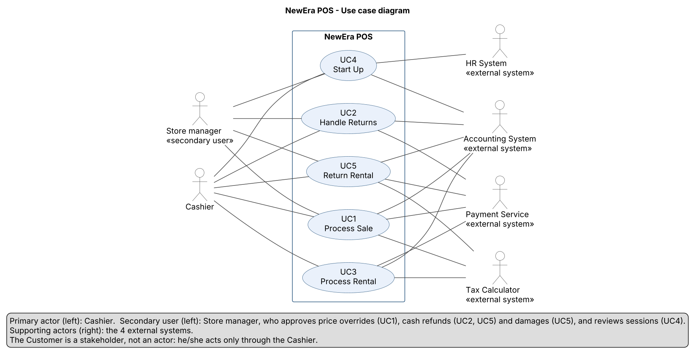

# Use Case Model (Overview) – NewEra POS

| | |
| --- | --- |
| **Maintainer** | Borja Nicolás |
| **Version** | 1.1 (aligned with SRS v1.2 and the decisions of W09) |
| **Last updated** | W09 |
| **Part of** | SRS (Assignment 1), ISO/IEC/IEEE 29148 – product functions and external interfaces |
| **Status** | Informative overview. If it differs from the [SRS](SRS.md), the SRS prevails. |

## 1. Purpose

This document gives the **overview** of what NewEra POS does from the point of view of its users and of the systems around it: who takes part (actors) and which goals the system supports (five use cases). It extends the use case diagram presented in the W05 report with the details of the [external interfaces inventory](external_interfaces.md), and it is the starting point of the *product functions* section of the [SRS](SRS.md).

Each use case is described here in **one paragraph**. The **fully dressed use cases** (main flow, extensions, pre- and postconditions) are in the [SRS](SRS.md), section 3.2: UC1–UC5 are all written there. Terms are used as defined in the [glossary](glossary.md) and business rules are referred to by their ID (for example, BR-05); the business rules and their status are in SRS section 3.10. The data exchanged with the external systems is described in [external_interfaces.md](external_interfaces.md).

## 2. Use case diagram

*Editable source: [`assets/use_case_diagram.puml`](../../assets/use_case_diagram.puml) (PlantUML).*

## 3. Actors

| Actor | Type | Description |
| --- | --- | --- |
| **Cashier** | Primary actor | Store employee who operates the register and starts all five use cases. |
| **Store manager** | Secondary user | Experienced employee who uses the register only for exceptions: approving a price override (UC1, BR-04), approving a cash refund that replaces a card or check refund (UC2 and UC5), confirming a damaged rental return (UC5), reviewing a cashier session with a cash difference larger than 5.00 (UC4, close session, FR-74, FR-75) and checking the products flagged for reorder (BR-09). The manager identifies himself or herself at the cashier's register with employee ID and PIN and does not close the cashier session. He or she is shown in the diagram (review #50, B-D11) and has no use case of his or her own. |
| **Payment Service** | Supporting actor (external system) | Authorizes or declines credit card and check payments and card refunds. Called *Payment Authorization* in the W05 slides; the glossary term is used here. |
| **Tax Calculator** | Supporting actor (external system) | Calculates the tax of a sale, of a rental fee and of a late fee (BR-01). It is not used in UC2: a return refunds the tax charged in the original sale (review #37). |
| **Accounting System** | Supporting actor (external system) | Receives the completed transactions for bookkeeping (BR-14). |
| **HR System** | Supporting actor (external system) | Checks the employee ID and PIN and confirms that the employee is a valid, active cashier or store manager. |

**The Customer is not shown as an actor.** The customer takes part in the sale, return and rental at the till, but only through the cashier: the customer does not use the POS terminal directly. The team decided this in W06 (SRS section 1.3.1): an actor interacts directly with the system, and the customer only does so through the cashier. The W01 scope of 2 actors therefore becomes 1 primary actor, 1 secondary user and 4 supporting actors. The customer's interests are described in [stakeholders.md](stakeholders.md).

## 4. Use case list

The use cases are numbered as in the [project overview](../project_overview.md). The *External systems* column follows the use case tables of the [SRS](SRS.md).

| ID | Use case | Priority | Primary actor | External systems involved | Main business rules | Build order\* |
| --- | --- | --- | --- | --- | --- | --- |
| UC1 | Process Sale | Must | Cashier | Payment Service, Tax Calculator, Accounting System | BR-01 to BR-06, BR-09, BR-13, BR-14, BR-18 | 1 |
| UC2 | Handle Returns | Must | Cashier (store manager approves exceptions) | Payment Service, Accounting System | BR-03, BR-07, BR-08, BR-13, BR-14 | 2 |
| UC3 | Process Rental | Should | Cashier | Payment Service, Tax Calculator, Accounting System | BR-01, BR-05, BR-10 to BR-15, BR-18 | 3 |
| UC4 | Start Up (with Close session) | Must | Cashier (store manager reviews a session) | HR System, Accounting System (pending records) | BR-13, BR-17 | 4 |
| UC5 | Return Rental | Should | Cashier (store manager confirms a damage and approves a cash refund) | Payment Service, Tax Calculator, Accounting System | BR-01, BR-10, BR-11, BR-13, BR-14, BR-16 | 5 (to be confirmed) |

Priorities are those of the [SRS](SRS.md), section 1.3.2 (MoSCoW). \* Planned order of implementation in increment 3 (W12–W15), as decided in W05: Process Sale first, then Returns, Rental and Start Up. The place of UC5, which is new, is still to be confirmed.

## 5. Use case descriptions

### UC1 – Process Sale

**Goal:** sell items to a customer and give the customer a receipt. **Primary actor:** Cashier. **External systems:** Payment Service, Tax Calculator, Accounting System.

A customer comes to the register with the items to buy. The cashier starts a new sale and enters each item by its item identifier (for example, by scanning it); for each one, the POS shows the product description and the price and adds a sale line item (BR-03). The store manager approves a price override when the cashier needs one (BR-04). When the last item has been entered, the POS asks the Tax Calculator for the tax (BR-01; if it is not available, the default tax rate is used, BR-02) and shows the total. The customer pays by cash (the POS checks that the amount tendered covers the total and calculates the change due, BR-06), by credit card (the payment must be authorized by the Payment Service first, BR-05) or, with priority *Could*, by check (also authorized by the Payment Service). When the payment is accepted, the POS completes the sale, updates the stock levels (a product that falls below the reorder threshold must be reordered, BR-09), prints the receipt, links the sale to the cashier of the current session (BR-13) and sends the sale to the Accounting System (BR-14).

### UC2 – Handle Returns

**Goal:** take back items that a customer bought and refund the customer. **Primary actor:** Cashier. **External systems:** Payment Service, Accounting System.

A customer brings back one or more items that were bought in the store. The cashier starts a return, identifies the original sale with the receipt number and selects the items and quantities that are returned, with the condition of each item (resellable or not resellable). The POS checks that the return is allowed (a refund is given only for an item with a valid receipt, returned within 30 days of the sale, BR-07) and calculates the refund from the **price paid and the tax charged in the original sale**; it does not call the Tax Calculator. The refund is paid with the same tender that was used in the original sale (BR-08): cash from the drawer, or a refund to the credit card through the Payment Service. If the card refund is declined, or if a check was used, cash is paid only with the approval of a store manager, recorded with the reason. The POS then increases the stock level of the resellable items only, marks the other items for inspection by the store manager, prints a return receipt, links the return to the cashier (BR-13) and sends it to the Accounting System (BR-14).

### UC3 – Process Rental

**Goal:** rent equipment to a customer for a limited period. **Primary actor:** Cashier. **External systems:** Payment Service, Tax Calculator, Accounting System.

A customer wants to rent an item instead of buying it. The cashier starts a rental and enters the customer ID; the POS checks that the customer has no overdue rental (BR-12). The cashier identifies the item by its serial number, and the POS checks that the item has the status *Available* (BR-11). The cashier selects the rental period (1, 3 or 7 days, BR-15), and the POS records a rental line item with the rental fee, the due date and the deposit that is required for every rental (BR-10). The POS gets from the Tax Calculator the tax of the rental fee (BR-01) and shows the total: the rental fee plus its tax plus the deposit. The deposit itself is not taxed (BR-10). The customer pays with one tender (BR-18): cash, credit card (authorized by the Payment Service, BR-05; the deposit is charged with the rental and not only held) or check (*Could*). The POS then changes the item status to *Rented*, prints the rental receipt, links the rental to the cashier (BR-13) and sends it to the Accounting System (BR-14). Bringing the item back is a separate use case (UC5).

### UC4 – Start Up (with Close session)

**Goal:** start the POS so that it is ready for the cashier to work, and close the cashier session at the end of the shift. **Primary actor:** Cashier. **External systems:** HR System, Accounting System.

At the beginning of the working day or of a shift, the cashier starts the register. The POS checks that it can work (the product catalog and the stored data are available) and sends to the Accounting System any record that is still waiting from the previous session. The cashier then identifies himself or herself with the employee ID and PIN, and the POS asks the HR System whether the employee is a valid, active cashier and checks the PIN; if the HR System is not available, the POS checks the PIN offline against the local copy of the employee list from the last successful connection (see [external_interfaces.md](external_interfaces.md), section 3.4). The cashier counts the cash in the drawer and enters the opening cash. The POS then opens a cashier session, so that every transaction made afterwards is linked to this cashier (BR-13), and shows the main screen, ready for UC1, UC2, UC3 and UC5. At the end of the shift the cashier closes the session (SRS section 3.2.4.1): the POS refuses to close it while a sale, return or rental is open, asks for the closing count of the drawer and records the end time, the closing cash and the difference with the expected cash. If the difference is larger than 5.00, the session is marked as to review and a store manager reviews it later with a reason (BR-17, FR-74, FR-75).

### UC5 – Return Rental

**Goal:** take back rented equipment and close the rental. **Primary actor:** Cashier. **External systems:** Payment Service, Tax Calculator, Accounting System.

*Added in W06 (see section 6).* A customer brings back equipment that was rented earlier, in a different visit from the one in which it was rented. The cashier starts a rental return and identifies the rental (with the serial number of the item or the rental receipt number), and the POS shows the rental, its due date and its deposit. The cashier checks the condition of the item. If the item is returned after its due date, the POS calculates the late fee: one day's rental fee for each whole day late, with its tax (BR-16). If the item is returned undamaged, the deposit is refunded (BR-10), minus the late fee and its tax; if the late fee is larger than the deposit, the customer pays the rest. If the item is damaged, a store manager confirms the damage and the store keeps the whole deposit. The refund is paid with the same tender used for the rental: a card refund goes through the Payment Service, and a cash refund that replaces a declined card or a check needs the approval of a store manager. As in UC3, the deposit is not taxed. The POS then changes the item status to *Available* again (BR-11), prints a receipt, links the return to the cashier (BR-13) and sends it to the Accounting System (BR-14).

## 6. Decisions and open questions

The use cases above are the summary of the fully dressed use cases in the [SRS](SRS.md). Open questions of the SRS are kept in SRS section 5.3, with an owner and a date; this section only lists the decisions that shape the use case model.

### 6.1 Decided in W06, W08 and W09

| # | Question | Decision |
| --- | --- | --- |
| 1 | Is the Customer an actor? | **No** (W06): the customer is a stakeholder who acts only through the Cashier (as in the NextGen POS case). |
| 2 | Where does the return of a rented item go? | **New use case UC5 Return Rental** (W06): it happens in a different visit, with a different goal and rules (condition check, late fee, deposit refund). It is neither part of UC2 nor an extension of UC3. Scope: 4 → 5 use cases. |
| 3 | How many payment methods? | **Three** (W06): cash, credit card and check. Check is authorized by the Payment Service and has priority *Could*. |
| 4 | Does the store manager appear in the model? | **Yes** (W08, review #50, B-D11): as a secondary user in the use case diagram, linked to UC1 (price override) and UC2 (cash refund approval), because he or she approves exceptions at the cashier's register. In W09 the links to UC4 (session review) and UC5 (damage confirmation, cash refund) were added to the diagram. He or she has no use case of his or her own. |
| 5 | Does UC2 use the Tax Calculator? | **No** (W08, review #37): the refund is the price paid plus the tax charged in the original sale. |
| 6 | Who closes the cashier session and what does UC4 contain? | **The cashier** (W08, review #26): UC4 includes the opening count of the drawer, the PIN check and the close-session function (FR-60 to FR-63). |
| 7 | Refund period, rental periods, late fee, tax of the deposit | **Decided in W09** (SRS §5.3 Q1): refund within 30 days (BR-07); rental of 1, 3 or 7 days (BR-15); late fee of one day's rental fee for each whole day late, taxed (BR-16); the deposit is not taxed (BR-10). |
| 8 | Is the card deposit charged or only held? | **Charged and refunded** (W09, Q2): no pre-authorization. |
| 9 | Can a sale or rental be paid with several tenders? | **No, one tender** (W09, Q3, BR-18). |
| 10 | Limit of the cash difference of a session | **5.00** (W09, Q9, BR-17): a larger difference marks the session as to review by a store manager. |

### 6.2 Still open

1. **Who starts UC4?** Here the cashier starts the system. If the system administrator can also do it (see [stakeholders.md](stakeholders.md)), the System Administrator would be a second primary actor of UC4.
2. **Returns without receipt (UC2 ext. 4b).** Whether the store manager may approve a refund without receipt (SRS, UC2 open issues).
3. **Deposit amount and the Accounting System.** The amount of the deposit of each product is still to be confirmed with the case study, and it is not decided whether the Accounting System receives the deposit or only the rental fee (SRS UC3 open issues).
4. **Order of construction of UC5** in increment 3 (it is new, with priority *Should*).

## 7. Next steps (W10)

- Keep this overview in line with the SRS after every change of version (now SRS v1.2).
- The analysis models are complete (system sequence diagrams of UC1 to UC5, operation contracts 1 to 29, domain model and state diagrams). The next documents are the architecture decisions AD-05 and AD-06 and, in W11, the design class diagram.
