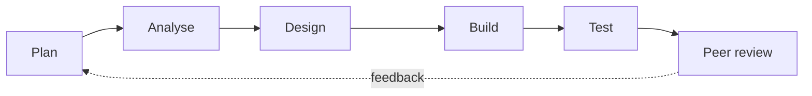

# Software Process Model – NewEra POS

Team D · Software Engineering · BUAA · Version 1.0 (W05)

## 1. Purpose

This document records which software process model Team D follows to develop NewEra POS and why. It applies the course topic *Software Process Models* (week 4) to our project.

## 2. Our situation

| Factor | Our case |
|---|---|
| Definition of requirements | High. NewEra POS is a well-known case study. Actors, use cases and business rules are already defined. |
| Volatility of requirements | Low. The scope (4 use cases, 4 external systems) was fixed in W01. |
| Communication with the "user" | Indirect. There is no real customer; feedback comes from the teacher and from the other teams (peer review). |
| Team experience | Mixed. Six members from different universities and backgrounds, new to working together. |
| Size and complexity | Medium. One primary actor, four use cases, four external systems. |
| Partial deliveries | Required. Fixed course milestones: SRS (W7), design (W11), product launch (W16). |
| Novelty of technology | Low. Standard desktop/web application. |

## 3. Models considered

| Model | Main idea | Advantages for us | Disadvantages for us | Decision |
|---|---|---|---|---|
| Code and fix (informal) | Code a first version and modify it until the client is satisfied | Fast to start | No process for versions, tests or changes; hard to coordinate six people | Rejected |
| Waterfall | Linear sequence of phases, each finished before the next | Simple, clear phases and documents | One big delivery at the end; no room for the feedback we get at each milestone | Rejected |
| Prototyping | Build a quick prototype to discover and validate requirements, then throw it away | Good to validate the cashier's screens | The prototype is not the product; it is a technique, not a full life cycle | Used only as a support technique for the UI |
| Spiral / Evolutionary | Repeated cycles driven by risk; requirements evolve | Handles unclear requirements and high risk | Our requirements are already clear | Rejected |
| **Iterative-incremental** | Requirements and architecture defined early; the system is delivered in increments | Matches the course milestones; feedback after each increment; partial results early | Needs good planning and integration between increments | **Selected** |

## 4. Decision

Team D follows an **iterative-incremental life cycle** (Unified Process style). Each increment ends with a course milestone, where we receive feedback from the teacher and the other teams, and we use that feedback in the next increment.

**Selection criteria**
- Requirements are well defined and stable.
- Small team that is new to working together.
- Fixed delivery dates (weeks 7, 11 and 16).
- Partial functionality wanted early.
- Peer review after each milestone.

## 5. Our increments

| Increment | Weeks | Focus | Main output | Milestone |
|---|---|---|---|---|
| 1 | W4–W7 | Requirements | SRS (ISO/IEC/IEEE 29148): use cases, quality attributes, business rules, interfaces | Assignment 1 – SRS (W7) |
| 2 | W8–W11 | Design | Architecture and detailed design (ISO/IEC/IEEE 42010), UI design | Design / architecture (W11) |
| 3 | W12–W15 | Build and test | Process Sale first, then Handle Returns, Process Rental and Start Up; tests per use case | — |
| Release | W16 | Launch | Product launch and investment pitch | Product launch (W16) |

## 6. Activities inside each increment

The weight of each activity changes from one increment to the next: increment 1 is mostly analysis, increment 2 mostly design and increment 3 mostly build and test.

## 7. Supporting activities (all increments)

Following IEEE 1074, these run in parallel with development:
- **Project management**: weekly plan, task allocation, weekly report slides (`weekly-reports/`), work logs (`worklogs/`).
- **Configuration management**: GitHub repository `bhsei/26D`, one document per commit, commit format `W<week> - 
; <description>`.
- **Verification and validation**: internal review of every document plus cross-team review with GitHub Issues.
- **Documentation**: Markdown documents in `docs/`, diagrams in `assets/`.

## 8. Use of prototyping

In increment 2 we will build a throw-away prototype of the cashier screens (sale entry, payment, receipt) to validate usability requirements with the team and the teacher. It will not be reused as production code.
